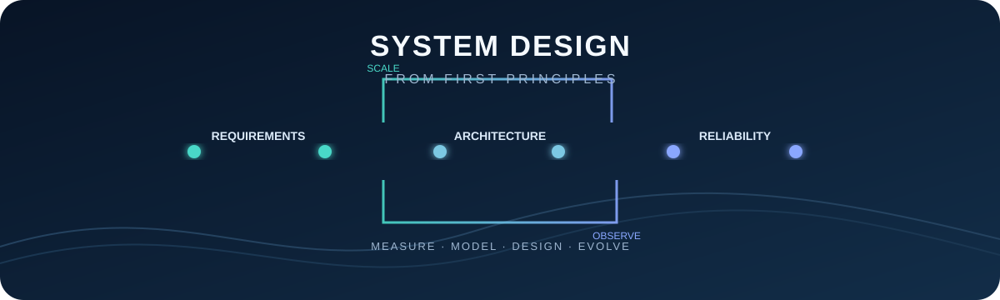
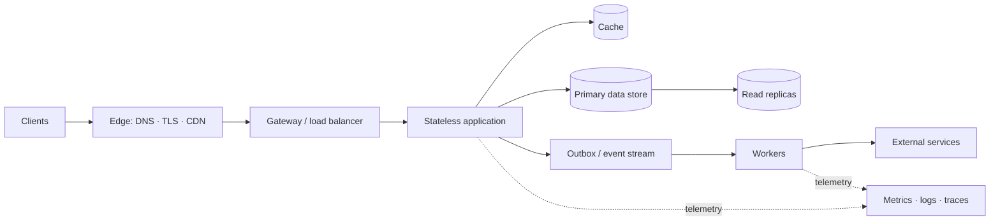

# System Design, From First Principles

<p align="center">
  
</p>

<p align="center">
  <b>A free, open course for learning to design useful, scalable, and dependable software systems.</b><br />
  Start with the problem. Make trade-offs explicit. Evolve the design as the constraints change.
</p>

<p align="center">
  
  
  
  
</p>

---

## Welcome

System design is the practice of turning a problem and its constraints into an architecture that can meet user needs. It is not a hunt for a universally “best” database, cloud, or diagram. A strong design explains **why** its components exist, **how** data moves, **what fails**, and **which trade-offs are being accepted**.

This course builds those skills progressively: first learn the vocabulary and reasoning tools, then design storage, APIs, and distributed workflows, and finally apply them in complete case studies.

> **Guiding loop**
>
> `Understand → Quantify → Model → Design → Stress → Refine`

## Course map

```mermaid
flowchart LR
    A[00 · Orientation] --> B[01 · Mental models]
    B --> C[02 · Requirements & estimates]
    C --> D[03 · APIs & data]
    D --> E[04 · Scale & caching]
    E --> F[05 · Distributed systems]
    F --> G[06 · Reliability]
    F --> H[07 · Async workflows]
    G --> I[08 · Security & observability]
    H --> I
    I --> J[09 · Design interview method]
    J --> K[10 · Storage systems]
    K --> L[11 · Networking & edge]
    L --> M[12 · Architecture evolution]
    M --> N[Case studies]
    N --> O[Capstone · Your design]
```



Each lesson is self-contained and includes core concepts, diagrams, decision guidance, failure modes, and a knowledge check. The sequence matters: later architecture choices depend on earlier requirements and data guarantees.

## Learning paths

| Path | Follow | Outcome |
|---|---|---|
| **First pass** | 00 → 01 → 02 → 03 → 04 → 05 → 06 → 07 → 08 → 09 → 10 → 11 → 12 | A complete conceptual foundation |
| **Interview sprint** | 01 → 02 → 03 → 04 → 05 → 09 → case studies | A repeatable, time-boxed design method |
| **Backend engineer** | 02 → 03 → 04 → 05 → 06 → 07 → 08 → 10 → 11 → 12 | Practical architecture and operational fluency |
| **Build by doing** | Lessons → [labs](labs/README.md) → [case studies](case-studies/README.md) → capstone | A portfolio-ready written design |

You do not need a specific cloud provider or framework. Basic programming, HTTP, and relational database familiarity help; unfamiliar terms are introduced as needed.

## Curriculum

| # | Lesson | You will be able to… |
|---|---|---|
| 00 | [How to use this course](lessons/00-course-orientation.md) | Navigate the course, choose a path, and practice effectively |
| 01 | [System design mental models](lessons/01-mental-models.md) | Reason about boundaries, bottlenecks, coupling, and trade-offs |
| 02 | [Requirements and back-of-the-envelope estimates](lessons/02-requirements-and-estimates.md) | Turn product language into measurable workloads and budgets |
| 03 | [API and data design](lessons/03-api-and-data-design.md) | Design interfaces, entities, indexes, and consistency guarantees |
| 04 | [Scaling, load balancing, and caching](lessons/04-scaling-and-caching.md) | Find bottlenecks and scale read/write paths deliberately |
| 05 | [Distributed systems fundamentals](lessons/05-distributed-systems.md) | Understand replication, partitioning, ordering, and coordination |
| 06 | [Reliability and fault tolerance](lessons/06-reliability.md) | Set service objectives and design for partial failure and recovery |
| 07 | [Queues and event-driven architecture](lessons/07-queues-and-events.md) | Build asynchronous workflows with safe delivery and replay |
| 08 | [Security and observability](lessons/08-security-observability.md) | Protect boundaries and make production behavior diagnosable |
| 09 | [A repeatable design interview](lessons/09-design-interview.md) | Communicate a coherent design under time constraints |
| 10 | [Storage systems and database selection](lessons/10-storage-systems.md) | Match data stores and indexes to access patterns and guarantees |
| 11 | [Networking, DNS, and the edge](lessons/11-networking-and-edge.md) | Follow a request across DNS, TLS, proxies, and connection pools |
| 12 | [Architecture evolution and migrations](lessons/12-architecture-evolution.md) | Evolve a system safely as teams, traffic, and constraints change |

### Case studies

| Design | Core challenges | Walkthrough |
|---|---|---|
| URL shortener | Key generation, redirects, hot keys, abuse | [Design a URL shortener](case-studies/url-shortener.md) |
| News feed | Fan-out, ranking, freshness, celebrity accounts | [Design a news feed](case-studies/news-feed.md) |
| Real-time chat | Ordering, presence, delivery, reconnects | [Design real-time chat](case-studies/real-time-chat.md) |
| Video streaming | Transcoding, adaptive bitrate, CDN, release spikes | [Design video streaming](case-studies/video-streaming.md) |
| Ride hailing | Geospatial search, dispatch, atomic matching | [Design ride matching](case-studies/ride-hailing.md) |
| File synchronization | Chunked uploads, offline changes, conflicts | [Design file sync](case-studies/file-sync.md) |
| Rate limiter | Token buckets, distributed quotas, fail-open/closed | [Design a rate limiter](case-studies/rate-limiter.md) |
| Web crawler | Frontier scheduling, deduplication, politeness, safe fetching | [Design a web crawler](case-studies/web-crawler.md) |

Practice the [company-oriented system design question bank](INTERVIEW_QUESTION_BANK.md), with sourced public prompt examples and a reusable interviewer follow-up list. Company associations are qualified examples, not promises about what any employer currently asks.

## How to study a lesson

1. Read the problem statement and list what is unknown.
2. Sketch the flow before reading the proposed architecture.
3. Read the explanation and note the constraint behind each choice.
4. Answer the knowledge check without looking back.
5. Complete the associated practice in [`labs/`](labs/README.md) and revisit one trade-off if the workload changes.

**Do not memorize product names as answers.** Practice explaining when a queue, cache, replica, or partition helps—and what new failure mode it introduces.

## A system at a glance



This is a vocabulary map, **not** a recommended default architecture. A small application may need only a client, an application process, and one database. Every additional component adds operational cost and another way to fail; introduce it to solve a demonstrated requirement.

## Interactive course website

Open the responsive, dark-only course website at the repository root by deploying `index.html`. It includes searchable lessons, mobile navigation, Mermaid diagrams, and browser-local reading progress. See [`DEPLOYMENT.md`](DEPLOYMENT.md) for GitHub Pages, Netlify, Vercel, and local preview instructions. GitHub Pages deployment is automated through the `Deploy course website` workflow; select **GitHub Actions** as the Pages source in repository settings.

## Design notebook

For every exercise, capture the design in this order:

1. **Problem and scope:** user-visible behavior, explicit exclusions, assumptions.
2. **Requirements:** functional requirements and measurable quality attributes.
3. **Workload:** users, traffic, data growth, peak-to-average ratio, hot spots.
4. **Contracts and state:** APIs, entities, invariants, consistency expectations.
5. **Baseline architecture:** simplest design that satisfies current constraints.
6. **Bottlenecks and failures:** what saturates, becomes stale, duplicates, or disappears?
7. **Evolution:** add only the change that addresses the observed constraint.
8. **Operations:** dashboards, alerts, rollout, backup, recovery, cost.

Copy the detailed [design review template](templates/design-review.md) for a new system.

## Repository map

```text
System-Design/
├── README.md                 # Course home and navigation
├── index.html                # Responsive, dark-only course website
├── site.css / site.js        # Website layout, navigation, search, and rendering
├── lessons/                  # Progressive, concept-first course modules
├── case-studies/             # Worked end-to-end system designs
├── INTERVIEW_QUESTION_BANK.md # Publicly sourced prompts and practice follow-ups
├── labs/                     # Exercises, prompts, and capstone
├── templates/                # Reusable design review notebook
├── assets/                   # Original SVG artwork and visual reference
├── .github/workflows/         # GitHub Pages deployment
├── DEPLOYMENT.md              # GitHub Pages, Netlify, Vercel, local preview
├── netlify.toml / vercel.json # Static-host configuration
├── GLOSSARY.md               # Shared vocabulary
├── CONTRIBUTING.md           # How to improve the course
└── LICENSE                   # MIT
```

## Visual guide

- Mermaid diagrams render directly on GitHub; read arrows as **data or control flow** and dashed arrows as **optional or observational paths**.
- SVG artwork is hand-authored, scales cleanly, and includes accessible alternative text.
- Tables, timelines, and text graphs work in a plain Markdown preview and complement—not replace—the written trade-off analysis.

Browse the [glossary](GLOSSARY.md), start [Lesson 00](lessons/00-course-orientation.md), or jump to the [practice labs](labs/README.md).

## Contributing

Corrections, clearer diagrams, and additional case studies are welcome. Please keep explanations vendor-neutral, state assumptions, and include failure modes alongside happy paths. See [`CONTRIBUTING.md`](CONTRIBUTING.md).

## License

Course content is available under the [MIT License](LICENSE).

---

<p align="center"><sub>Good architecture is a series of explicit decisions that fit a real workload.</sub></p>
