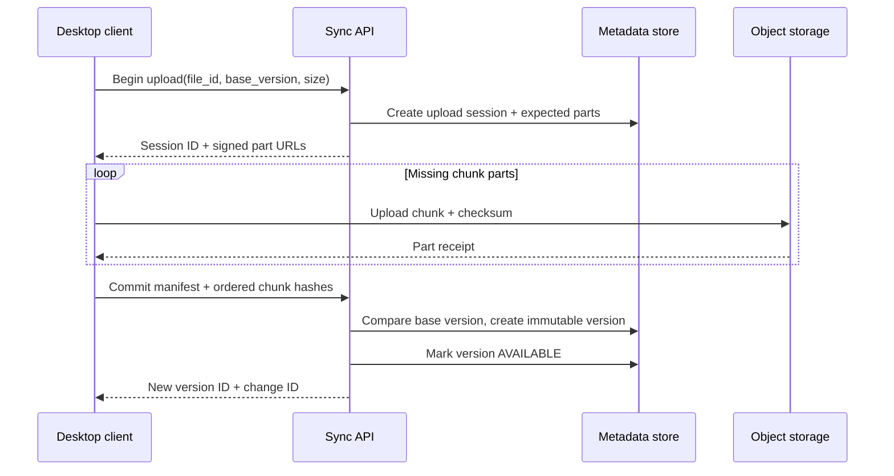
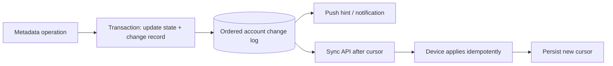

# Case study · Design Dropbox-style file synchronization

[← Case studies](README.md) · [Question bank](../INTERVIEW_QUESTION_BANK.md) · [Course home](../README.md)

Design a service that stores files and synchronizes changes across a user’s devices. “Sync” includes offline edits, large/resumable uploads, deletes, sharing, and conflict behavior—not merely putting files in object storage.

## 1. Scope and invariants

Users upload, download, rename, move, delete, share, and browse files from multiple devices. The service must preserve acknowledged versions and enforce access on every download. A device can be offline for a long period and later submit edits based on stale state.

State the conflict policy before selecting storage. This walkthrough keeps immutable file versions and uses explicit conflict copies for concurrent content edits rather than silently overwriting bytes. Folder moves/renames are metadata operations with separate concurrency rules.

## 2. Data model

```text
File(file_id, owner_id, parent_id, name, current_version, deleted_at)
FileVersion(file_id, version_id, parent_version, size, checksum, created_by, created_at)
Chunk(version_id, ordinal, content_hash, object_key, byte_range)
DeviceCursor(user_id, device_id, last_applied_change_id)
Share(file_id, principal_id, permission, revoked_at)
```

File bytes live in blob/object storage. Relational metadata owns hierarchy, sharing, version pointers, and change sequence. Content-addressed chunks can deduplicate repeated bytes, but global deduplication can leak whether another user has a known file; use tenant-scoped/private deduplication or avoid it when confidentiality requires.

## 3. Upload protocol

For a 100 MB file and 4 MB chunks, the client uploads 25 chunks; failed parts can be retried without restarting the entire file.



Use a manifest commit as the visibility boundary: uploaded orphan chunks are not a visible file version until metadata atomically commits the manifest. Validate size/checksum and authorize the file at both session creation and commit. Expire abandoned sessions and garbage-collect unreferenced chunks after a safety window.

## 4. Change log and device synchronization

Each successful metadata operation receives an ordered change ID within an account or sync scope. Devices request changes after their cursor, apply them idempotently, then advance the cursor. If the cursor predates retained history, issue a snapshot/rescan token. Push notifications are hints to sync sooner; the durable change log and cursor are the recovery mechanism.



## 5. Concurrent edits and conflict behavior

Suppose devices A and B both read version 17 while offline. A commits version 18. B later submits with parent version 17. Compare-and-set detects that the current version is no longer B’s base. Options include:

- Create a conflict copy so both byte streams remain available.
- Attempt a content-aware merge only for formats with safe merge semantics.
- Reject and ask a user to resolve, appropriate for some structured/business files.
- Use an operational-transform or CRDT model for live collaborative documents (a different product contract and architecture).

Do not apply last-write-wins to arbitrary file bytes unless losing a concurrent version is an explicit product decision. Preserve ancestry and audit information to support recovery.

## 6. Deletion and access control

Deletion creates a tombstone with a change ID, then asynchronously removes derived indexes and unreferenced blobs after retention/restore requirements are satisfied. Tombstones must remain long enough that a long-offline device does not re-upload an older version and resurrect deleted data without a conflict. Check current sharing permission before issuing signed download URLs; revocation behavior must account for already-issued URL expiry.

## 7. Scaling and failure modes

| Concern | Design response |
|---|---|
| Large uploads tie up app servers | Direct multipart uploads to object storage |
| Duplicate network retry | Session/part ID + checksum makes part retries safe |
| Metadata commit fails after bytes upload | Keep object unreferenced; resume or garbage-collect later |
| Device offline for weeks | Cursor expiry followed by snapshot/rescan; retain version history by policy |
| One shared file gets hot | Cache metadata carefully; keep authoritative permission checks |
| Accidental delete/corruption | Immutable versions, trash retention, verified backups |
| Revoked access but stale client cache | Revalidate on server operations and define offline-access policy |

## 8. Capacity and operational signals

Measure upload bytes/sec, active multipart sessions, abandoned-part storage, checksum failures, sync changes per device, oldest unacknowledged cursor age, conflict rate, orphan-object growth, restore success, and permission-denial anomalies. Size object bandwidth separately from metadata transaction capacity.

### Interview follow-ups

1. How does selective sync avoid downloading every file’s bytes?
2. What happens when a user renames a folder with one million descendants?
3. Which states are needed for end-to-end encryption across multiple devices?
4. How do you migrate chunking size or encryption keys without forcing a full re-upload?

**Key lesson:** file synchronization is a metadata/change-propagation problem plus a large-object transfer problem. Model them separately and make conflict semantics explicit.
