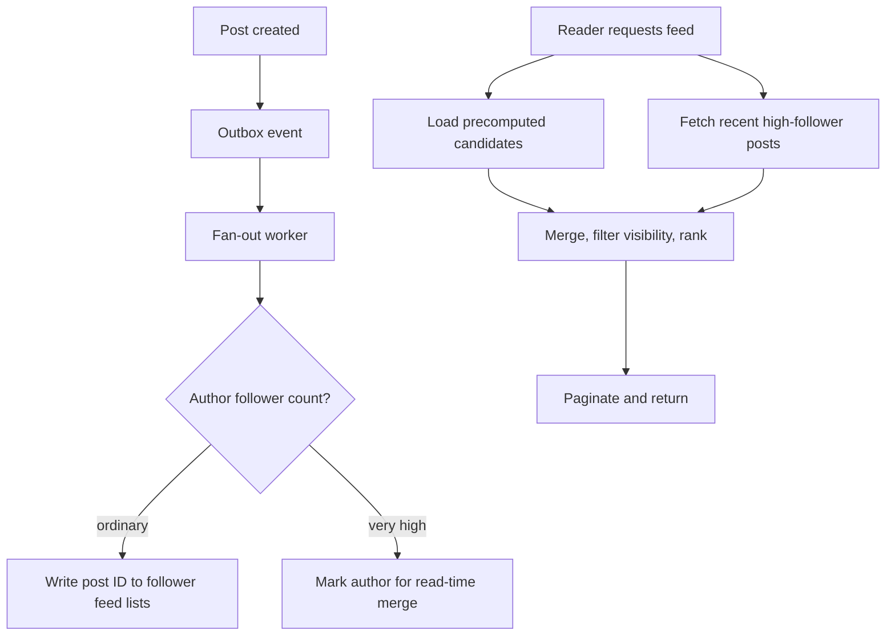

# Case study · Design a news feed

[← Case studies](README.md) · [Course home](../README.md)

## 1. Scope and requirements

Users publish posts, follow accounts, and retrieve a ranked feed. Assume a typical reader values a fresh feed within a few seconds; exact global ordering is unnecessary. Privacy and block relationships must be enforced. Exclude ads and recommendation model training from the initial design.

The workload is read-heavy. A few accounts may have millions of followers, while most have a small audience. A uniform fan-out strategy will be inefficient at one end of this distribution.

## 2. Core entities and API

```text
Post(post_id, author_id, created_at, visibility, content_ref)
Follow(follower_id, followed_id)
FeedEntry(viewer_id, post_id, author_id, created_at, rank_features...)
```

`GET /v1/feed?cursor=...` returns a bounded page in a stable cursor order. `POST /v1/posts` commits the canonical post, then triggers feed distribution. Visibility checks must remain authoritative even when a feed entry is precomputed.

## 3. Hybrid fan-out

**Fan-out on write:** when a post is created, insert an entry into each follower’s feed. Reads are fast, but publishing by a celebrity creates huge write amplification. **Fan-out on read:** fetch recent posts from followed authors at read time. Writes are cheap, but reads grow with follow count and may be slow. A hybrid approach uses write fan-out for ordinary accounts and read-time merge for very high-follower accounts.



## 4. Ranking, pagination, and privacy

Treat candidate retrieval, filtering, ranking, and pagination as separate steps. Cursor must represent the relevant stable position; offsets can skip or repeat entries as new posts arrive. Ranking may be approximate or personalized, but moderation, blocks, and privacy are hard constraints—not soft ranking features. Re-check access when serving if authorization can change after feed materialization.

## 5. Backpressure and repair

A celebrity post can create a very large distribution job. Chunk work, rate-limit per author, track event progress, and prioritize interactive reads over background fan-out. Feed entries are derived data; rebuild/replay from canonical posts and follow relationships when feasible. Deduplicate on `(viewer_id, post_id)` so replay is safe. Monitor oldest pending event age and distribution lag.

## 6. Trade-offs and failure behavior

- Queue lag increases freshness delay; return the available feed and report/measure lag rather than blocking all reads.
- A stale follow graph can expose or omit items; decide whether it is acceptable and how changes invalidate derived entries.
- If ranking is unavailable, fall back to a deterministic chronological ordering.
- If precomputed feeds are missing, serve a bounded fallback query rather than an unbounded scan.
- Do not rely on a feed entry as proof of authorization.

### Design review

1. At what follower threshold should an author switch strategies? What cost do you compare?
2. How do you prevent duplicate feed rows after event replay?
3. What does a cursor contain if ranking order changes over time?
4. How do deletes/moderation propagate through derived feeds?

<details><summary>Possible answers</summary>

Measure fan-out write cost against read-time merge cost; deduplicate by viewer and post; use a stable snapshot/version or define pagination semantics across ranking changes; tombstone or filter at serving time and asynchronously clean derived entries.

</details>
