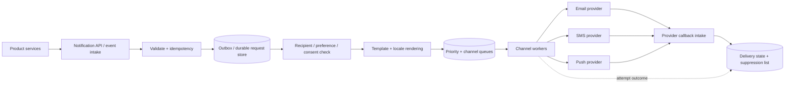

# Case study · Design a multi-channel notification system

[← Case studies](README.md) · [Question bank](../INTERVIEW_QUESTION_BANK.md) · [Course home](../README.md)

Design a platform used by product teams to deliver email, push, SMS, or in-app notifications. A reliable platform does more than fan out messages: it enforces preferences and consent, protects providers from bursts, retries safely, and explains delivery state honestly.

## 1. Requirements and semantics

Functional: accept a notification request/event, resolve recipient and template, apply user preferences and quiet hours, route to one or more channels, and record provider outcomes. Support priority classes (security alert vs. marketing), localization, unsubscribe/suppression, and per-tenant quotas.

Define delivery milestones precisely:

```text
ACCEPTED → ELIGIBILITY_CHECKED → QUEUED → PROVIDER_ACCEPTED
                                      ├→ DELIVERED (if provider reports it)
                                      ├→ FAILED_TERMINAL
                                      └→ RETRY_SCHEDULED
```

`PROVIDER_ACCEPTED` does not mean a human read the message. Channel providers have different delivery receipts and guarantees; expose only what the system can observe.

## 2. Architecture



## 3. Intake and idempotency

Accept a stable `notification_id` or derive an idempotency key from the business event and recipient. Validate tenant, template, recipient reference, priority, and allowed channels. Persist request/outbox before acknowledging. Keep message payloads small in the queue; large personalization context should be referenced safely or resolved at render time.

Deduplicate at the logical-send level, not only by provider response. If retries create a new provider message each time, a user may receive duplicates. Use provider idempotency support where available, and store per-channel attempt state.

## 4. Preferences, consent, and fan-out

Check recipient status, channel consent, tenant policy, unsubscribe/bounce suppression, quiet hours, and priority exceptions before enqueueing. Preferences can change after enqueue; define whether workers re-check immediately before sending. Treat suppression and consent as correctness gates, not ranking signals.

One business event may target one user or millions. Expand recipients in bounded batches; partition by tenant/recipient and apply fairness so one campaign cannot starve urgent transactional alerts. Bulk campaign workloads may need a separate queue and resource pool from password-reset or payment notifications.

## 5. Provider limits and retries

Track per-provider throughput quotas, error classes, retry-after values, and circuit-breaker state. Retry transient errors with exponential backoff and jitter. Do not retry invalid addresses or permanent policy rejection. Use a dead-letter/quarantine path for malformed templates or repeated failures, with alerting and controlled replay.

```text
Provider response
  2xx / accepted     → persist provider message ID and accepted state
  429 / throttled    → honor retry-after, reduce concurrency for that provider
  5xx / timeout      → bounded retry with same logical-send identity
  invalid recipient  → terminal failure + suppression/bounce policy
  repeated failure   → dead-letter, alert, operator repair / replay
```

Provider callbacks can be delayed, duplicated, or out of order. Persist callback IDs, authenticate/signature-verify them, and apply only legal state transitions. Store only delivery metadata needed for debugging and analytics; message bodies and phone/email addresses are sensitive.

## 6. Capacity and delivery-latency targets

Separate queue arrival rate from provider send capacity. If campaigns create 2 million emails in 10 minutes, average arrival is about 3,333/s. If provider quota is 2,000/s, backlog grows by 1,333/s during the burst; the system must either slow intake, extend delivery time, use additional permitted providers, or reject/defer low-priority campaigns.

Measure time from accepted to provider-accepted by priority/channel, oldest queued age, queue depth per tenant, provider throttling, retry rate, bounce/complaint rate, suppressed count, and callback lag. Queue depth alone can hide one old stuck partition; alert on age and priority-specific SLA burn.

## 7. Privacy, content, and abuse

Render templates with escaped/untrusted fields, track template version, and prevent arbitrary sender spoofing. Rate-limit by tenant, recipient, device, and campaign. Protect magic links/one-time codes from appearing in logs. Define retention and deletion for rendered bodies, provider IDs, bounce records, and user preferences. Signed deep links should expire and be scoped to the specific action.

## 8. Failure modes

| Failure | User impact | Response |
|---|---|---|
| Provider outage | Notifications delayed | Route only to approved alternate; keep per-channel state and queue |
| Preference service down | Consent cannot be checked | Fail closed for non-essential messages; define narrowly scoped critical exceptions |
| Campaign surge | Transactional alerts starve | Separate queues, reserved capacity, tenant fairness |
| Provider accepted, response lost | Duplicate risk | Retry with same idempotency key or query provider state |
| Template bug | Bad content sent widely | Validate/version, canary, kill switch, stop campaign |
| Callback delayed | Dashboard shows stale status | Track callback lag; accepted state remains distinct from delivered |

### Interview follow-ups

1. How would you prioritize 2FA codes over a marketing campaign?
2. How can you stop a provider outage from causing a retry storm?
3. If a user unsubscribes while an email is queued, where is the final eligibility check?
4. How do you make notification replay safe after changing a template?

**Key lesson:** notification fan-out is a policy and delivery workflow, not just a queue. Separate priority, consent, provider capacity, and delivery evidence.

## Pressure test: consent changes after a message is queued

A marketing email is queued while the recipient is subscribed. The recipient unsubscribes before a provider worker sends it. A consent check only at enqueue time is stale by the time the external side effect occurs.

Keep consent and suppression state authoritative and re-evaluate eligibility as close as practical to dispatch. Record the policy version and decision for audit, but avoid storing message content or personal data in broad operational logs. Coordinate the final check with the provider call: there may still be a small race if the user opts out after the check but before the provider accepts the request. State that boundary honestly and use provider suppression controls where available.

If the worker times out after the provider may have accepted the message, do not blindly retry a send that could be duplicated. Use provider idempotency or delivery-status lookup when supported; otherwise represent the outcome as unknown and reconcile it. Keep unsubscribe handling fast, prioritized, and independent of a backlogged marketing queue.

**Review prompt:** which event is the consent authority, how quickly does an unsubscribe take effect, and what evidence is retained for a disputed send?
