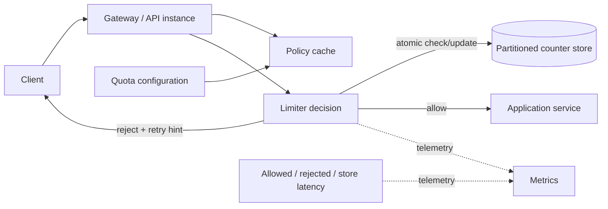

# Case study · Design a distributed API rate limiter

[← Case studies](README.md) · [Question bank](../INTERVIEW_QUESTION_BANK.md) · [Course home](../README.md)

An API rate limiter decides whether a request may consume capacity under a policy such as “100 calls/minute per authenticated account.” The hard part is choosing semantics and failure behavior across many application instances.

## 1. Requirements and policy

Clarify: limit key (account, API key, IP, route, tenant), unit (requests, bytes, weighted cost), window (steady rate vs. burst), response on rejection, and whether counters must be globally exact. Separate abuse protection from fair-use quotas and infrastructure overload protection; one limit may not serve all three.

## 2. Algorithms

| Algorithm | Behavior | Strength | Limitation |
|---|---|---|---|
| Fixed window counter | Reset count at wall-clock bucket boundary | Very simple and memory-efficient | Boundary burst can allow nearly 2× limit in a short interval |
| Sliding log | Store each request timestamp and count recent entries | Accurate rolling window | Memory/write cost proportional to request count |
| Sliding-window counter | Blend current/previous bucket counts | Smooths fixed-window boundary with low state | Approximation depends on traffic distribution |
| Token bucket | Tokens refill at rate `r`; each request consumes cost `c` | Enforces average rate while allowing burst capacity | Distributed token balance needs atomic coordination or approximation |
| Leaky bucket | Queue/drain at a fixed service rate | Smooth output rate | May add wait/queue semantics instead of immediate allow/deny |

For a token bucket with capacity `B`, refill rate `r` tokens/s, and current time `t`, compute `tokens = min(B, old_tokens + (t−old_time)×r)`. Allow a request of cost `c` if `tokens ≥ c`, then subtract `c`. Use monotonic time locally where possible; distributed state needs a clear clock/atomicity strategy.

## 3. Distributed architecture

The policy definition can be cached longer than rapidly changing counters. Partition counter keys so one tenant does not block unrelated tenants, while handling a single very hot key intentionally. Use a key such as `(policy_id, subject_id, time_bucket)` and expire state after the window plus safety margin.

## 4. Atomicity and clock behavior

Read-then-write counter updates race under concurrent requests. Use an atomic increment/conditional transaction/script in the counter store or a local token bucket with explicit approximate global quotas. Define whether a client may overshoot by a bounded amount. Clock skew across app nodes can create inconsistent fixed windows; use shared store time or a monotonic strategy and include time-bucket boundaries in the policy contract.

## 5. Exact global versus approximate local limits

| Design | Benefit | Cost |
|---|---|---|
| Centralized atomic counter | Consistent quota across instances | One network hop and shared-store dependency on every request |
| Local per-instance bucket | Low latency, works through counter-store outage | Aggregate allowance multiplies with instance count; uneven load |
| Leased token allocation | Gateway obtains a block of tokens and spends locally | Small bounded overshoot / stranded tokens; lease recovery |
| Hierarchical limits | Local burst control plus regional/global quota | More policy, coordination, and operational complexity |

Choose exactness from business risk: login brute-force and expensive model calls may need tighter coordination than an approximate public-read quota. Always add a coarse local overload guard so a failed shared store does not remove all protection.

## 6. Failure policy

When the limiter store is unavailable, **fail open** preserves request availability but risks overload/abuse; **fail closed** protects downstream resources but blocks legitimate users. A hybrid policy can use conservative local emergency buckets for high-risk operations and fail open for low-risk reads, with a short deadline and explicit telemetry. Do not allow every application thread to wait on a slow limiter dependency.

On rejection, return a stable error code and `Retry-After` only when the retry time is meaningful. Avoid leaking internal quota configuration. Define whether failed application requests consume quota; otherwise clients may repeatedly trigger expensive errors without a limit.

## 7. Capacity and hot keys

Estimate limiter calls/sec as API requests × fraction subject to a distributed check. At 50,000 API requests/s and 60% requiring shared quotas, a single centralized key-value call per request means 30,000 limiter ops/s before retries and policy lookups. Batch only when semantics allow it; token leases lower per-request calls but trade exactness for a bounded allocation.

Monitor allow/reject rates by bounded policy/route labels, counter-store latency/errors, local fallback activation, key cardinality, hot partitions, and policy propagation delay. Never label metrics with raw API keys or user IDs.

### Interview follow-ups

1. How do you enforce both per-user and per-IP rules without double-counting?
2. How would a single highly popular API key avoid becoming one hot partition?
3. What happens when 1,000 gateways restart and all counters are cold?
4. How does policy change propagate while preserving the intended quota window?

**Key lesson:** “rate limit” is a policy plus an algorithm plus a failure mode. Explain burst semantics, state ownership, and availability behavior before choosing a counter store.

## Pressure test: a regional limiter loses shared state

An API has both a per-account quota and a global protection limit. A region loses access to the shared counter store during a burst. If every gateway fails open, the global protection limit disappears exactly when the service may need it most; if every gateway fails closed, legitimate traffic can be rejected despite healthy application capacity.

Separate the product quota from the overload-protection control. For a product quota, define whether a bounded local allowance is acceptable during partition and how that allowance is reconciled. For a safety limit, a conservative local ceiling may protect the dependency even if users see temporary throttling. Allocate tokens or budget to gateways with explicit leases and expiry if temporary local enforcement is used; avoid giving every restarted gateway a fresh full quota.

Return a clear retry signal and use a stable time window or token-bucket policy so clients can behave predictably. Monitor rejected requests, counter-store health, local fallback use, and post-recovery reconciliation without high-cardinality user identifiers.

**Review prompt:** for each quota, say whether it fails open or closed, the maximum overshoot during a partition, and who owns the authoritative limit.
