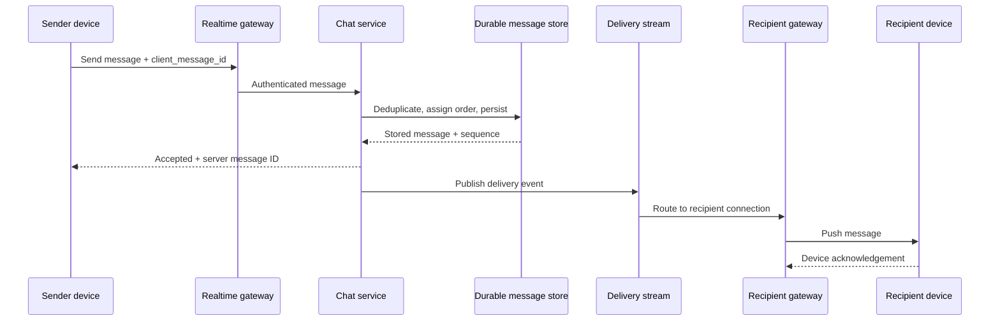

# Case study · Design real-time chat

[← Case studies](README.md) · [Course home](../README.md)

## 1. Scope and guarantees

Users send messages in one-to-one and small group conversations, see history, and receive updates on connected devices. Define “delivered”: accepted by server, stored, pushed to an online device, or acknowledged by a recipient. This design treats server persistence as acceptance; device delivery can happen later.

Guarantees: durable accepted messages, ordering within a conversation, reconnect from a cursor, access control for membership. Presence can be approximate; global cross-conversation ordering is not required.

## 2. API and state

```text
Conversation(conversation_id, member_ids, created_at)
Message(conversation_id, sequence, message_id, sender_id, body_ref, created_at)
DeliveryCursor(user_id, conversation_id, last_seen_sequence)
```

Client sends a stable `client_message_id` for retry deduplication. The server assigns a per-conversation sequence or equivalent ordering token. `GET /conversations/{id}/messages?after=sequence` supports reconnect and history pagination. Authorization checks current membership before returning history or accepting a message.

## 3. Message flow



Persistence precedes acceptance. If the gateway disconnects after persistence but before the sender receives the acknowledgement, a retry with the same client ID returns the prior result. Push is a delivery optimization; history synchronization is the durable recovery path.

## 4. Connections, routing, and ordering

Long-lived WebSocket connections terminate at gateways. A routing layer maps user/device IDs to currently connected gateways; this presence map is ephemeral and can be rebuilt. For multiple devices, fan out to each active connection but store one canonical conversation message. Gateways need limits, heartbeats, reconnect backoff, and load-aware draining during deployment.

Partition messages by conversation ID to keep common reads and ordering local. Very large groups can make one partition hot; larger-scale designs may separate message persistence from recipient fan-out. A single sequencer per conversation is straightforward but has availability/capacity constraints that must be addressed.

## 5. Offline delivery and privacy

Offline recipients fetch messages from their last durable cursor after reconnect. Push notifications should not expose sensitive text on a locked screen by default. Message retention, deletion, attachments, end-to-end encryption, and moderation materially change the architecture; state which are supported. End-to-end encryption changes server-side search and moderation capabilities and needs its own key-management design.

## 6. Failure modes

| Failure | Behavior |
|---|---|
| Recipient gateway unavailable | Message remains stored; recipient reconnects and catches up |
| Duplicate send retry | Deduplicate by sender + client message ID |
| Queue lag | Delayed live push; durable history remains available |
| Presence map stale | Retry routing or treat user as offline; do not lose stored message |
| Conversation partition hot | Measure per-key load; split/reroute only with ordering plan |

### Design review

1. What scope of message ordering does the product actually require?
2. Why is push acknowledgement not a substitute for durable history?
3. How does multi-device delivery affect read receipts and unread counts?
4. Which data must be encrypted or excluded from logs and notification payloads?

<details><summary>Possible answers</summary>

Order within a conversation is often enough; push may be lost while a stored message can be replayed; per-device cursors or a clearly defined user-level read cursor are needed; message bodies and keys require a threat-model-specific encryption and logging policy.

</details>
