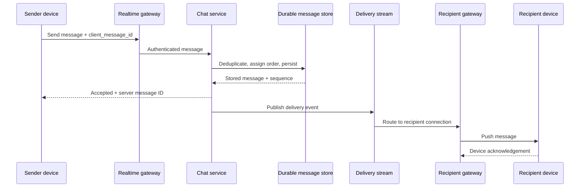
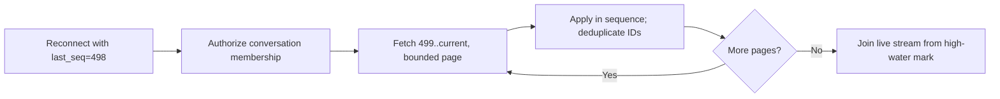

# Case study · Design real-time chat

[← Case studies](README.md) · [Course home](../README.md)

## 1. Scope and guarantees

Users send messages in one-to-one and small group conversations, see history, and receive updates on connected devices. Define “delivered”: accepted by server, stored, pushed to an online device, or acknowledged by a recipient. This design treats server persistence as acceptance; device delivery can happen later.

Guarantees: durable accepted messages, ordering within a conversation, reconnect from a cursor, access control for membership. Presence can be approximate; global cross-conversation ordering is not required.

## 2. API and state

```text
Conversation(conversation_id, member_ids, created_at)
Message(conversation_id, sequence, message_id, sender_id, body_ref, created_at)
DeliveryCursor(user_id, conversation_id, last_seen_sequence)
```

Client sends a stable `client_message_id` for retry deduplication. The server assigns a per-conversation sequence or equivalent ordering token. `GET /conversations/{id}/messages?after=sequence` supports reconnect and history pagination. Authorization checks current membership before returning history or accepting a message.

## 3. Message flow



Persistence precedes acceptance. If the gateway disconnects after persistence but before the sender receives the acknowledgement, a retry with the same client ID returns the prior result. Push is a delivery optimization; history synchronization is the durable recovery path.

## 4. Connections, routing, and ordering

Long-lived WebSocket connections terminate at gateways. A routing layer maps user/device IDs to currently connected gateways; this presence map is ephemeral and can be rebuilt. For multiple devices, fan out to each active connection but store one canonical conversation message. Gateways need limits, heartbeats, reconnect backoff, and load-aware draining during deployment.

Partition messages by conversation ID to keep common reads and ordering local. Very large groups can make one partition hot; larger-scale designs may separate message persistence from recipient fan-out. A single sequencer per conversation is straightforward but has availability/capacity constraints that must be addressed.

## 5. Offline delivery and privacy

Offline recipients fetch messages from their last durable cursor after reconnect. Push notifications should not expose sensitive text on a locked screen by default. Message retention, deletion, attachments, end-to-end encryption, and moderation materially change the architecture; state which are supported. End-to-end encryption changes server-side search and moderation capabilities and needs its own key-management design.

## 6. Failure modes

| Failure | Behavior |
|---|---|
| Recipient gateway unavailable | Message remains stored; recipient reconnects and catches up |
| Duplicate send retry | Deduplicate by sender + client message ID |
| Queue lag | Delayed live push; durable history remains available |
| Presence map stale | Retry routing or treat user as offline; do not lose stored message |
| Conversation partition hot | Measure per-key load; split/reroute only with ordering plan |

## 7. Delivery state is not one boolean

“Sent” can mean several different milestones. Model them separately so retries and support tools remain truthful:

```text
CLIENT_CREATED
   │ upload / send
   ▼
SERVER_ACCEPTED ── persisted with conversation sequence
   │ route to active devices
   ├── DEVICE_DELIVERED (one or more recipient devices acknowledged)
   └── remains pending while recipient is offline
          │ recipient reconnects and syncs history
          ▼
      DEVICE_DELIVERED
          │ user opens conversation / explicit read receipt
          ▼
       READ (product-defined scope: device or user)
```

Do not mark a message “read” just because a push provider accepted a notification. Push acceptance is a provider-side event, not evidence the user saw it. Read receipts also have privacy implications and should follow product controls.

## 8. Idempotent acceptance and per-conversation ordering

The canonical write can enforce uniqueness on `(conversation_id, sender_id, client_message_id)`. On retry, return the previously assigned server message ID and sequence. Assign sequence in the same atomic operation as persistence, for example by updating a per-conversation counter or using an ordered log partition. A single counter can be a hot row in an extremely active group, so partition and throughput limits must be considered.

```mermaid
sequenceDiagram
    participant S as Sender
    participant C as Chat service
    participant D as Message store
    S->>C: client_id=abc, body hash=h1
    C->>D: Insert if unique; assign sequence 501
    D-->>C: Stored message_id=m9, sequence=501
    C-->>S: Accepted m9 / 501
    Note over S,C: Response lost; retry same client_id
    S->>C: client_id=abc, body hash=h1
    C->>D: Find prior idempotency record
    D-->>C: Existing m9 / 501
    C-->>S: Return original acceptance
```

If the client reuses the same ID with a different body hash, return a conflict rather than silently returning or overwriting a different message. Deduplication retention must be at least as long as the supported retry/offline window.

## 9. History sync as the recovery mechanism

On reconnect, the client sends its last durable sequence for each conversation. The server authorizes membership and returns the bounded gap after that cursor. If the cursor is too old for online retention, return a clear resync instruction and fetch a snapshot/history archive. A gap can also mean a deleted or moderated message; use tombstones or explicit sequence placeholders if the client must preserve ordering.



Avoid a race between catch-up and live subscription: establish a high-water mark or subscribe first and buffer live events while paginating, then merge/deduplicate in sequence.

## 10. Presence and fan-out costs

Presence is ephemeral, approximate state: device heartbeats expire after a bounded lease. A missed heartbeat can mark a user offline; this is generally preferable to a permanent false-online record. Do not fan out frequent presence changes to every member of a huge group without sampling/coalescing. Separate message durability from presence so a presence service failure cannot prevent sending or reading messages.

## 11. Storage and partitioning

Partitioning by conversation keeps ordered history local but permits a very active room to dominate one partition. A user-centric inbox projection can speed unread/conversation lists but is derived and needs repair. Large attachments belong in object storage, with authorization and expiration enforced for signed URLs. Encrypt sensitive bodies according to the threat model; end-to-end encryption changes server-side search, moderation, previews, and multi-device key recovery.

## 12. Useful operational signals

Monitor accepted-message latency, write conflicts, duplicate retry rate, per-conversation hot partitions, queue age, push delivery lag, reconnect sync volume, sequence gaps, and stale presence leases. Use aggregate counts or sampled traces rather than message IDs or user IDs as high-cardinality metric labels. Alert on loss of durable acceptance or growing history gaps, not merely on a temporary decline in online presence.

### Design review

1. What scope of message ordering does the product actually require?
2. Why is push acknowledgement not a substitute for durable history?
3. How does multi-device delivery affect read receipts and unread counts?
4. Which data must be encrypted or excluded from logs and notification payloads?

<details><summary>Possible answers</summary>

Order within a conversation is often enough; push may be lost while a stored message can be replayed; per-device cursors or a clearly defined user-level read cursor are needed; message bodies and keys require a threat-model-specific encryption and logging policy.

</details>

## Pressure test: a client retries after losing the send acknowledgement

A client sends message `M`, the server stores it and assigns conversation sequence 84, but the acknowledgement is lost. The client reconnects and retries. If the server creates a new message at sequence 85, recipients see a duplicate even though the original operation succeeded.

Assign a stable client message ID and scope it to the sender and conversation. Enforce uniqueness at the durable write boundary and return the original server message and sequence on a duplicate retry. Persist the message before acknowledging it; push notification is a delivery hint, not the message source of truth. On reconnect, the client resumes from a durable cursor and fetches missed messages, deduplicating by message ID.

Define ordering per conversation, not as a promise of global order across all conversations. If sequence allocation is partitioned by conversation, a hot conversation may become a serialization point; that is a deliberate trade-off for a comprehensible order. Keep presence ephemeral and separate from durable message history so a presence-store outage does not lose messages.

**Review prompt:** which server record lets a client distinguish “stored but acknowledgement lost” from “never stored,” and how long is that deduplication state retained?
