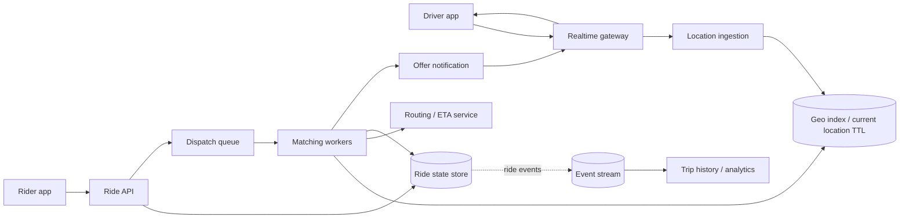

# Case study · Design a ride-hailing matching system

[← Case studies](README.md) · [Question bank](../INTERVIEW_QUESTION_BANK.md) · [Course home](../README.md)

Focus on the dispatch loop: rider requests, nearby drivers are found, one driver is reserved, and the ride state advances. Pricing, maps, identity, payments, and safety services are dependencies with their own contracts.

## 1. Requirements and guarantees

- Rider can request a ride, cancel, and see status/ETA.
- Driver can report location/availability and accept or reject an offer.
- One ride must not be confirmed with two drivers; one driver must not accept two active rides.
- Location can be briefly stale; match ownership cannot be ambiguous.
- Matching should complete quickly enough to feel responsive; unmatched requests need bounded retries and an explicit user-visible state.

We need clarify whether dispatch optimizes for nearest distance, ETA, fairness, vehicle type, or acceptance likelihood. “Closest driver” is not a complete objective: straight-line distance can be wrong across rivers, traffic, or road networks.

## 2. Workload assumptions

Assume 300,000 active drivers, each sending one location update every two seconds:

```text
Location events/s ≈ 300,000 / 2 = 150,000 updates/s
```

That stream is write-heavy, regionally skewed, and mostly short-lived. Persisting every GPS point in the transactional ride database is wasteful. Keep a TTL-bounded current-location index for matching; selectively archive/summarize trip traces only if product, safety, or regulatory needs require it.

## 3. Architecture



## 4. Location index and nearby search

Store each driver’s latest `(driver_id, location, availability, timestamp, vehicle_class, version)` with a short expiry. A geospatial index can query nearby candidates; a cell/geohash scheme is another option. Query the rider’s cell and neighbors, then progressively widen the search radius if too few candidates are found. Filter by availability and vehicle constraints, then compute a more accurate route ETA for a bounded candidate set.

Trade-offs:

- Small cells narrow searches but make boundary handling and multi-cell queries more complex.
- Large cells reduce query fan-out but return many irrelevant candidates.
- Stale driver locations are acceptable only within a defined age threshold; reject stale candidates and ask for an update.
- Geospatial candidate distance is a filter, not necessarily final route cost.

## 5. Atomic matching and state machine

```mermaid
stateDiagram-v2
    [*] --> REQUESTED
    REQUESTED --> SEARCHING: enqueue dispatch
    SEARCHING --> OFFERED: reserve one driver + create offer
    OFFERED --> ASSIGNED: driver accepts before lease expiry
    OFFERED --> SEARCHING: decline / timeout; release reservation
    SEARCHING --> EXPIRED: bounded search deadline
    ASSIGNED --> PICKUP
    PICKUP --> IN_PROGRESS
    IN_PROGRESS --> COMPLETED
    REQUESTED --> CANCELLED
    SEARCHING --> CANCELLED
    OFFERED --> CANCELLED
```



Use a conditional state transition / compare-and-set with a version so only one worker can claim a ride state. A driver reservation also needs an atomic lease/ownership check; otherwise two concurrent riders can offer the same driver. Offer expiry must verify the same offer ID/version before releasing capacity, so a delayed timeout cannot undo a later accepted ride.

## 6. Dispatch flow

1. Persist the rider’s request with an idempotency key and state `REQUESTED`.
2. Enqueue `RideRequested` through an outbox so committed requests are not lost.
3. Matching worker queries nearby, fresh, eligible drivers and ranks a bounded set.
4. Conditionally reserve one driver and transition the ride to `OFFERED`.
5. Send an offer with a unique offer ID and expiry; wait a bounded interval.
6. Accept only if offer ID, ride version, and driver availability still match. Otherwise release/continue search.
7. Publish state changes for rider/driver updates; reconnect clients query authoritative ride state.

If there are several candidate drivers, sequential offers reduce simultaneous contention but increase time-to-match. Small parallel offer batches improve speed but need a rule for multiple accepts (first atomic claim wins; revoke the others). Explain the fairness and user-experience trade-off.

## 7. Failure handling

| Failure | Behavior |
|---|---|
| Location event delayed | Mark stale by timestamp/TTL; do not offer to stale driver |
| Matching worker crashes after reservation | Lease expires or recovery worker inspects persisted offer state |
| Driver app disconnects after accept | Query authoritative state on reconnect; do not infer cancellation from socket close |
| Duplicate rider request | Return the existing ride for the same idempotency key |
| Geo index unavailable | Pause or degrade matching explicitly; do not silently use stale/unverified drivers |
| Route/ETA service slows | Use bounded fallback score or delay dispatch only within deadline |

## 8. Observability and interview follow-ups

Track location age distributions, updates accepted/dropped, candidate count per search radius, time to first offer, offer acceptance/expiry rate, duplicate reservation conflicts, time-to-match p50/p95, unmatched/abandoned rate, and per-city partition load. Alert on user-visible match delay and incorrect double assignment—not just worker CPU.

1. How would you prevent one stadium/city from overwhelming one geo partition?
2. What is the correctness policy when two drivers accept at nearly the same time?
3. How should dispatch change if the business values pickup ETA over distance?
4. How do offline drivers recover their availability and current-trip state after reconnect?

**Key lesson:** approximate geo search is acceptable; exclusive assignment is not. Keep volatile location state and durable ride state separate, and make the state transition authoritative.
