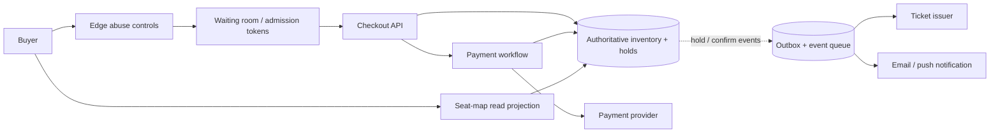
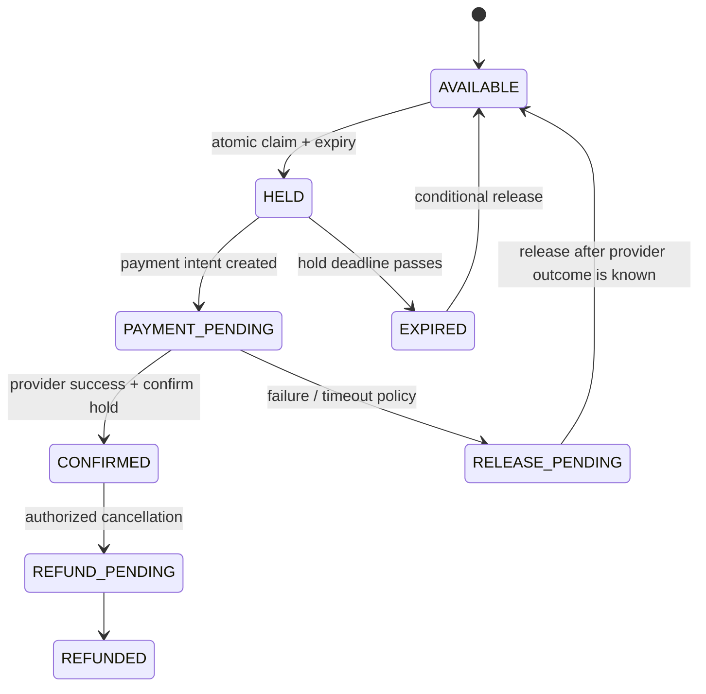

# Case study · Design high-demand ticket reservations

[← Case studies](README.md) · [Question bank](../INTERVIEW_QUESTION_BANK.md) · [Course home](../README.md)

This design sells a limited inventory of event seats during a sharp traffic spike. The core correctness promise is **never confirm more seats than exist**. Queueing users protects capacity and fairness, but the inventory store remains the authority.

## 1. Scope and product semantics

Users can discover an event, enter a waiting room, view/select seats, hold seats briefly, pay, and receive a confirmed ticket. Define whether users can pick exact seats, whether one order can contain multiple seats, hold duration, cancellation/refund rules, and how a user sees sold-out inventory.

Important distinction:

- **Waiting room admission** controls who may attempt a reservation now.
- **Seat hold** temporarily reserves inventory for one checkout attempt.
- **Confirmed ticket** is a durable allocation after payment policy succeeds.

A waiting-room token is not proof that a seat is available; inventory can change between the map view and the hold request.

## 2. Burst estimate

Suppose one event has 20,000 seats and 600,000 users arrive during a 5-minute sale window:

```text
Average arrivals during sale = 600,000 / 300 ≈ 2,000 requests/s
If 5× launch burst            ≈ 10,000 requests/s
Available seats/user ratio    = 20,000 / 600,000 ≈ 3.3%
```

The system should not send every visitor directly to the seat database. The waiting room can admit a controlled flow based on downstream capacity. Randomized or sequenced admission policy is a product/fairness decision; communicate it clearly and protect against token replay or automated bypass.

## 3. Architecture



The seat-map projection may lag briefly; the hold transaction must re-check availability. Separate read-heavy map traffic from writes, and render state as “available,” “held,” or “sold” with clear freshness cues.

## 4. Data model and atomic allocation

```text
Event(event_id, sale_state, opens_at, closes_at, inventory_version)
Seat(event_id, seat_id, state, hold_id, hold_expires_at, order_id, version)
Hold(hold_id, buyer_id, event_id, state, expires_at, idempotency_key)
Order(order_id, buyer_id, state, amount_minor_units, currency)
Ticket(ticket_id, event_id, seat_id, order_id, state)
```

For assigned seating, allocate a selected group in one transaction where possible: lock/check all requested seats in a consistent order, verify they are available or their prior holds expired, then write the same `hold_id` and expiry to every seat. If multi-seat transactions span partitions, choose an event-local partition or use a reservation workflow that can safely compensate partial holds.

For general admission, use a conditional decrement:

```sql
UPDATE event_inventory
SET remaining = remaining - :quantity
WHERE event_id = :event_id AND remaining >= :quantity;
```

Only confirm the reservation if the conditional update changed one row. A cache can show approximate counts but cannot decide the final sale.

## 5. Hold lifecycle and payment saga



Payment is external; it cannot share the inventory database transaction. Use a durable state machine and idempotency key per payment attempt. A timeout from the provider is ambiguous: query/retry with the same key before releasing a seat if a charge may have succeeded. Expiry workers must compare the same `hold_id`/version before releasing; a stale timer must not clear a newer hold.

Choose whether payment is authorized before capture, or charged immediately with refund compensation if the hold loses the race. Each changes customer experience, provider fees, and recovery work. Record the decision explicitly.

## 6. Waiting room and abuse controls

Issue signed, short-lived admission tokens bound to sale, account/session, and allowed action. Enforce per-account/device limits and detect suspicious automation. Do not make a single global queue database the only availability boundary; queue state may be partitioned by event. Admission pacing should adapt to observed inventory transaction latency, provider quotas, and fraud review capacity.

## 7. Failure and reconciliation

| Failure | Safe behavior |
|---|---|
| Inventory store saturated | Slow admission / show waiting state; never infer a successful hold |
| Client retries hold request | Same idempotency key returns the same hold result |
| Payment provider timeout | Mark outcome unknown, query/retry idempotently, reconcile before release |
| Expiry worker delayed | Hold may temporarily reduce availability; conditional cleanup can catch up |
| Notification provider fails | Keep confirmed ticket durable; retry message independently |
| Seat-map cache stale | Hold transaction rejects unavailable seat and refreshes client view |
| Region failover during sale | Preserve one authoritative inventory writer or define strict conflict handling |

Compare ticket ledger, inventory rows, and payment provider settlement records. Alert on `CONFIRMED` without a ticket, paid order without inventory, expired holds never released, duplicate ticket IDs, and refund mismatch.

## 8. Interview follow-ups

1. What does the user see when the final seat is held by another buyer during checkout?
2. How would you support adjacent seats without deadlocking large seat selections?
3. Can a user hold seats on multiple devices? What is the limit and cleanup policy?
4. How do queue admission and seat allocation respond to provider/API throttling?
5. How do you prove no oversell after an ambiguous payment timeout or regional failover?

**Key lesson:** smoothing demand is not the same as controlling inventory. Make the allocation transaction authoritative; make queueing, payment, and notifications recoverable around it.
