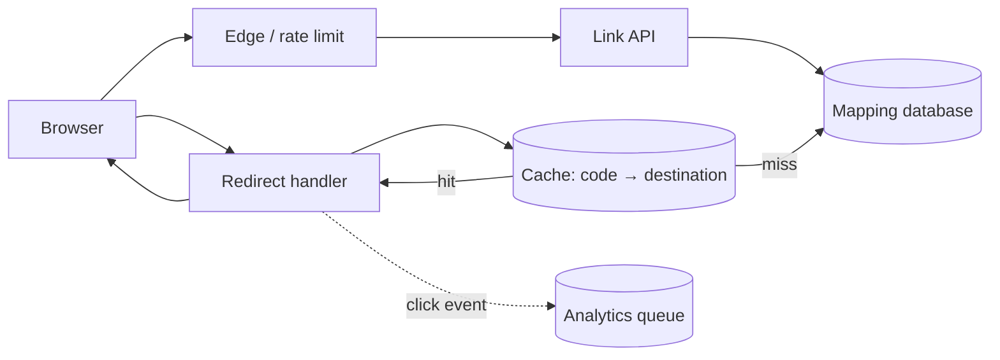

# Case study · Design a URL shortener

[← Case studies](README.md) · [Course home](../README.md)

## 1. Scope and requirements

Users submit a long URL and receive a short URL. Anyone with the short URL can be redirected. Keep link ownership, expiration, and abuse protection in scope; exclude custom analytics dashboards initially.

**Functional:** create a link, redirect, optionally expire or disable it. **Quality:** redirects are read-heavy and low-latency; mappings must not silently point to the wrong destination; malicious links must be blockable. The write response should mean the mapping is durably stored before returning the short link.

Assume 10 million new links/month, 100 redirects per link/month on average, and 10× read skew for popular links. This is roughly 3.3 writes/second and 385 reads/second on average; actual redirect distribution is highly uneven, so hot-key behavior matters more than the mean.

## 2. API and data

```http
POST /v1/links
{"url":"https://example.com/a/long/path","expires_at":null}
```

Returns `201` with a short URL after validation and durable write. Redirect: `GET /{code}`. Choose `302` if the destination may change and browser/CDN caching should be controlled; choose `301` only when permanent browser caching is intended. Exact cache semantics are part of product behavior.

```text
Link(code PK, owner_id, destination, created_at, expires_at, state)
```

Use a unique index on `code`. Consider storing a normalized URL for validation and canonical behavior, but preserve destination semantics carefully; URL normalization can change meaning in edge cases.

## 3. Baseline architecture



Split creation from redirect behavior logically; they need not be separate services at small scale. The redirect path checks link state/expiry, emits bounded analytics asynchronously, and returns the chosen HTTP status. Analytics should never hold the redirect response open without a product requirement.

## 4. Generate unique short codes

Options include a random token with collision check, a monotonic ID encoded in a URL-safe alphabet, or a preallocated ID range per writer. Random codes are simple but need collision handling; sequential IDs are compact but reveal creation volume and can be enumerated. A robust design can generate a random candidate, attempt an insert under a unique constraint, and retry on collision with a strict bound. Rate limit link creation and validate destinations to reduce phishing and abuse.

For alphabet size 62 and code length 7, the namespace is `62⁷ ≈ 3.5 trillion` values. Namespace size alone does not guarantee collision-free random generation; collision probability rises as issued IDs accumulate, so uniqueness must be enforced transactionally.

## 5. Scaling and failure

- Cache popular mappings with bounded TTL; invalidate or version when a link changes/disables.
- Replicate mapping data for read scale; define what redirect behavior is acceptable during lag.
- Partition by code hash for balance, while recognizing extremely popular codes can still overload cache entries.
- If cache is unavailable, fall back to the database with load shedding/rate limits so a cache outage does not overwhelm the origin.
- If analytics is unavailable, preserve redirects and buffer or drop analytics according to the stated business requirement.

### Trade-off review

| Decision | Benefit | Cost |
|---|---|---|
| Cache-aside mapping | Fast repeated popular redirects | Stale disable/expiry state until invalidation/TTL |
| Random code | Harder to enumerate | Collision retries; randomness/uniqueness management |
| Async analytics | Redirect unaffected by analytics latency | Delayed counts and queue operations |
| Redirect status policy | Control caching and destination updates | Browser/proxy semantics can persist unexpectedly |

## 6. Evolution questions

1. How would custom domains affect tenant isolation and key uniqueness?
2. How would deletion propagate through edge caches and replicas?
3. How would you defend against a single viral code saturating the cache?
4. Which metrics reveal a redirect service that is healthy on average but failing for one region?

<details><summary>One possible direction</summary>

Namespace codes by domain/tenant where required; version or actively invalidate mapping cache entries; coalesce hot-key lookups and use replicated cache reads; track redirect latency/error rate by region and cache-hit tier without unbounded user-level metric labels.

</details>
