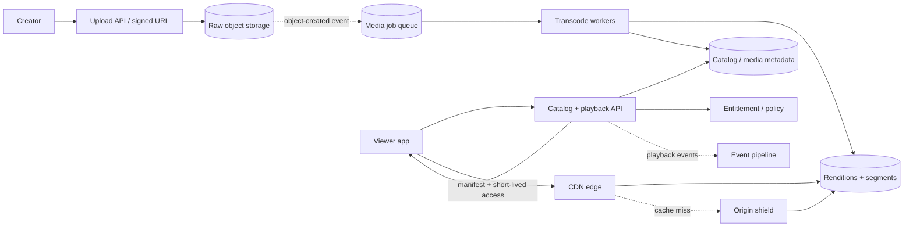
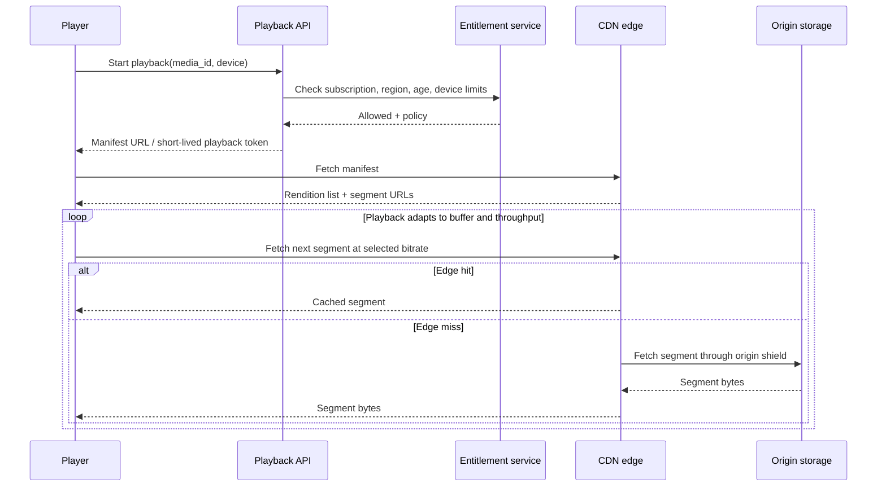

# Case study · Design a video streaming platform

[← Case studies](README.md) · [Question bank](../INTERVIEW_QUESTION_BANK.md) · [Course home](../README.md)

This is a **video-on-demand** design. Live streaming, user-generated short clips, digital rights, and recommendation modeling can be layered on after the playback and ingest paths are clear.

## 1. Scope and quality goals

Users browse a catalog, start playback, seek, pause/resume, and continue on another device. Creators or operators upload master media that becomes available in multiple renditions.

Priorities: playback starts quickly; rebuffering is rare; a transient metadata or recommendation failure should not interrupt already-buffered playback; media bytes must be durable and authorized. “Fast” means p95 time-to-first-frame, not the time to download an entire feature-length file.

## 2. Workload estimate

Illustrative assumption: 1 million playback starts/day, 30 minutes watched per start on average, and average delivered bitrate of 4 Mbit/s.

```text
Viewer seconds/day = 1M × 30 × 60 = 1.8B seconds
Payload/day        = 1.8B × 4 Mbit/s ÷ 8 ≈ 900 TB/day
Average egress     = 900 TB ÷ 86,400 ≈ 10.4 GB/s ≈ 83 Gbit/s
Peak egress (5×)   ≈ 52 GB/s ≈ 415 Gbit/s
```

This is why serving video bytes from application servers is the wrong baseline: the application should authorize playback and issue a manifest/access path; a CDN should serve cached segments close to viewers. Actual bitrate, watch time, caching, geography, and peak concentration change the estimate dramatically.

## 3. Architecture overview



## 4. Ingest and transcode workflow

1. Create an upload record with owner, declared metadata, expected size, and `UPLOADING` state.
2. Issue a short-lived, constrained signed URL; upload media directly to object storage, preferably multipart/resumable for large files.
3. Verify the completed object, checksum, file signature, and policy. Do not trust extension or client MIME type alone.
4. Emit a durable job reference (object key + media ID; do not place huge bytes in a queue).
5. Workers probe codecs/duration, generate a ladder of renditions and segment manifests, and write outputs to versioned object keys.
6. Only publish `READY` after required renditions and metadata are verified. Failed jobs retry idempotently or enter a visible dead-letter workflow.

Transcode capacity is a separate workload from playback egress. Use a queue to smooth upload bursts and prioritize work according to product needs; monitor job age and processing seconds per source-minute.

## 5. Playback and adaptive bitrate



The player estimates available bandwidth and buffer health, then chooses a rendition for each segment. A bitrate ladder trades quality against startup/rebuffer probability and CDN/storage volume. Segments and manifests should be versioned so an update does not mix incompatible encodes. Signed playback access should expire but last long enough for normal playback; short-lived authorization must account for paused playback and token refresh.

## 6. Cache strategy and release spikes

- Cache immutable segments for a long time using versioned URLs.
- Cache catalog metadata separately from access/entitlement decisions.
- Use an origin shield or regional cache layer to collapse many identical cache misses.
- Pre-position predictable popular titles before a scheduled release when the demand/cost trade-off supports it.
- Protect the origin with request coalescing, concurrency limits, and a fallback ladder.

Cache hit ratio alone is not enough: a 99% hit ratio during normal traffic can still leave a huge miss storm on a global premiere. Forecast edge capacity by region and test a cold-cache launch.

## 7. Failure modes and behavior

| Failure | User effect | Response |
|---|---|---|
| Transcode worker crash | New title takes longer to become ready | Retry idempotently from durable input; alert on job age |
| CDN region outage | Playback errors or higher latency locally | Route to alternate edge/origin within capacity; preserve token policy |
| Catalog unavailable after playback starts | Browse/start may fail | Existing manifest and buffered segments continue where valid |
| Entitlement service unavailable | New playback authorization uncertain | Product-specific fail-open/closed policy; never expose restricted content accidentally |
| Origin overload on a cache miss | Popular title stalls | Origin shield, coalesce misses, limit concurrency, serve alternate bitrate if possible |
| Bad encode/manifest | Playback fails on certain devices | Validate profiles before publish; version/rollback rendition set |

## 8. State and data model

```text
Media(media_id, owner_id, state, duration, region_policy, rendition_version)
Rendition(media_id, version, codec, bitrate, resolution, manifest_key, status)
PlaybackSession(session_id, user_id, media_id, device_id, started_at, last_position)
```

Keep large bytes outside the relational catalog. Playback position is a checkpoint, not a per-frame transaction: batch or asynchronously persist progress, accepting small resume-point staleness to avoid a write for every segment. Define retention and privacy for viewing history.

## 9. Interview deep dives

1. What changes for live video with a seconds-level latency target?
2. How would you prevent a single title release from saturating one origin region?
3. Which response data is safe to cache publicly, and which requires a user-specific cache key?
4. How do you resume a multipart upload after a mobile connection drops?
5. If video egress costs dominate, which levers (bitrate, codec, caching, catalog policy) can reduce cost without unacceptable quality loss?

**Key lesson:** media delivery is dominated by moving bytes efficiently. Keep control-plane APIs and media data-plane delivery separate, then design authorization and cache behavior together.

## Pressure test: a new release causes a cache-fill storm

A popular title launches globally. Many viewers request the same first segments at once, but those segments are not warm in every region. If each edge miss independently downloads from origin, the release can saturate origin bandwidth and delay both new and existing playback.

Plan cache warming for the most likely initial segments, but treat it as an optimization rather than a correctness dependency. Use request coalescing at the edge or regional origin so concurrent misses for the same immutable segment share a fetch. Keep segment names versioned by encoded asset so a manifest never points to bytes that are being replaced in place. Protect origin with concurrency limits and prioritize active playback over speculative prefetch.

Adaptive bitrate selection should respond to measured delivery throughput and buffer health, not only the viewer's nominal connection type. Monitor startup time, rebuffer ratio, cache-hit ratio, origin egress, and rendition switches together; a cache improvement that serves the wrong or unauthorized version is not a success.

**Review prompt:** how does the system behave when prewarming is incomplete and one origin region is unavailable during the launch spike?
