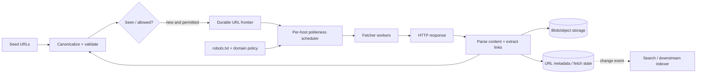

# Case study · Design a distributed web crawler

[← Case studies](README.md) · [Question bank](../INTERVIEW_QUESTION_BANK.md) · [Course home](../README.md)

Build a polite crawler that starts from seed URLs, fetches pages, extracts links and content, avoids repeated work, and makes results available to a search/indexing pipeline. Crawling the open web is not simply “put URLs on a queue”: it is a scheduling, deduplication, and safety problem.

## 1. Scope and workload

Assume a target of 10 billion pages in 30 days:

```text
Average successful fetches/s = 10B / (30 × 86,400) ≈ 3,858 pages/s
At 100 KB/page, raw content ingress ≈ 386 MB/s before replication/derived indexes
```

Peak demand, retries, domain politeness, page size variation, rendering needs, and robots rules affect actual completion time. If a prompt instead requires 10 billion pages in five days, the average is about 23,150 pages/s. State which constraints define “done.”

## 2. Requirements and boundaries

- Fetch URLs from seed sets and newly discovered links.
- Deduplicate canonical URLs and avoid fetching already-current content too often.
- Respect robots exclusions, per-domain crawl delay, and bounded concurrency.
- Retry transient fetch errors without losing frontier state.
- Store raw or extracted content in blob storage; index metadata/content separately.
- Prevent the crawler from becoming a tool to reach private/internal networks.

## 3. High-level pipeline



The frontier is durable work state, not an in-memory list. Queue messages can contain a compact URL ID and lease metadata; keep page bodies out of the queue. Store large payloads in blob/object storage and reference them from metadata.

## 4. URL canonicalization and deduplication

Canonicalization may normalize scheme/host case, remove default ports, and apply a documented fragment policy. Do not aggressively reorder or remove query parameters: they may change page content. Apply URL-length and scheme limits before scheduling.

Use a probabilistic Bloom filter or similar in-memory structure to quickly identify likely-seen URLs, backed by a durable exact store for correctness. A Bloom filter can say “possibly seen” when an item is new (false positive); if the product cannot tolerate skipping pages, use it as a prefilter rather than the only deduplication record. Partition the exact store by a stable URL hash and set a recrawl policy for changed pages.

## 5. Politeness and frontier scheduling

Partition candidate URLs by hostname or registrable domain. Each domain has a delay/concurrency budget, robots policy, last request time, and possibly a retry/backoff state. A scheduler chooses an eligible domain, then a URL; this avoids one highly linked host monopolizing fetch workers.

```text
Candidate URL
   ↓ canonicalize + validate scheme/host
robots policy loaded? ── no → fetch robots.txt under domain budget
   ↓ yes
path allowed? ────────── no → record excluded; do not fetch page
   ↓ yes
domain delay elapsed? ── no → defer until eligible time
   ↓ yes
lease URL → bounded fetch → persist result → schedule discovered links
```

Respect robots rules as a crawl policy, not an authorization system. Cache rules for a bounded period and define conservative behavior when policy cannot be retrieved. The allowed-request rate is per domain; global worker scaling must not bypass it.

## 6. Fetching, retries, and leases

Workers lease a frontier item with an expiry. A successful response advances the URL state and emits discovered links. A process crash lets the lease expire so another worker can retry. Use attempt limits, exponential backoff with jitter, and error classification (DNS/transient network, 429/503, permanent 4xx, robots exclusion). A retry must not exceed a domain’s politeness budget.

Track conditional request metadata (`ETag`, `Last-Modified`) so recrawls can use `If-None-Match`/`If-Modified-Since` and avoid transferring unchanged bodies where supported. Bound decompressed response size and parsing time; a compressed response can expand dramatically.

## 7. Security boundary: untrusted URLs

A crawler fetches attacker-influenced locations. Validate schemes (typically HTTP/HTTPS only), resolve hostnames, and block loopback, private, link-local, multicast, and reserved address ranges. Re-check the resolved destination on redirects and guard against DNS rebinding between validation and connect. Use egress network controls as defense in depth. Apply response size/time limits and sandbox parsers for active or malformed content.

## 8. Storage and indexing

```text
URLRecord(url_hash PK, canonical_url, host_key, state, next_fetch_at,
          last_status, etag, modified_at, content_object_key)
DomainPolicy(host_key PK, robots_version, next_allowed_at, concurrency_limit)
FetchAttempt(url_hash, attempt_id, started_at, outcome, duration, response_bytes)
```

Keep crawl state and scheduling metadata in a queryable durable store; store large HTML/text objects separately. The downstream search index is a derived projection and should be rebuildable from retained crawl data and metadata. Use lifecycle policies for raw content and respect removal/takedown requests.

## 9. Failures and observability

| Failure | Mitigation / signal |
|---|---|
| One domain is slow or blocks requests | Per-domain delay/concurrency, timeout, backoff; measure domain-level wait |
| Frontier backlog grows | Compare eligible arrival/completion rates; partition and increase safe fetch capacity |
| Duplicate work after crash | Idempotent URL state transition + lease/attempt ID |
| Parser hangs or huge page | CPU, memory, response-byte, and parse-time limits |
| DNS / robots dependency fails | Bounded retry and documented conservative policy |
| Search index unavailable | Continue durable crawl storage; replay index changes later |
| Malicious URL targets private network | Resolve/check destination, re-check redirects, restrict egress |

Measure pages/s and bytes/s, frontier age by domain, queue eligibility delay, duplicate ratio, retry distribution, robots exclusions, status codes, parse failures, storage growth, and index lag. Avoid logging full query strings that may contain secrets or personal data.

### Interview follow-ups

1. How do you keep a high-volume domain from starving all other domains?
2. What is the correctness cost of Bloom-filter false positives?
3. How would you schedule recrawls for pages with different change rates?
4. What changes when pages require JavaScript rendering?
5. How do you comply with a host removal request after content was indexed and copied?

**Key lesson:** globally scale workers while keeping domain-level behavior polite. Global throughput and per-host fairness are separate control loops.
