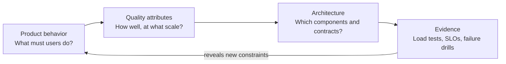

# 00 · How to use this course

[← Course home](../README.md) · [Next: Mental models →](01-mental-models.md)

## Start here: course introduction

Before the first lesson, watch the course roadmap: **[System Design From First Principles — A Learner’s Roadmap ▶](https://docs.google.com/videos/d/15kJjGC8OyHCujioJoT_r3xM69kETwXy85pg1QYZWatI/play?usp=sharing)**. It introduces the course and how to approach the learning path. The link opens the video in Google Vids.

## What “system design” means here

A **system** is a set of components and people that cooperate to deliver behavior. **Design** is deciding how responsibilities, data, and failure handling are arranged under constraints. The goal is not to draw the largest diagram. It is to make a design that meets the required behavior with a cost, complexity, and risk that are acceptable.

You will move repeatedly between three views:

Product behavior tells us **what** the system does. Quality attributes tell us **how well** it must do it: latency, availability, durability, privacy, cost, and so on. Architecture is a hypothesis that must be checked against the workload and then measured in operation.

## A useful progression

1. **Describe the user-visible job.** Avoid choosing technology before the problem is bounded.
2. **Separate must-haves from preferences.** “Fast” needs a percentile, a scope, and a measurement point.
3. **Estimate orders of magnitude.** Rough numbers expose impossible assumptions; they are not a substitute for measurement.
4. **Draw one end-to-end request.** Mark reads, writes, network boundaries, and authoritative state.
5. **Ask what changes at 10× load.** Find the actual bottleneck before adding components.
6. **Walk through a failure.** A component that fails must have an explicit effect and recovery path.

## The course’s visual language

- A **solid arrow** is a synchronous call or data path unless a diagram says otherwise.
- A **dashed arrow** is optional, asynchronous, or observational.
- A database cylinder marks persistent state; it does not imply a specific database product.
- A box is a responsibility, not necessarily a separate deployable service.
- Arrows crossing a boundary often imply latency, failure, security, and ownership considerations.

Mermaid diagrams are included as source so you can fork and change them. Sketching by hand is equally valid: clarity matters more than diagram software.

## How deep should you go?

Use the beginner path if terms like replica, cache, or queue are new. If you already build backend services, skim familiar explanations and spend time on the assumption checks and exercises. Interview preparation benefits from saying decisions aloud and keeping a visible time budget. Production design benefits from deployment, migration, and operational details that interviews may omit.

## Check your understanding

1. Why is “use microservices” not a requirement?
2. What three details would make “the service should be fast” testable?
3. Which source is more useful when deciding what to scale: a generic architecture diagram or a measured bottleneck? Why?

Suggested answers

1. It is an implementation strategy; the requirement is user-visible behavior and quality.
2. For example: endpoint or operation, percentile, and measurement boundary / time window.
3. A measured bottleneck tied to the workload; a generic diagram is only a set of possible components.

[Continue to Lesson 01 →](01-mental-models.md)
