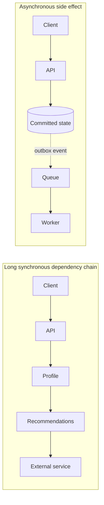
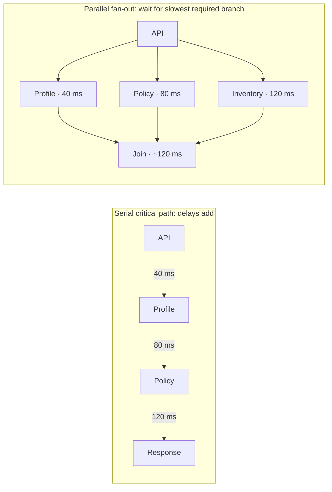

# 01 · System design mental models

[← Course home](../README.md) · [Previous: Orientation](00-course-orientation.md) · [Next: Requirements & estimates →](02-requirements-and-estimates.md)

## 1. Start with a boundary

Every design has a **system boundary**: what this team owns, what it calls, and what it assumes about external systems. Drawing the boundary prevents accidental promises about a payment provider, identity service, or mobile network that the system cannot control.

An architecture is also a graph. Nodes represent responsibilities or state; edges represent communication. Every edge costs something: time, capacity, and a chance of failure. Combining boxes can reduce network boundaries; splitting boxes can enable independent ownership and scaling, but introduces remote-call and operations costs.

## 2. Find the bottleneck, not a fashionable component

For a serial request path, response time is approximately the sum of its component and network times. Under parallel work, it is closer to the slowest branch plus coordination and merge time. Throughput is constrained by the narrowest resource on the critical path.

Little’s Law is a useful steady-state relation:

> **L = λ × W**
>
> average work in the system = arrival rate × average time in the system

If a service receives 200 requests/second and average residence time is 0.25 seconds, Little’s Law predicts about 50 requests in flight at steady state. This is not a capacity guarantee: bursts, queueing, and changing latency can raise concurrency quickly.

## 3. Coupling and cohesion

High cohesion means a component’s responsibilities belong together. Low coupling means changes or failures in one component do not unnecessarily propagate to another. These are goals, not binary properties. A synchronous chain of eight “independent” services is still tightly coupled at runtime if one request needs all eight to succeed.



Async decoupling changes the user-visible contract: the request can complete before the side effect. It is only correct if the product accepts eventual completion and the workflow has a way to track and retry it.

## 4. Trade-offs are conditional

Architecture decisions exchange one property for another. “X is better than Y” is incomplete without workload and requirements.

| Choice | Helps with | Costs or risks |
|---|---|---|
| Cache | Repeated reads and latency | Stale values, invalidation, memory, stampedes |
| Replica | Read capacity and regional proximity | Replication lag, failover complexity |
| Partitioning | Data volume and write capacity | Cross-partition queries and rebalancing |
| Queue | Burst smoothing and failure isolation | Delayed completion, duplicates, backlog |
| More services | Independent ownership or scaling | Network calls, deployments, observability burden |

## 5. Optimize the whole user journey

Local improvements can make a system worse end-to-end. A faster cache lookup does not help if a slow downstream dependency dominates. A high availability percentage for each component does not guarantee the whole request path meets its goal. Begin with the critical user action and include every dependency in its path.

### 5.1 Request paths, fan-out, and the tail

If a request must call dependencies **in series**, their latencies accumulate. If it calls independent dependencies in **parallel** and waits for all of them, the request latency is approximately the slowest branch, not the average branch. More branches make it increasingly likely that at least one is slow.



This is why a “small” remote call is not free: it consumes a latency budget and creates another dependency that can time out. If a branch is optional, consider returning a partial result with a clear contract rather than making every user wait for it. Parallel fan-out also increases concurrency and can overload downstream services; set per-dependency limits.

### 5.2 Utilization and queueing intuition

As a shared resource approaches full utilization, there is less spare capacity to absorb bursts or slow requests. Queues form; waiting time can rise much faster than utilization. A system at 95% average CPU may have little headroom for a short burst, garbage collection, or a noisy neighbor. “Average load is below capacity” is not enough: request-size variation, synchronized arrivals, locks, and dependency waits matter.

```text
Relative wait
  high |                                  ╭────
       |                            ╭─────╯
       |                     ╭──────╯
       |             ╭───────╯
   low |─────────────╯
       +----------------------------------------> utilization
        0%          50%        80%       100%
```

The curve is qualitative, not a universal equation. Use load tests and production measurements to find the safe operating region. Capacity headroom is a product choice: too little increases outage risk; too much may waste money.

### 5.3 Availability of a dependency chain

If one user action requires every independent component in a serial chain, a rough availability estimate is the product of component availabilities. Three required components each at 99.9% yield `0.999³ ≈ 99.70%` for the whole chain under simplifying independence assumptions. Correlated failures make the real result worse; optional branches, redundancy, retries, and graceful degradation change the model.

The lesson is not to multiply arbitrary vendor uptime numbers. It is to identify which dependencies are truly required for the user action and where a fallback can preserve useful behavior.

### 5.4 Feedback loops and control

Architectures contain feedback loops: autoscaling observes load and starts capacity; retries react to errors; cache fill reacts to misses. A delayed or overly aggressive controller can oscillate. For example, retries increase load on a failing service, causing more timeouts and further retries—a positive feedback loop. Backoff, jitter, retry budgets, queue limits, and gradual scaling reduce this amplification.

### Knowledge check

1. What does Little’s Law estimate, and what assumptions make the estimate useful?
2. Why can splitting one process into more services increase latency and failure modes?
3. Give one requirement that would justify accepting stale cached data.

<details><summary>Suggested answers</summary>

1. Average in-flight work from arrival rate and average time, under a stable/steady-state workload.
2. Calls cross networks and deployment boundaries; each adds latency, timeout, capacity, and failure considerations.
3. A profile picture or public catalog description may tolerate short staleness; an account balance usually needs stronger guarantees.

</details>

[Continue to Lesson 02 →](02-requirements-and-estimates.md)
