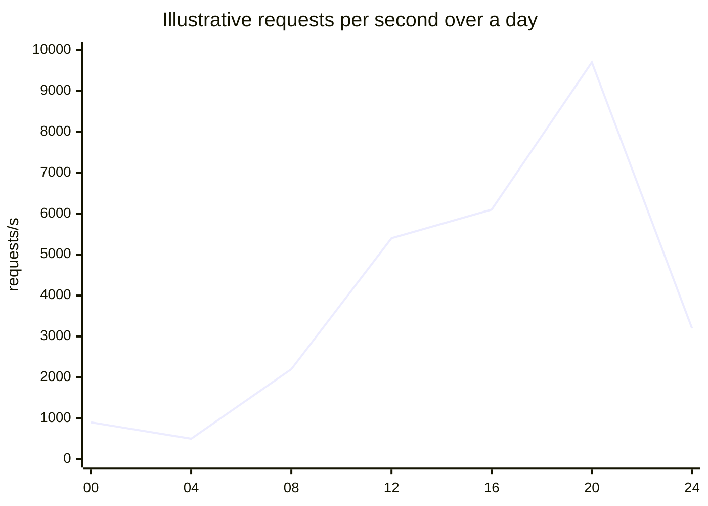

# 02 · Requirements and back-of-the-envelope estimates

[← Course home](../README.md) · [Previous](01-mental-models.md) · [Next →](03-api-and-data-design.md)

## 1. Convert a prompt into a bounded problem

For “design a photo-sharing service,” list core behaviors before infrastructure:

- **Functional:** upload a photo, follow a user, view a feed, react to a post.
- **Quality attributes:** read latency, write latency, availability, durability, privacy.
- **Scope:** which behaviors are in the first design? What is explicitly out?
- **Constraints:** geography, retention, compliance, existing integrations, team size.

Rank requirements. A “must keep private photos private” constraint is not equivalent to an optional recommendation feature. Clarify ambiguous terms with a proposed default and make the assumption visible.

## 2. Estimate the workload

Use round numbers and state assumptions. Suppose a product has 2 million daily active users; each opens the app 5 times/day, and each opening makes 20 feed reads:

```text
Daily feed reads       = 2M × 5 × 20 = 200M reads/day
Average feed read rate = 200M / 86,400 ≈ 2,315 reads/second
Peak rate (3× average) ≈ 6,945 reads/second
```

If 1 in 10 sessions publishes one 1 MB image:

```text
Uploads/day            = 2M × 5 × 0.1 = 1M images/day
Raw image ingress      ≈ 1 TB/day
30-day raw retention   ≈ 30 TB, before replicas, derivatives, and metadata
```

These are **order-of-magnitude** estimates. Real traffic is skewed by time zones, campaigns, bots, and unusually active accounts. Storage estimates must account for compression, retention, replicas, versions, and derived data. A peak factor is an assumption to validate, not a law.

### A simple storage growth graph

```text
Stored data
 900 TB |                               ● month 30
 600 TB |                       ● month 20
 300 TB |               ● month 10
   0 TB +------------------------------------------> time
          0             10              20       30 months
```

This linear sketch assumes 1 TB/day, no deletion, no compression, and no growth change (about 30 TB/month). Real capacity planning needs a retention policy and observed growth rate; the graph helps surface those assumptions. With 30-day retention, this workload would instead approach roughly 30 TB of raw data at steady state, before replicas and derivatives.

## 3. Establish budgets

Write measurable targets with a scope and percentile. Example: “99% of authenticated feed reads from a supported region complete in under 300 ms, measured at the API edge over a rolling 30-day window.” Separate average, tail, and worst-case behavior. Percentiles expose users who experience long tail latency.

Break a latency goal into a budget, not just component guesses:

```text
Client ↔ edge:         80 ms
Gateway + application: 45 ms
Cache / database:     100 ms
Serialization + slack: 75 ms
                      ------
Total target:         300 ms
```

Network distance and retries consume the same end-to-end budget. If every dependency independently uses a timeout of 300 ms, the full request cannot reliably meet a 300 ms goal.

## 4. Check orders of magnitude

Useful unit conversions:

| Quantity | Approximation |
|---|---:|
| Seconds/day | 86,400 ≈ 10⁵ |
| Requests/day at 1 request/second | 86,400 |
| 1 KB × 1 million objects | ~1 GB (decimal) |
| 1 MB × 1 million objects | ~1 TB (decimal) |
| 1 year | ~31.5 million seconds |

Keep decimal (GB) versus binary (GiB) conventions consistent. Round early; precision beyond the input assumptions is false confidence.

## 5. Produce a workload profile

For each operation record: average and peak requests/second, read/write mix, payload size, burst shape, geographic distribution, data growth, hot-key risk, and latency target. This profile guides the later architecture. It should be revisited whenever the product or traffic assumptions change.

### 5.1 A complete first-pass capacity estimate

Assume 10 million daily active readers, each requesting 30 feed pages per day. Suppose each response averages 80 KB and peak traffic is 5× the daily average.

```text
Reads/day       = 10M × 30 = 300M
Average RPS     = 300M / 86,400 ≈ 3,470
Peak RPS        = 3,470 × 5 ≈ 17,350
Peak egress     = 17,350 × 80 KB ≈ 1.39 GB/s ≈ 11.1 Gbit/s
```

That is application payload alone: protocol overhead, TLS, retransmission, image assets, cache misses, and regional concentration add more. The estimate suggests a need to think about edge delivery, response size, regional capacity, and bandwidth—not a specific vendor or number of machines.

Suppose each user creates 2 posts/day at 2 KB average metadata size:

```text
Posts/day                 = 10M × 2 = 20M
Metadata writes/second    = 20M / 86,400 ≈ 231 average
Raw metadata growth/year  = 20M × 2 KB × 365 ≈ 14.6 TB/year
```

Attachments are a separate workload. Store them in a blob/object system and keep references/metadata in the transactional data store. Replication, indexes, versions, tombstones, and backups multiply the physical storage requirement; estimate each separately.

### 5.2 Sensitivity matters more than false precision

Create a small range, not one magic answer:

| Assumption | Low | Base | High |
|---|---:|---:|---:|
| Peak factor | 3× | 5× | 10× |
| Feed response | 40 KB | 80 KB | 160 KB |
| Peak egress at 17,350 RPS base | 0.56 GB/s | 1.39 GB/s | 2.78 GB/s |

The high case can be a campaign, launch, or celebrity event. Ask which assumption changes the architecture: e.g., whether payloads can be cached at the edge, whether writes can be delayed, or whether one shard sees disproportionate load. Estimates should narrow questions, not pretend the future is known.

### 5.3 Burst shape and concurrency

The same total daily volume can arrive smoothly or in a sharp spike. A ten-minute launch burst can exhaust connection pools even when daily request averages look comfortable. Use a time series where possible: per-minute peak, burst duration, and recovery time. Queueable work may be smoothed; interactive work generally cannot be hidden indefinitely behind a queue.



If GitHub’s Mermaid renderer changes chart support, the intended takeaway is still visible: production demand varies over time; provision and test against a peak profile, not only a daily average.

### Knowledge check

1. If reads are 80% of calls but writes are 95% of bytes, what additional detail is needed before choosing a storage strategy?
2. Why is average requests/second insufficient for capacity planning?
3. What makes an SLO measurable rather than aspirational?

<details><summary>Suggested answers</summary>

1. Payload size and write pattern, retention, access pattern, durability, and consistency requirements.
2. Bursts and peak traffic can saturate a system even when its daily average is low.
3. A defined user journey, threshold/percentile, measurement point, and time window.

</details>

[Continue to Lesson 03 →](03-api-and-data-design.md)
