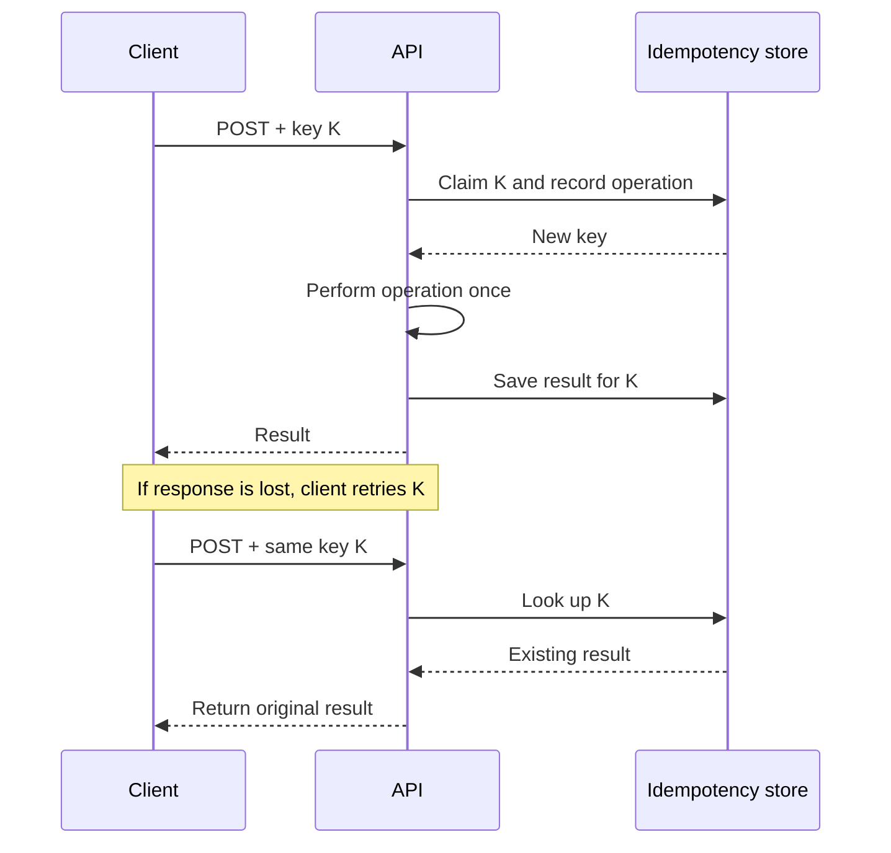
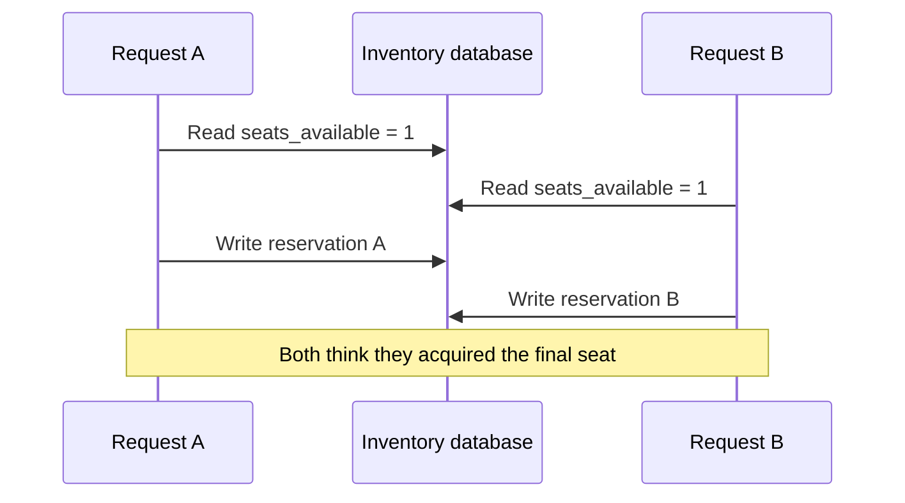

# 03 · API and data design

[← Course home](../README.md) · [Previous](02-requirements-and-estimates.md) · [Next →](04-scaling-and-caching.md)

## 1. Design the contract from user actions

An API is a contract: operations, inputs, outputs, errors, authorization, and evolution rules. Start with the caller’s job, then define behavior precisely. Example:

```http
POST /v1/posts
Authorization: Bearer <token>
Idempotency-Key: 8c3...
Content-Type: application/json

{"text":"A useful design note","visibility":"followers"}
```

```json
{
  "id": "post_7f2...",
  "created_at": "2026-10-11T12:00:00Z",
  "status": "published"
}
```

Document whether the response means “stored,” “visible to all readers,” or merely “accepted for processing.” Use pagination for collections; cursor pagination generally behaves better than large offsets as datasets grow and rows are inserted. Define stable ordering and what happens if an item disappears between pages.

## 2. Model invariants before tables

An **invariant** is a condition the product requires to remain true. Examples: a payment has at most one successful capture; a user cannot read another user’s private object; a post ID is unique. Identify which component is authoritative for each invariant. If two services can independently write the same fact, define how conflicts are resolved.

Example relational model for a follower feed:

```text
User(user_id PK, created_at, ...)
Follow(follower_id, followed_id, created_at,
       PK(follower_id, followed_id), index(followed_id, created_at))
Post(post_id PK, author_id, created_at, visibility, body, ...,
     index(author_id, created_at DESC))
FeedEntry(viewer_id, post_id, author_id, created_at,
          PK(viewer_id, post_id), index(viewer_id, created_at DESC))
```

The same data can be modeled differently for different access patterns. Ask which queries must be cheap and which can be computed or delayed. A normalized source of truth plus a derived feed is one option; storing a precomputed feed creates another consistency and repair problem.

## 3. Choose consistency per operation

Consistency is not a single system-wide switch. Define the user-visible guarantee per operation:

| Operation | Example expectation |
|---|---|
| Update display name | Other regions may see the change shortly after |
| Reserve scarce inventory | Do not confirm more units than exist |
| Read own new post | Read-your-writes is desirable |
| View public reaction count | A small delay is acceptable |

“Eventually consistent” should say what converges, under what assumptions, and what the user sees before convergence. “Strongly consistent” should identify the scope (record, partition, transaction) and its availability/latency costs.

## 4. Idempotency and retries

Networks fail ambiguously: a client can time out after the server committed a write. Retrying a non-idempotent request may create duplicates. An idempotency key lets a server recognize repeated attempts:



Define key scope, retention, conflict behavior when the same key is reused with a different request body, and what happens if the operation is still in progress.

## 5. Schema and API evolution

Prefer additive changes first: add an optional field, deploy readers that tolerate it, then write it. For removals or renames, support both forms during a migration. A safe rollout often has expand → migrate → contract phases. Keep clients backward-compatible where old versions remain active; database migration safety is part of API design.

### 5.1 Design indexes from queries

Suppose the common query is “list the newest posts by one author”:

```sql
SELECT post_id, created_at, body
FROM posts
WHERE author_id = ?
ORDER BY created_at DESC
LIMIT 50;
```

An index beginning with `(author_id, created_at DESC)` can locate one author’s range and return rows in the desired order. An index only on `created_at` may scan many unrelated authors. Composite-index order matters: a B-tree on `(tenant_id, created_at)` is generally useful for filtering by tenant and time, but not necessarily for a query filtering only by `created_at`.

Every index has write amplification: insert/update operations maintain it, it consumes memory and disk, and extra indexes can make a write-heavy workload slower. Verify the actual query plan and data distribution. An index does not fix an inefficient access pattern if the query still reads most of the table.

### 5.2 Transactions protect invariants

Consider reserving the final seat. A naïve read-then-write can overbook:



Enforce the invariant in the authoritative store with an atomic conditional update, serializable transaction, or unique constraint, depending on the data model:

```sql
UPDATE inventory
SET seats_available = seats_available - 1
WHERE event_id = ? AND seats_available > 0;
```

The caller succeeds only if exactly one row was updated. This protects one inventory row’s invariant; a multi-item cart, payment authorization, and external ticket provider span multiple systems and require a broader workflow (often a saga with compensating actions). Transactions do not make external side effects atomic.

### 5.3 Isolation and anomalies

Transactions provide atomicity, but the isolation level determines which concurrent observations are allowed. A weak isolation level may permit non-repeatable reads or write skew. Stronger isolation can reduce anomalies but may increase contention, retries, or aborts. State the invariant first, then choose the lightest mechanism that reliably enforces it; validate the database’s actual semantics rather than assuming all products interpret isolation labels identically.

### 5.4 Cursor pagination example

For a descending `(created_at, post_id)` order, a cursor can encode the last returned pair. The next page asks for rows lexicographically older than that pair:

```sql
SELECT post_id, created_at, body
FROM posts
WHERE author_id = ?
  AND (created_at, post_id) < (?, ?)
ORDER BY created_at DESC, post_id DESC
LIMIT 50;
```

The unique tie-breaker prevents ambiguous order for equal timestamps. Opaque cursors should be signed or otherwise validated, bound to the query/filter context, and versioned if the format may change. Cursor pagination avoids scanning increasingly large offsets, but does not automatically provide a frozen snapshot while records are changing.

### 5.5 API error semantics

Clients need to distinguish validation errors, authentication/authorization failures, conflicts, rate limits, transient server failures, and ambiguous timeouts. Return stable machine-readable error codes; do not expose stack traces or internal secrets. A `429` should usually include retry guidance; a `409` can communicate a state conflict; a `5xx` may be retryable only when the operation is idempotent or carries a deduplication key.

### Knowledge check

1. What exact problem does an idempotency key solve, and what does it not solve?
2. Why should an index be justified by a query pattern?
3. Describe one invariant that should be enforced transactionally.

<details><summary>Suggested answers</summary>

1. It makes repeated attempts for the same logical operation return/reuse the original outcome; it does not guarantee exactly-once effects across arbitrary downstream systems.
2. Indexes consume storage and write work; designing indexes without query patterns wastes resources or misses important queries.
3. For example, a transfer must debit and credit accounts as one atomic state change, subject to the chosen ledger model.

</details>

## Worked example: make reservation retries safe

A client asks to reserve seat `A17` and times out before receiving the response. The server may have committed the reservation even though the client does not know it. Retrying a plain `POST /reservations` could create a second hold or charge; asking the client not to retry does not resolve the uncertainty.

Give the operation an idempotency key scoped to the authenticated customer and operation. In one transaction, record the key, a hash of the normalized request, and the resulting reservation identifier alongside the inventory transition. A repeat with the same key and same request returns the original result. Reusing the key with a different seat is a conflict, not a second interpretation of the request. The unique constraint and conditional inventory update must be enforced by the authoritative store, not by a read-then-write check in application memory.

Define the key's retention period from the maximum supported client retry and recovery window. Keep enough durable outcome information that an old retry cannot accidentally become a new reservation after the idempotency record expires.

**Design drill:** write the success, timeout-after-commit, timeout-before-commit, and same-key/different-body responses. Then identify which database constraint makes each response safe under concurrent requests.

[Continue to Lesson 04 →](04-scaling-and-caching.md)
