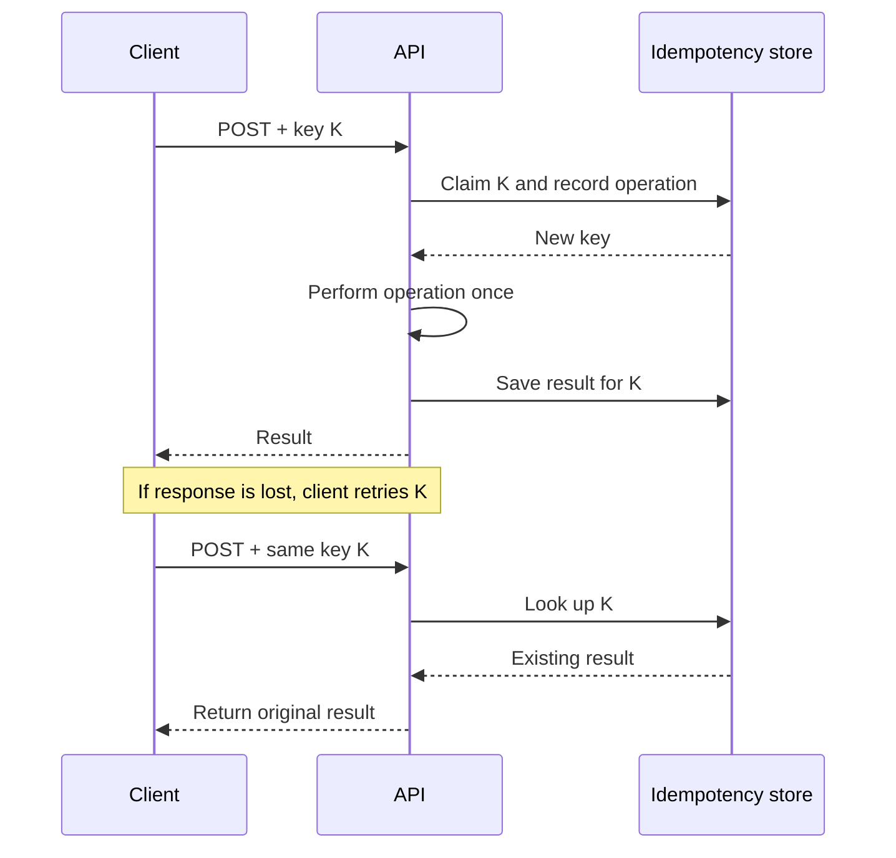

# 03 · API and data design

[← Course home](../README.md) · [Previous](02-requirements-and-estimates.md) · [Next →](04-scaling-and-caching.md)

## 1. Design the contract from user actions

An API is a contract: operations, inputs, outputs, errors, authorization, and evolution rules. Start with the caller’s job, then define behavior precisely. Example:

```http
POST /v1/posts
Authorization: Bearer <token>
Idempotency-Key: 8c3...
Content-Type: application/json

{"text":"A useful design note","visibility":"followers"}
```

```json
{
  "id": "post_7f2...",
  "created_at": "2026-10-11T12:00:00Z",
  "status": "published"
}
```

Document whether the response means “stored,” “visible to all readers,” or merely “accepted for processing.” Use pagination for collections; cursor pagination generally behaves better than large offsets as datasets grow and rows are inserted. Define stable ordering and what happens if an item disappears between pages.

## 2. Model invariants before tables

An **invariant** is a condition the product requires to remain true. Examples: a payment has at most one successful capture; a user cannot read another user’s private object; a post ID is unique. Identify which component is authoritative for each invariant. If two services can independently write the same fact, define how conflicts are resolved.

Example relational model for a follower feed:

```text
User(user_id PK, created_at, ...)
Follow(follower_id, followed_id, created_at,
       PK(follower_id, followed_id), index(followed_id, created_at))
Post(post_id PK, author_id, created_at, visibility, body, ...,
     index(author_id, created_at DESC))
FeedEntry(viewer_id, post_id, author_id, created_at,
          PK(viewer_id, post_id), index(viewer_id, created_at DESC))
```

The same data can be modeled differently for different access patterns. Ask which queries must be cheap and which can be computed or delayed. A normalized source of truth plus a derived feed is one option; storing a precomputed feed creates another consistency and repair problem.

## 3. Choose consistency per operation

Consistency is not a single system-wide switch. Define the user-visible guarantee per operation:

| Operation | Example expectation |
|---|---|
| Update display name | Other regions may see the change shortly after |
| Reserve scarce inventory | Do not confirm more units than exist |
| Read own new post | Read-your-writes is desirable |
| View public reaction count | A small delay is acceptable |

“Eventually consistent” should say what converges, under what assumptions, and what the user sees before convergence. “Strongly consistent” should identify the scope (record, partition, transaction) and its availability/latency costs.

## 4. Idempotency and retries

Networks fail ambiguously: a client can time out after the server committed a write. Retrying a non-idempotent request may create duplicates. An idempotency key lets a server recognize repeated attempts:



Define key scope, retention, conflict behavior when the same key is reused with a different request body, and what happens if the operation is still in progress.

## 5. Schema and API evolution

Prefer additive changes first: add an optional field, deploy readers that tolerate it, then write it. For removals or renames, support both forms during a migration. A safe rollout often has expand → migrate → contract phases. Keep clients backward-compatible where old versions remain active; database migration safety is part of API design.

### Knowledge check

1. What exact problem does an idempotency key solve, and what does it not solve?
2. Why should an index be justified by a query pattern?
3. Describe one invariant that should be enforced transactionally.

<details><summary>Suggested answers</summary>

1. It makes repeated attempts for the same logical operation return/reuse the original outcome; it does not guarantee exactly-once effects across arbitrary downstream systems.
2. Indexes consume storage and write work; designing indexes without query patterns wastes resources or misses important queries.
3. For example, a transfer must debit and credit accounts as one atomic state change, subject to the chosen ledger model.

</details>

[Continue to Lesson 04 →](04-scaling-and-caching.md)
