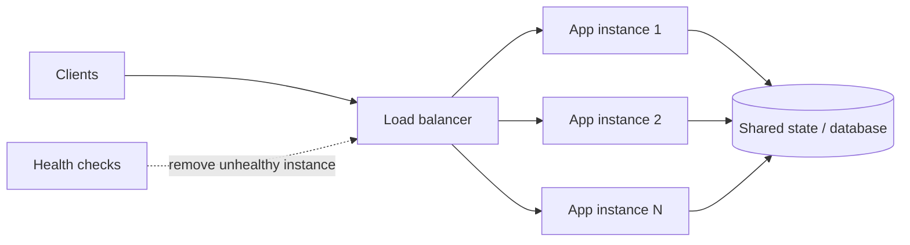
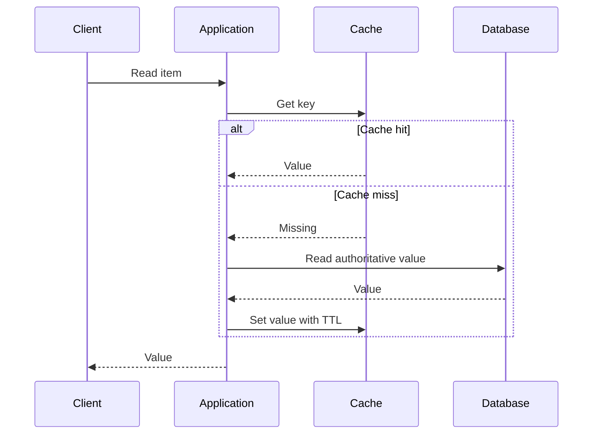
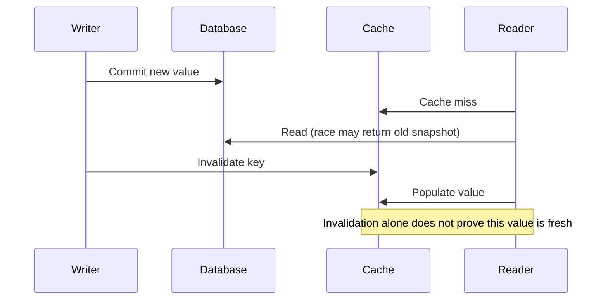
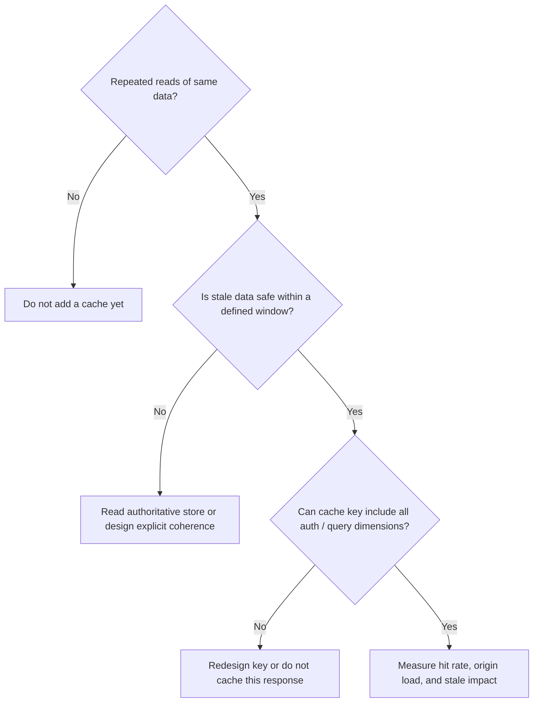

# 04 · Scaling, load balancing, and caching

[← Course home](../README.md) · [Previous](03-api-and-data-design.md) · [Next →](05-distributed-systems.md)

## 1. Scale the constrained resource

Vertical scaling adds resources to one machine and is often the simplest first step. Horizontal scaling adds instances and requires the workload to be distributable. Stateless application processes are usually easy to replicate; shared mutable state is not. Before scaling out, profile CPU, memory, storage I/O, lock contention, network, and downstream limits.



Load balancing distributes traffic; it does not create database capacity or make stateful sessions safe. Health checks should distinguish “process is alive” from “instance can serve this request.” Aggressive health checks can evict healthy instances during shared dependency incidents.

## 2. Cache as a derived copy

A cache stores a copy optimized for reuse, not a source of truth by default. The basic cache-aside flow reads cache, falls back to storage, then populates the cache:



Choose a policy based on semantics: TTL bounds stale duration but does not ensure correctness within that duration. Write-through or explicit invalidation can reduce staleness but add coordination. Cache keys must include identity/authorization dimensions when data visibility differs.

### Common cache failure modes

- **Cold start:** most lookups miss after a restart or deployment.
- **Stampede:** many callers recompute one expired hot key simultaneously.
- **Hot key:** one key overloads a cache shard despite moderate aggregate traffic.
- **Unbounded cardinality:** rarely reused keys evict useful entries and consume memory.
- **Stale authorization:** user-specific content is served under an incomplete key.

Mitigations include request coalescing, jittered expiration, bounded admission, replication/partitioning, and correct cache-key design. Each has costs; measure hit rate and backend load rather than assuming the cache helps.

## 3. Read and write scaling

Read replicas can offload reads when replication lag is acceptable. Route “read your write” operations to the primary or use a consistency token if product semantics require it. Write scaling may need batching, partitioning, schema changes, or workload redesign; adding read replicas usually does not solve primary write saturation.

Partitioning by a key distributes records. A good key balances traffic, keeps common queries local, and can evolve as volume grows. User ID is often a simple starting point; a famous user, tenant, or time range can still become a hotspot. Range partitioning helps range scans but can concentrate recent writes.

## 4. A scaling diagnostic

```text
Symptom                         First question
CPU saturated                   Is work expensive, duplicated, or unevenly routed?
Database read I/O saturated     Which query/index is responsible? Can it be cached?
Database write I/O saturated    What is the write pattern, transaction scope, and hot key?
Queue age increasing            Is consumer capacity below arrival rate? Is a poison item stuck?
Tail latency rising              Which dependency dominates p95/p99? Are retries multiplying load?
```

Scale only after identifying the resource and preserving the required data guarantees.

### 4.1 Load-balancing policy is a workload choice

- **Round robin** is simple when instances have similar capacity and request cost.
- **Least outstanding requests** can help when request durations vary, but it requires accurate in-flight accounting.
- **Consistent hashing** can keep related keys on the same cache/storage node and reduce remapping when membership changes, but skewed keys still create hot spots.
- **Locality-aware routing** can reduce latency and data-transfer cost, but may send too much traffic to one region if routing fails to consider remaining capacity.

Health checks should be cheap, frequent enough to detect a real dead instance, and not fail every instance just because one shared downstream system is degraded. Liveness asks “should this process be restarted?” Readiness asks “should it receive new work?” Conflating them can cause restart storms.

### 4.2 Cache write policies and stale windows

| Policy | Write sequence | Useful when | Main risk |
|---|---|---|---|
| Cache-aside | App writes DB; later invalidates or expires cache | General-purpose, read-heavy data | Stale value or cache stampede |
| Write-through | App writes cache and DB as part of its write path | Hot data needs immediate cache refresh | More write latency; dual-system consistency |
| Write-behind | App writes cache; persistence happens later | Specialized high-throughput workloads | A cache failure may lose acknowledged data |

For cache-aside, “write database then delete key” has a race: an overlapping reader may load the old DB value and repopulate the cache after invalidation. Versioned cache values, short TTLs, serialized updates, or event-driven invalidation can reduce the stale window. Pick based on how damaging stale data is; for authorization or financial state, bypassing the cache may be the correct design.



### 4.3 Read/write amplification

One logical request can cause multiple physical operations: an index lookup plus table fetch, replica reads, cache refresh, or fan-out to many recipients. Count **work per user operation**, not just API calls. A single feed publish with 500,000 followers can translate to hundreds of thousands of writes. Batching reduces overhead but increases delay and batch-failure complexity.

When increasing concurrency, check downstream connection pools and limits. If each of 100 app instances can open 200 database connections, the database may see 20,000 connections after a rollout. Cap per-instance pools and size them from database capacity, queueing, and request concurrency.

### 4.4 A practical cache decision tree



### Knowledge check

1. What workload does a read replica address, and what problem can lag create?
2. Why can a cache increase complexity without reducing backend load?
3. What should be checked before adding application instances?

<details><summary>Suggested answers</summary>

1. It offloads read traffic; lag can make recent writes appear missing or stale.
2. Poor reuse, unbounded keys, wrong invalidation, or a stampede can keep origin traffic high and make behavior harder to reason about.
3. Whether compute is the bottleneck and whether processes are stateless / downstream systems can handle additional traffic.

</details>

[Continue to Lesson 05 →](05-distributed-systems.md)
