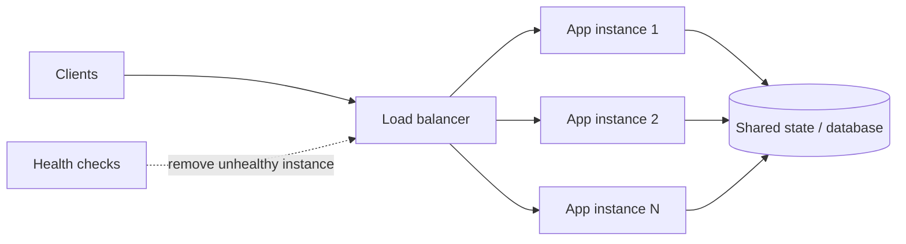
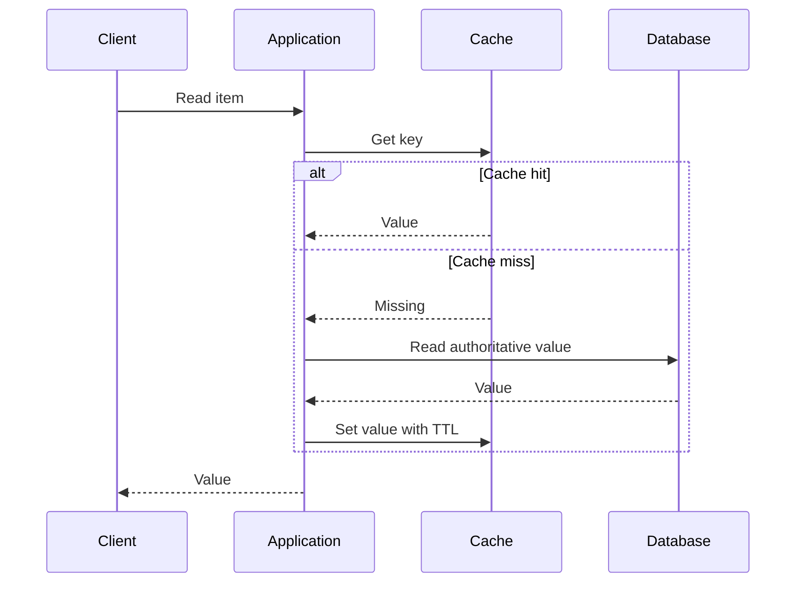

# 04 · Scaling, load balancing, and caching

[← Course home](../README.md) · [Previous](03-api-and-data-design.md) · [Next →](05-distributed-systems.md)

## 1. Scale the constrained resource

Vertical scaling adds resources to one machine and is often the simplest first step. Horizontal scaling adds instances and requires the workload to be distributable. Stateless application processes are usually easy to replicate; shared mutable state is not. Before scaling out, profile CPU, memory, storage I/O, lock contention, network, and downstream limits.



Load balancing distributes traffic; it does not create database capacity or make stateful sessions safe. Health checks should distinguish “process is alive” from “instance can serve this request.” Aggressive health checks can evict healthy instances during shared dependency incidents.

## 2. Cache as a derived copy

A cache stores a copy optimized for reuse, not a source of truth by default. The basic cache-aside flow reads cache, falls back to storage, then populates the cache:



Choose a policy based on semantics: TTL bounds stale duration but does not ensure correctness within that duration. Write-through or explicit invalidation can reduce staleness but add coordination. Cache keys must include identity/authorization dimensions when data visibility differs.

### Common cache failure modes

- **Cold start:** most lookups miss after a restart or deployment.
- **Stampede:** many callers recompute one expired hot key simultaneously.
- **Hot key:** one key overloads a cache shard despite moderate aggregate traffic.
- **Unbounded cardinality:** rarely reused keys evict useful entries and consume memory.
- **Stale authorization:** user-specific content is served under an incomplete key.

Mitigations include request coalescing, jittered expiration, bounded admission, replication/partitioning, and correct cache-key design. Each has costs; measure hit rate and backend load rather than assuming the cache helps.

## 3. Read and write scaling

Read replicas can offload reads when replication lag is acceptable. Route “read your write” operations to the primary or use a consistency token if product semantics require it. Write scaling may need batching, partitioning, schema changes, or workload redesign; adding read replicas usually does not solve primary write saturation.

Partitioning by a key distributes records. A good key balances traffic, keeps common queries local, and can evolve as volume grows. User ID is often a simple starting point; a famous user, tenant, or time range can still become a hotspot. Range partitioning helps range scans but can concentrate recent writes.

## 4. A scaling diagnostic

```text
Symptom                         First question
CPU saturated                   Is work expensive, duplicated, or unevenly routed?
Database read I/O saturated     Which query/index is responsible? Can it be cached?
Database write I/O saturated    What is the write pattern, transaction scope, and hot key?
Queue age increasing            Is consumer capacity below arrival rate? Is a poison item stuck?
Tail latency rising              Which dependency dominates p95/p99? Are retries multiplying load?
```

Scale only after identifying the resource and preserving the required data guarantees.

### Knowledge check

1. What workload does a read replica address, and what problem can lag create?
2. Why can a cache increase complexity without reducing backend load?
3. What should be checked before adding application instances?

<details><summary>Suggested answers</summary>

1. It offloads read traffic; lag can make recent writes appear missing or stale.
2. Poor reuse, unbounded keys, wrong invalidation, or a stampede can keep origin traffic high and make behavior harder to reason about.
3. Whether compute is the bottleneck and whether processes are stateless / downstream systems can handle additional traffic.

</details>

[Continue to Lesson 05 →](05-distributed-systems.md)
