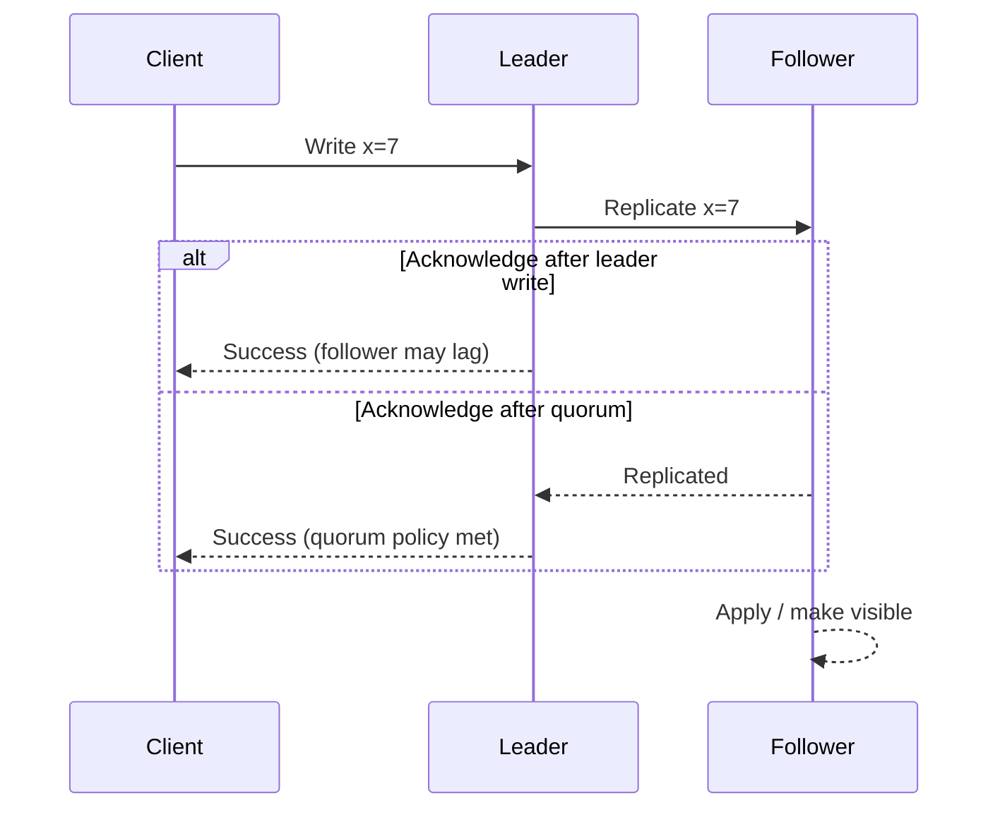
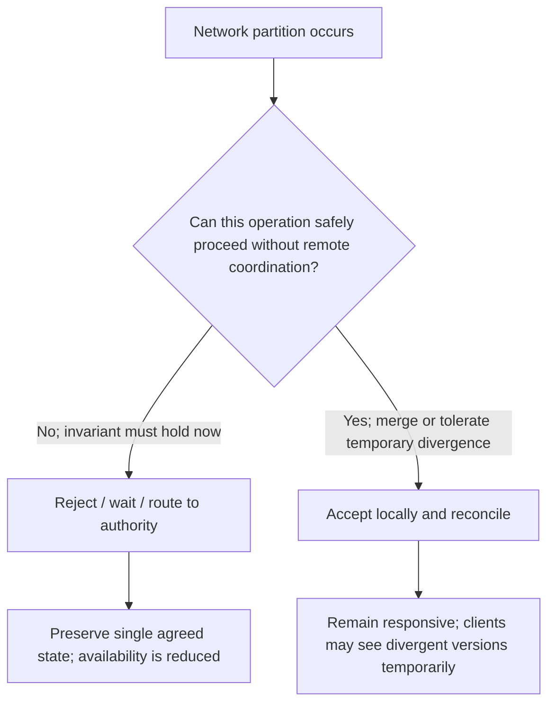

# 05 · Distributed systems fundamentals

[← Course home](../README.md) · [Previous](04-scaling-and-caching.md) · [Next →](06-reliability.md)

## 1. A network call is uncertain

Two machines do not share a clock or memory. A timeout means the caller did not observe a response in time; it does **not** prove the remote operation did not happen. Messages may be delayed, duplicated, reordered, or lost. Processes can pause and resume. Disks can fail independently of processes. Designs need explicit timeout, retry, deduplication, and recovery behavior.

## 2. Replication

Replication keeps copies of data to improve availability, read capacity, or geographic locality. It introduces the question: when is a write acknowledged, and which copies have observed it?

The diagram simplifies real protocols. A quorum is a configured acknowledgement threshold, not a magical guarantee; durability and consistency depend on membership, failure detection, storage, and recovery behavior. Replication is not backup: accidental deletion can replicate too.

## 3. Partitioning and shard keys

Partitioning splits data across nodes. A hash key distributes items but makes ordered range queries harder. A range key supports ranges but risks concentrating current writes. A composite key can balance both. Choosing a shard key is choosing which queries are cheap and where hot spots can occur.

Before partitioning, inspect whether one well-indexed database and bounded workload meet the target. Partitioning complicates transactions, joins, uniqueness, resharding, and operations. Keep a migration path: mapping versions, backfill strategy, dual-read/dual-write risks, and rollback criteria.

## 4. Ordering and time

Wall clocks drift; timestamps from separate machines do not define a perfect global order. If order matters, define its scope: per account, per conversation, per partition, or globally. A single global sequencer is simple conceptually but can limit availability and throughput. Per-entity sequence numbers often give enough order for a product workflow.

## 5. Consistency, availability, and partition tolerance

In an asynchronous network, a partition can prevent nodes from learning whether another node is slow or unreachable. During that uncertainty, a distributed service may favor rejecting/pausing some operations to preserve a consistent view, or accept some operations and reconcile later. The product operation determines the acceptable choice; the slogan alone does not choose the architecture.

## 6. “Exactly once” needs careful wording

End-to-end exactly-once effects are difficult because a sender may not know whether a receiver committed before a connection failed. Common practical design: at-least-once delivery plus idempotent processing, deduplication keys, and transactional state/outbox boundaries. Be precise about the effect guaranteed and the scope of the transaction.

### 6.1 Consistency is a user-visible contract

| Guarantee | Meaning | Example use |
|---|---|---|
| Strong / linearizable read | A read behaves as if it occurred atomically after the latest completed write in the defined scope | Check whether a scarce resource is still available |
| Read-your-writes | A client that wrote a value can subsequently observe that value | Show a newly edited profile to its owner |
| Monotonic reads | A client does not move backward to an older version after seeing a newer one | Avoid a feed appearing to “unsee” a recent item |
| Eventual convergence | Replicas converge if updates stop and communication/recovery succeeds | Approximate public counters or derived search data |

These guarantees can be scoped per key, entity, partition, session, or transaction. A system can offer strong writes on a primary and stale-tolerant reads from replicas; it can offer read-your-writes through session routing without making every global read linearizable. Ask what the user notices, not only what the database advertises.

### 6.2 A more precise view of CAP

During a network partition, two groups of nodes cannot communicate reliably. For a given operation, a service cannot always both accept conflicting updates independently on both sides and guarantee every response reflects one single real-time order. It must define which operations reject/block and which may accept work that later needs reconciliation. CAP is specifically about behavior under partition, not a blanket ranking of “CP databases” versus “AP databases.”

The decision may differ by feature: a collaborative draft can accept concurrent edits, while a single-use coupon redemption may reject when it cannot check authoritative state.

### 6.3 Leader-based and multi-leader writes

A single leader simplifies ordering and conflict handling but creates a failover and capacity concern. Multi-leader writes improve regional autonomy, yet concurrent changes can conflict. Conflict policies—last-writer-wins, field merge, CRDT operation, or user resolution—have different semantics. Timestamps alone are dangerous for conflict resolution when clocks drift; use explicit versions, causal metadata, or a domain-specific merge rule.

### 6.4 Partitioning details: hash, range, and virtual shards

- **Hash partitioning** spreads uniformly distributed keys, but range queries cross partitions.
- **Range partitioning** makes ordered scans local, but monotonically increasing keys can overload the newest range.
- **Virtual shards** map many logical buckets onto fewer physical nodes, making gradual movement easier than moving one huge partition at once.

Resharding is a data migration, not merely a routing config change. Define who owns a key during transition, how in-flight writes are routed, how data is copied and verified, when reads switch, and how rollback works. Dual-writing without a source-of-truth rule can create permanent divergence.

### 6.5 Failure detection is suspicion

A timeout cannot distinguish a crashed server from a slow network or a long pause. Distributed systems therefore use failure detectors that express suspicion, then protocols (leases, epochs/terms, quorum votes) prevent two nodes from both acting as current leader. Fencing tokens or monotonically increasing epochs can stop a former leader from writing after a replacement takes over.

### Knowledge check

1. Does a request timeout prove that a write failed?
2. What is the difference between replication and backup?
3. Give an example where per-entity ordering is sufficient and global ordering is unnecessary.

Suggested answers

1. No; the server may have committed while the response was delayed or lost.
2. Replication copies current state for availability/capacity; backup preserves recoverable history against corruption, deletion, or disaster.
3. Ordering messages within one chat conversation or ledger account.

## Worked example: a timeout does not tell you whether a write happened

A service sends `CreateOrder` to a remote dependency and receives no response before its deadline. Two histories are consistent with that observation: the remote side never committed the order, or it committed and the reply was lost. The caller cannot safely infer either outcome from the timeout alone.

Represent the operation with a stable identifier and make the receiver deduplicate that identifier durably. On retry, the receiver returns the original outcome instead of repeating the side effect. If the receiver cannot provide idempotency, add a query or reconciliation path that can discover the result before another attempt. A short-lived in-memory deduplication cache is insufficient if retries can outlive a process restart.

Keep the timeout and retry policy bounded. Use backoff and jitter to avoid synchronized retry waves, propagate the original deadline, and distinguish a retryable transport error from a definitive business rejection. The end-to-end guarantee depends on every boundary preserving the identifier and outcome; a single non-idempotent downstream call can still duplicate work.

**Design drill:** draw the two possible histories, label what each participant knows, and mark the durable record that resolves the ambiguity. Then state the behavior if that record is unavailable.

[Continue to Lesson 06 →](06-reliability.md)
