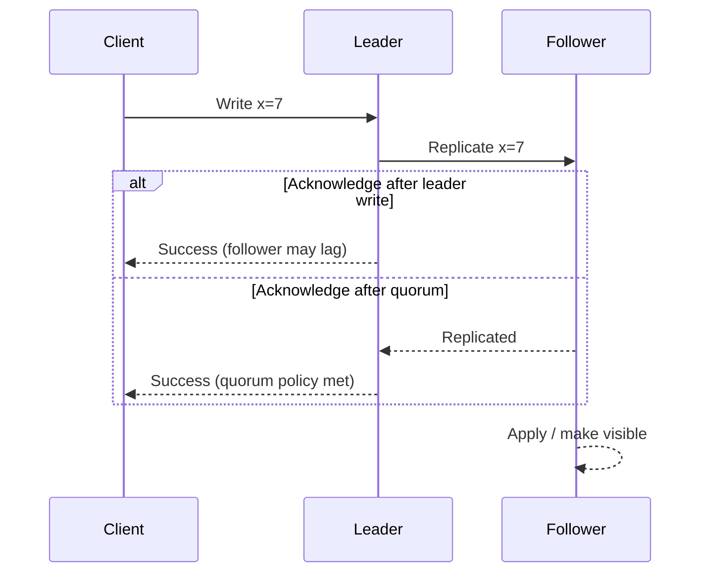

# 05 · Distributed systems fundamentals

[← Course home](../README.md) · [Previous](04-scaling-and-caching.md) · [Next →](06-reliability.md)

## 1. A network call is uncertain

Two machines do not share a clock or memory. A timeout means the caller did not observe a response in time; it does **not** prove the remote operation did not happen. Messages may be delayed, duplicated, reordered, or lost. Processes can pause and resume. Disks can fail independently of processes. Designs need explicit timeout, retry, deduplication, and recovery behavior.

## 2. Replication

Replication keeps copies of data to improve availability, read capacity, or geographic locality. It introduces the question: when is a write acknowledged, and which copies have observed it?

The diagram simplifies real protocols. A quorum is a configured acknowledgement threshold, not a magical guarantee; durability and consistency depend on membership, failure detection, storage, and recovery behavior. Replication is not backup: accidental deletion can replicate too.

## 3. Partitioning and shard keys

Partitioning splits data across nodes. A hash key distributes items but makes ordered range queries harder. A range key supports ranges but risks concentrating current writes. A composite key can balance both. Choosing a shard key is choosing which queries are cheap and where hot spots can occur.

Before partitioning, inspect whether one well-indexed database and bounded workload meet the target. Partitioning complicates transactions, joins, uniqueness, resharding, and operations. Keep a migration path: mapping versions, backfill strategy, dual-read/dual-write risks, and rollback criteria.

## 4. Ordering and time

Wall clocks drift; timestamps from separate machines do not define a perfect global order. If order matters, define its scope: per account, per conversation, per partition, or globally. A single global sequencer is simple conceptually but can limit availability and throughput. Per-entity sequence numbers often give enough order for a product workflow.

## 5. Consistency, availability, and partition tolerance

In an asynchronous network, a partition can prevent nodes from learning whether another node is slow or unreachable. During that uncertainty, a distributed service may favor rejecting/pausing some operations to preserve a consistent view, or accept some operations and reconcile later. The product operation determines the acceptable choice; the slogan alone does not choose the architecture.

## 6. “Exactly once” needs careful wording

End-to-end exactly-once effects are difficult because a sender may not know whether a receiver committed before a connection failed. Common practical design: at-least-once delivery plus idempotent processing, deduplication keys, and transactional state/outbox boundaries. Be precise about the effect guaranteed and the scope of the transaction.

### Knowledge check

1. Does a request timeout prove that a write failed?
2. What is the difference between replication and backup?
3. Give an example where per-entity ordering is sufficient and global ordering is unnecessary.

Suggested answers

1. No; the server may have committed while the response was delayed or lost.
2. Replication copies current state for availability/capacity; backup preserves recoverable history against corruption, deletion, or disaster.
3. Ordering messages within one chat conversation or ledger account.

[Continue to Lesson 06 →](06-reliability.md)
