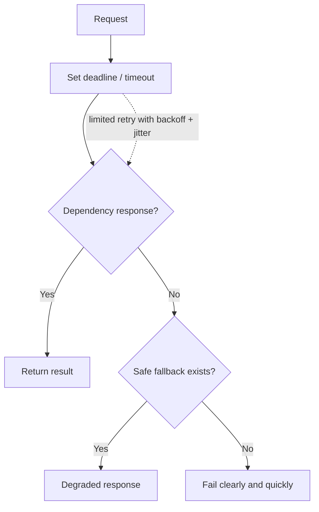

# 06 · Reliability and fault tolerance

[← Course home](../README.md) · [Previous](05-distributed-systems.md) · [Next →](07-queues-and-events.md)

## 1. Define the promise

**Availability** asks whether a service is usable when needed. **Reliability** includes correct behavior over time. **Durability** asks whether acknowledged data survives failures. These are related, not interchangeable.

An SLI is a measured indicator; an SLO is the target for that indicator; an SLA is an external commitment with consequences. Example SLI: successful eligible requests / total eligible requests. An availability target of 99.9% over 30 days allows roughly 43 minutes of error budget (30 × 24 × 60 × 0.001). Define how planned maintenance, client errors, and dependencies are counted.

## 2. Fail in bounded ways

Retries can amplify an outage. Retry only transient failures, bound attempts, use exponential backoff with jitter, and stay within the end-to-end deadline. Avoid retrying at every layer: three attempts at three layers can create 27 downstream calls for one user action.

## 3. Isolation and graceful degradation

Bulkheads isolate resource pools so one slow dependency cannot consume all workers. Circuit breakers temporarily stop calls likely to fail, then probe recovery. Rate limits protect capacity and fairness. These mechanisms need observable state and carefully chosen thresholds; a breaker that never resets creates an outage of its own.

Graceful degradation preserves the most valuable behavior. A storefront may show cached catalog data while recommendations are unavailable, but must not claim a payment succeeded when it did not. Decide which features can be stale, omitted, or queued before an incident.

## 4. Backups, recovery, and deployment

Reliability includes restore, not just redundancy. Document backup frequency, retention, encryption, restore validation, and recovery-point objective (RPO: tolerable data loss) / recovery-time objective (RTO: tolerable downtime). A backup that has never been restored is an assumption.

Use health-gated and gradual deployments where possible. Canary or blue/green rollout reduces blast radius but requires compatibility across versions. Database migrations should be reversible or forward-recoverable. Define rollback triggers from user-facing metrics, not only process health.

## 5. Failure analysis table

| Failure | User impact | Detection | Mitigation / recovery |
|---|---|---|---|
| App instance exits | Some requests fail | Error rate, health check | Remove instance, replace, inspect crash |
| Primary database unavailable | Reads/writes may fail | Dependency probes, SLO burn | Failover if safe; preserve writes; recover |
| Queue consumer stops | Work delayed | Oldest-message age | Restore consumers, control backlog, replay |
| Bad deployment | Broad incorrect behavior | SLOs, canary comparison | Stop rollout, rollback or forward-fix |
| Region loss | Regional users impacted | Synthetic probes | Fail over with data-loss / consistency policy |

### Knowledge check

1. If a service’s SLO error budget is exhausted, what should change in engineering priorities?
2. Why can retries worsen a dependency outage?
3. Define RPO and RTO in your own words.

Suggested answers

1. Prioritize reliability work and reduce risky changes until the service is back within its reliability target.
2. Retries add traffic to an already saturated dependency and can multiply load across layers.
3. RPO is how much recent data loss is tolerable; RTO is how long recovery may take.

[Continue to Lesson 07 →](07-queues-and-events.md)
