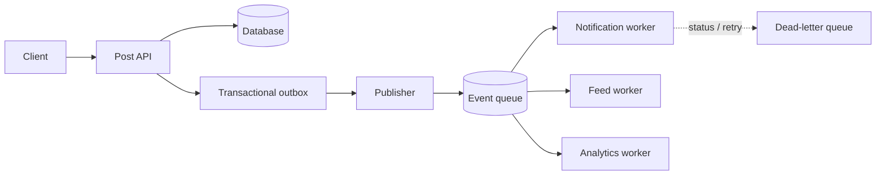
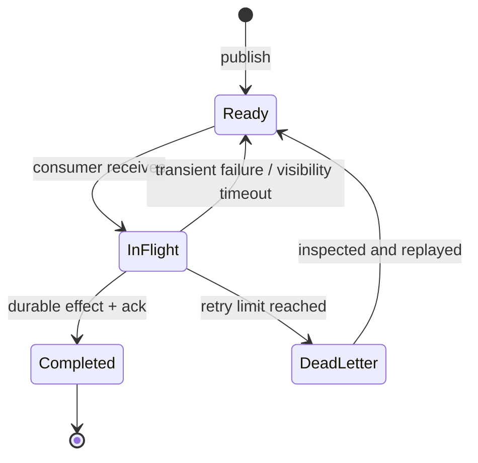

# 07 · Queues and event-driven architecture

[← Course home](../README.md) · [Previous](06-reliability.md) · [Next →](08-security-observability.md)

## 1. Why move work off the request path?

Suppose a user publishes a post. Persisting the post is required before success; resizing images, notifying followers, and updating analytics may happen after. An asynchronous queue can smooth bursts, isolate slower consumers, and let the request return sooner—but the side effects are no longer immediately complete.



## 2. The dual-write problem and outbox

Writing a database row and publishing an event are two separate operations. If the row commits but publication fails, consumers never hear about it. If publication succeeds and the row rolls back, consumers act on nonexistent state. A **transactional outbox** writes the business change and an event record in the same local transaction; a publisher later delivers unsent records. Consumers still need idempotency because delivery may repeat.

## 3. Delivery semantics and processing

- **At-most-once:** a message is delivered zero or one time; loss is possible.
- **At-least-once:** it is retried until acknowledged; duplicates are possible.
- **Effectively-once outcome:** duplicates are made harmless through a stable event ID, deduplication, and atomic state changes at the consumer.

Consumers should acknowledge only after durable processing or after safely recording work for later. A poison message should not block an entire partition indefinitely: bound retries, isolate it, alert, and provide a controlled replay path.

## 4. Queue capacity and backlog

Let arrival rate be λ messages/second and sustainable service rate be μ messages/second. A backlog grows while λ > μ. If a 300,000-message backlog is drained at a net 500 messages/second (consumer capacity minus ongoing arrivals), catch-up takes about 600 seconds. If consumers retry failures indefinitely, effective μ may fall below λ. Track oldest message age, not just queue depth: a large queue of fresh events differs from a small queue with one very old blocked partition.

```text
Queue depth
 300k |       /\       burst adds work faster than workers consume
 200k |      /  \      backlog drains only when net capacity is positive
 100k | ____/    \____
    0 +------------------------------> time
```

## 5. Event schema and ordering

Events are contracts between independently deployed producers and consumers. Include stable IDs, entity IDs, event type, schema version, occurrence time, and enough context to process reliably. Avoid leaking sensitive payload fields to broad consumers. Prefer additive evolution and tolerate unknown fields. Partition by the entity whose events need ordering; do not promise a global order unless the product needs it.

### 5.1 Queue versus event log

The terms overlap in products, but the design intent differs:

| Concern | Work queue | Append-only event log |
|---|---|---|
| Typical intent | A worker claims a task and completes it | Multiple consumer groups independently read a durable sequence |
| Consumption | Often one worker handles a given task | Each group tracks its own offset |
| Replay | Usually explicit retry/dead-letter flow | Re-read retained history by resetting offsets |
| Best fit | Email send, image resize, export job | Domain events, activity stream, change data feed |
| Main question | Is the task completed and acknowledged? | How long is history retained and how is replay made safe? |

The same platform may support both patterns. Choose based on replay, ordering, retention, ownership, and consumer isolation—not on the product label.

### 5.2 Message lifecycle and acknowledgement



If a worker crashes after the effect commits but before acknowledgement, the broker may redeliver. Store a processed-event ID in the same transaction as the consumer’s state change when possible. If the effect is external (e.g., send a payment request), pass an idempotency key to that provider or model a durable pending/confirmed state machine.

### 5.3 Backlog sizing and catch-up

If arrival rate is 800 events/s and current consumers process 1,000 events/s, net drain capacity is only 200 events/s. A 120,000-event backlog takes about 600 seconds to drain, assuming arrivals remain at 800/s and processing costs remain stable. Scaling workers helps only until the database, provider, partition count, or rate limit becomes the bottleneck. Scaling consumers without a downstream budget can turn delayed work into a cascading outage.

```text
Queue age / backlog response plan
  normal     → monitor arrivals, completions, oldest age
  growing    → locate slow consumer / hot partition / retry loop
  critical   → shed low-priority producers, add safe capacity
  recovered  → drain gradually, protect dependencies, verify side effects
```

### 5.4 Ordering, partitions, and poison events

Ordering is typically guaranteed only within a partition or key. If events for one account must remain ordered, key by account ID; then one unusually active account can become a hot partition. If work is independent, spread keys more evenly. Dead-lettering prevents one poison event from blocking progress, but it creates an obligation: alert, inspect, repair, and replay. Silently parking messages is data loss from the user’s perspective.

### 5.5 Outbox publishing choices

An outbox publisher can poll rows or tail a change stream. Polling is easy to understand but creates query load and a cleanup/locking policy. Change-data capture can reduce polling but adds operational and schema-evolution dependencies. In either approach track the age of the oldest unpublished event, publisher lag, duplicate rate, and outbox growth. Retain enough information to replay safely, then prune only after a defined retention period.

### 5.6 Event design example

```json
{
  "event_id": "evt_01J...",
  "event_type": "post.published",
  "schema_version": 2,
  "occurred_at": "2026-10-11T12:00:00Z",
  "aggregate": {"type": "post", "id": "post_7f2", "version": 18},
  "data": {"author_id": "user_42", "visibility": "followers"}
}
```

An event is a fact that happened, not necessarily a command telling a consumer what to do. Keep payloads minimal and avoid embedding rapidly changing profile fields if consumers can resolve them safely. Version event schemas explicitly; do not reuse an event type with an incompatible meaning.

### Knowledge check

1. Why does a queue not automatically make a side effect “exactly once”?
2. What atomicity gap does the outbox pattern address?
3. Why is oldest-message age useful to monitor?

<details><summary>Suggested answers</summary>

1. Delivery can repeat after ambiguous acknowledgements; consumers must deduplicate or make effects idempotent.
2. It ensures a committed local state change and the intent to publish are recorded together.
3. Queue depth alone does not show how long the oldest work has waited or whether one partition is stuck.

</details>

[Continue to Lesson 08 →](08-security-observability.md)
