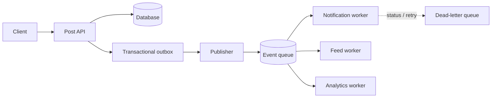

# 07 · Queues and event-driven architecture

[← Course home](../README.md) · [Previous](06-reliability.md) · [Next →](08-security-observability.md)

## 1. Why move work off the request path?

Suppose a user publishes a post. Persisting the post is required before success; resizing images, notifying followers, and updating analytics may happen after. An asynchronous queue can smooth bursts, isolate slower consumers, and let the request return sooner—but the side effects are no longer immediately complete.



## 2. The dual-write problem and outbox

Writing a database row and publishing an event are two separate operations. If the row commits but publication fails, consumers never hear about it. If publication succeeds and the row rolls back, consumers act on nonexistent state. A **transactional outbox** writes the business change and an event record in the same local transaction; a publisher later delivers unsent records. Consumers still need idempotency because delivery may repeat.

## 3. Delivery semantics and processing

- **At-most-once:** a message is delivered zero or one time; loss is possible.
- **At-least-once:** it is retried until acknowledged; duplicates are possible.
- **Effectively-once outcome:** duplicates are made harmless through a stable event ID, deduplication, and atomic state changes at the consumer.

Consumers should acknowledge only after durable processing or after safely recording work for later. A poison message should not block an entire partition indefinitely: bound retries, isolate it, alert, and provide a controlled replay path.

## 4. Queue capacity and backlog

Let arrival rate be λ messages/second and sustainable service rate be μ messages/second. A backlog grows while λ > μ. If a 300,000-message backlog is drained at a net 500 messages/second (consumer capacity minus ongoing arrivals), catch-up takes about 600 seconds. If consumers retry failures indefinitely, effective μ may fall below λ. Track oldest message age, not just queue depth: a large queue of fresh events differs from a small queue with one very old blocked partition.

```text
Queue depth
 300k |       /\       burst adds work faster than workers consume
 200k |      /  \      backlog drains only when net capacity is positive
 100k | ____/    \____
    0 +------------------------------> time
```

## 5. Event schema and ordering

Events are contracts between independently deployed producers and consumers. Include stable IDs, entity IDs, event type, schema version, occurrence time, and enough context to process reliably. Avoid leaking sensitive payload fields to broad consumers. Prefer additive evolution and tolerate unknown fields. Partition by the entity whose events need ordering; do not promise a global order unless the product needs it.

### Knowledge check

1. Why does a queue not automatically make a side effect “exactly once”?
2. What atomicity gap does the outbox pattern address?
3. Why is oldest-message age useful to monitor?

<details><summary>Suggested answers</summary>

1. Delivery can repeat after ambiguous acknowledgements; consumers must deduplicate or make effects idempotent.
2. It ensures a committed local state change and the intent to publish are recorded together.
3. Queue depth alone does not show how long the oldest work has waited or whether one partition is stuck.

</details>

[Continue to Lesson 08 →](08-security-observability.md)
