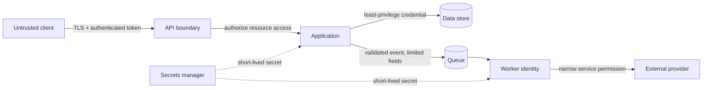
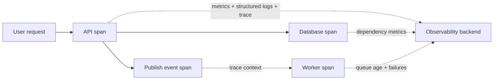
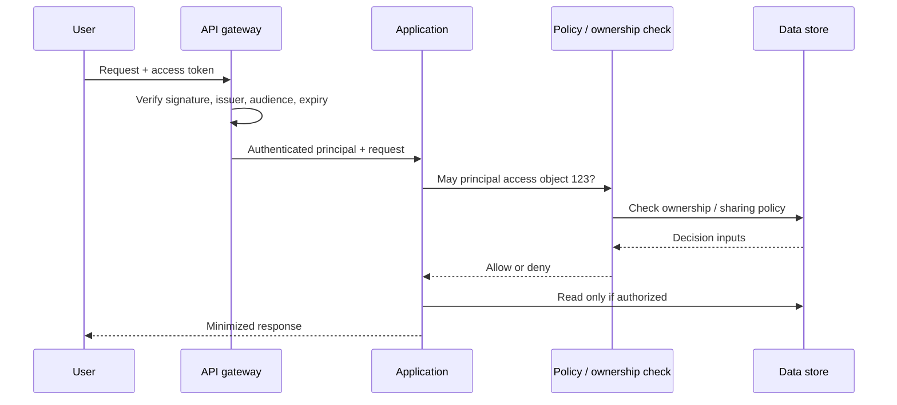

# 08 · Security and observability

[← Course home](../README.md) · [Previous](07-queues-and-events.md) · [Next →](09-design-interview.md)

## 1. Security is an architecture property

Security controls belong at trust boundaries, not only in a final review. Map assets, actors, boundaries, and abuse cases. A public API, worker queue, admin console, and third-party callback all have different identity and input assumptions.



Authentication answers **who**; authorization answers **what may they do to this resource?** Enforce authorization close to the data access and avoid trusting client-provided user IDs without checking ownership. Least privilege limits damage from compromised credentials. Encrypt network paths and stored sensitive data according to the threat model; encryption does not replace access control.

## 2. Threat-model the flow

For each important flow ask:

- What data is sensitive, and where is it copied (logs, caches, backups, events)?
- Can an attacker enumerate IDs, replay requests, inject content, or consume expensive work?
- Which identity does a service use, and what is the minimum permission it needs?
- How are secrets rotated, revoked, and kept out of source control and logs?
- What is the privacy deletion path across primary data and derived stores?

Rate limits, input limits, abuse detection, audit trails, and secure defaults should be tied to actual risks. Do not put tokens, passwords, full payment details, or private message contents in routine logs.

## 3. Observability: answer “what is happening?”

- **Metrics** show aggregate trends and alertable signals (latency percentiles, error rate, saturation, queue age).
- **Logs** explain discrete events with context; use structured fields and a correlation/trace ID.
- **Traces** show a request across components and reveal where latency accumulates.



Measure user-facing SLIs and supporting saturation signals. Alert on actionable symptoms and error-budget burn rather than every transient blip. High-cardinality labels (user ID, request ID) can make metrics prohibitively expensive; put per-request identifiers in logs/traces instead.

## 4. Privacy and retention

Data flow diagrams should include replicas, caches, search indexes, analytics exports, and backups. A deletion promise must specify when data is removed or rendered inaccessible in each store and what backup retention means. Minimize collected data and retention time; fewer sensitive copies means less exposure and simpler deletion.

### 4.1 Threat modeling with STRIDE

STRIDE is a brainstorming aid for threats at a trust boundary; it does not replace a domain-specific security review.

| Threat category | Example in a file-sharing system | Design question |
|---|---|---|
| Spoofing | Attacker impersonates a user or service | How is identity verified, rotated, and scoped? |
| Tampering | Client changes a file ID or event payload | Which component validates integrity and authorization? |
| Repudiation | User denies a sensitive administrative action | Which minimal, protected audit record is retained? |
| Information disclosure | Private file leaks through a CDN cache | Does cache keying and authorization match the object’s visibility? |
| Denial of service | Large upload or expensive query exhausts resources | What size, rate, and concurrency limits apply? |
| Elevation of privilege | Worker can access unrelated tenants’ records | Can service identity be restricted to only required actions? |

Map threats to mitigations, owners, and residual risks. A control can introduce its own failure mode: strict rate limits can block legitimate users behind shared NAT; audit logs can become a sensitive data store.

### 4.2 Identity and authorization flow



Authentication at a gateway is useful but does not eliminate object-level authorization. Re-check permissions close to the operation using trusted principal identity. Be careful with time-of-check/time-of-use races when ownership can change between the check and the read/write.

### 4.3 Metrics cardinality and useful labels

Good metric dimensions are bounded: route template, status class, region, dependency, and deployment version. A raw URL, user ID, request ID, or arbitrary error string creates a new time series per value and can overwhelm storage. Put high-cardinality context in sampled traces or structured logs with access and retention controls.

Useful starting RED signals (Rate, Errors, Duration) for each service and USE signals (Utilization, Saturation, Errors) for each resource:

| View | Example metric | Question answered |
|---|---|---|
| User request | p50 / p95 / p99 latency by route | Which user path is slow? |
| Correctness | success and conflict rate | Are valid operations completing? |
| Capacity | CPU, memory, connection pool wait | Which resource is saturated? |
| Async work | oldest event age, retry and dead-letter rate | Is delayed work falling behind? |
| Dependency | timeout rate and latency by dependency | Which downstream is degrading? |

### 4.4 Trace context across asynchronous boundaries

Copy a trace/correlation context into event metadata when publishing, then start a consumer span linked to the producer context. A queue delay may be minutes or hours, so traces need sampling and retention policies; metrics should still represent aggregate lag. Never rely on a trace ID as an authorization secret.

### 4.5 Incident workflow

```text
Detect user impact → establish scope → mitigate blast radius → restore correctness
        ↓                 ↓                    ↓                    ↓
 SLO / synthetic     region / route      shed or rollback       reconcile / replay
```

During an incident, distinguish mitigation from root-cause repair. Capture a timeline, communicate what users experience, and preserve evidence without copying secrets into tickets or chat. Afterward convert findings into a code, test, alert, runbook, or architectural change with an owner.

### Knowledge check

1. Why should authorization include the requested resource, not merely the user identity?
2. Which telemetry signal helps find which dependency consumed a request’s latency?
3. What is one risk of using user ID as a metric label?

<details><summary>Suggested answers</summary>

1. An authenticated user may still not own or have permission to access that resource.
2. A distributed trace with spans across the request path.
3. Very high cardinality can inflate metric storage and cost; it may also expose personal data.

</details>

## Worked example: trace a private download without leaking it

A user requests a private photo through a CDN. The browser is authenticated to the application, but the CDN may not share that session. The application must authorize the user's access before issuing a short-lived signed URL or equivalent capability. The capability should be scoped to the object and action, expire quickly enough for the product's needs, and avoid exposing a reusable account credential.

Decide how cache keys treat authorization. If the CDN caches a private response under a URL that does not distinguish authorized access, one user's content could be served to another. A signed URL can act as a cache key, but its expiry, revocation delay, and logging exposure become part of the security model. Do not put private tokens into analytics, referrer headers, or unredacted request logs.

Trace the request with a non-sensitive correlation ID. Record the authorization decision, policy version, object class, and outcome, but not the image bytes or bearer secret. Alert on abnormal denial or access patterns while keeping labels bounded and retaining sensitive audit data only as long as justified.

**Review check:** follow identity, authorization, cache behavior, logs, and deletion through the entire path. A secure API boundary is not enough if a downstream cache or telemetry sink changes the trust boundary.

[Continue to Lesson 09 →](09-design-interview.md)
