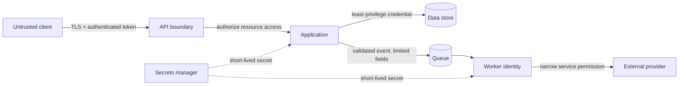
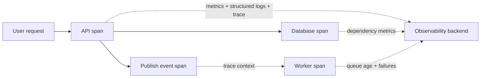

# 08 · Security and observability

[← Course home](../README.md) · [Previous](07-queues-and-events.md) · [Next →](09-design-interview.md)

## 1. Security is an architecture property

Security controls belong at trust boundaries, not only in a final review. Map assets, actors, boundaries, and abuse cases. A public API, worker queue, admin console, and third-party callback all have different identity and input assumptions.

Authentication answers **who**; authorization answers **what may they do to this resource?** Enforce authorization close to the data access and avoid trusting client-provided user IDs without checking ownership. Least privilege limits damage from compromised credentials. Encrypt network paths and stored sensitive data according to the threat model; encryption does not replace access control.

## 2. Threat-model the flow

For each important flow ask:

- What data is sensitive, and where is it copied (logs, caches, backups, events)?
- Can an attacker enumerate IDs, replay requests, inject content, or consume expensive work?
- Which identity does a service use, and what is the minimum permission it needs?
- How are secrets rotated, revoked, and kept out of source control and logs?
- What is the privacy deletion path across primary data and derived stores?

Rate limits, input limits, abuse detection, audit trails, and secure defaults should be tied to actual risks. Do not put tokens, passwords, full payment details, or private message contents in routine logs.

## 3. Observability: answer “what is happening?”

- **Metrics** show aggregate trends and alertable signals (latency percentiles, error rate, saturation, queue age).
- **Logs** explain discrete events with context; use structured fields and a correlation/trace ID.
- **Traces** show a request across components and reveal where latency accumulates.

Measure user-facing SLIs and supporting saturation signals. Alert on actionable symptoms and error-budget burn rather than every transient blip. High-cardinality labels (user ID, request ID) can make metrics prohibitively expensive; put per-request identifiers in logs/traces instead.

## 4. Privacy and retention

Data flow diagrams should include replicas, caches, search indexes, analytics exports, and backups. A deletion promise must specify when data is removed or rendered inaccessible in each store and what backup retention means. Minimize collected data and retention time; fewer sensitive copies means less exposure and simpler deletion.

### Knowledge check

1. Why should authorization include the requested resource, not merely the user identity?
2. Which telemetry signal helps find which dependency consumed a request’s latency?
3. What is one risk of using user ID as a metric label?

Suggested answers

1. An authenticated user may still not own or have permission to access that resource.
2. A distributed trace with spans across the request path.
3. Very high cardinality can inflate metric storage and cost; it may also expose personal data.

[Continue to Lesson 09 →](09-design-interview.md)
