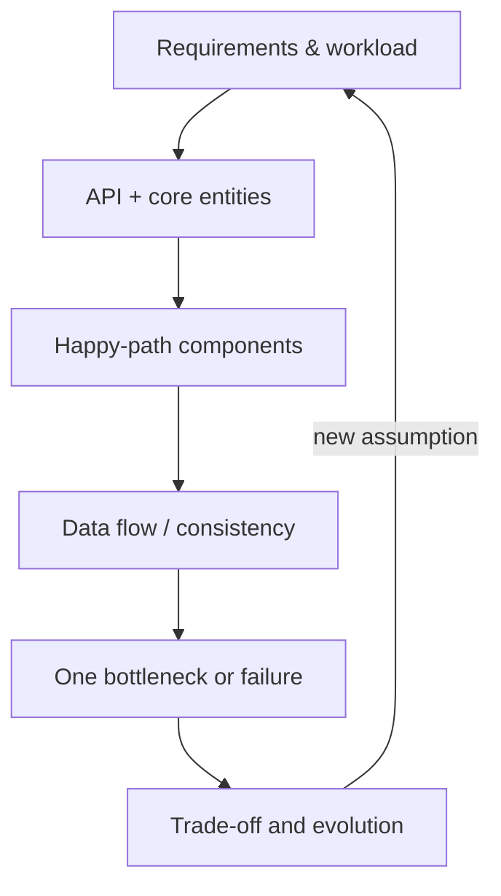
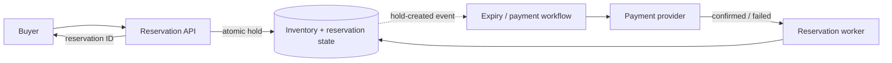
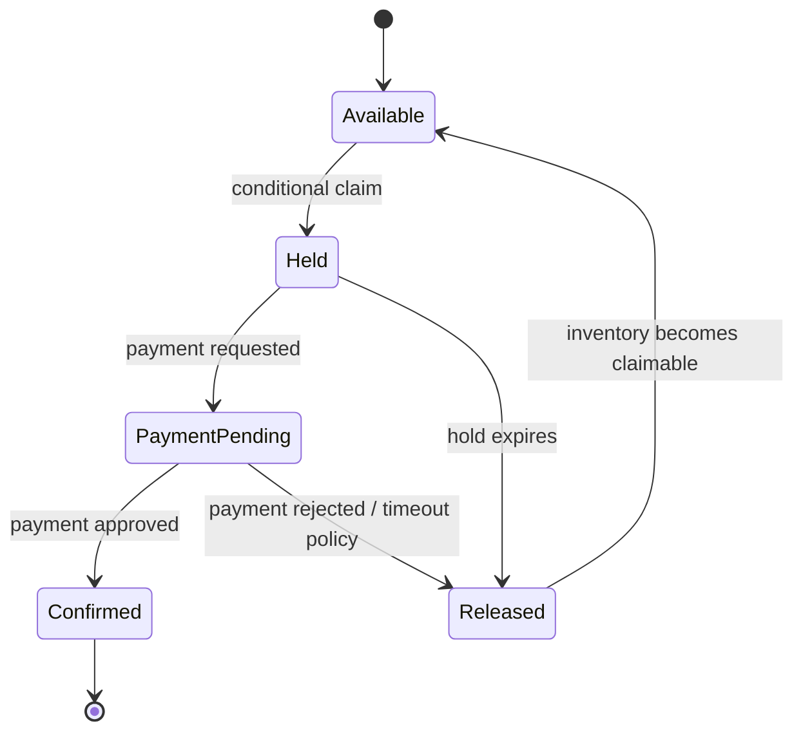

# 09 · A repeatable system design interview

[← Course home](../README.md) · [Previous](08-security-observability.md) · [Next: Storage systems →](10-storage-systems.md)

## The 45-minute structure

The exact interview varies; this is a flexible scaffold, not a script. Ask the interviewer to prioritize if time is short.

| Time | Activity | Deliverable |
|---:|---|---|
| 0–5 min | Clarify users, actions, scope, constraints | Bounded problem statement |
| 5–10 min | Functional and quality requirements; rough scale | Requirement / workload table |
| 10–15 min | API, key entities, invariants | Contracts and data model |
| 15–30 min | High-level architecture and critical path | One legible end-to-end diagram |
| 30–40 min | Bottleneck, failure, consistency, trade-offs | Targeted deep dive |
| 40–45 min | Summarize and identify next evolution | Clear recap and open questions |

## Speak your assumptions

If the prompt leaves traffic unknown, state an assumption and ask whether it is reasonable. Use estimates to guide a design, not to perform arithmetic theater. For example: “I’ll assume reads outnumber writes 20:1, so I’ll first optimize the feed read path; if writes are much heavier, I’d revisit this.”

## Draw in layers

Begin with clients, API, application, and authoritative data. Add cache, queue, replica, search, or partition only when the workload or requirement motivates it. Mark synchronous versus asynchronous boundaries and name the owner of state.

## Deep-dive checklist

- What happens on retry after an ambiguous timeout?
- Which read may be stale, and how stale?
- What is the hottest key or shard? How would you detect it?
- What happens when one dependency slows down or becomes unavailable?
- How does data move to a new schema or partition layout?
- What metrics indicate user impact, saturation, and backlog?
- What does the design cost at average and peak load?

## Communicate trade-offs, not buzzwords

Use: **“Given requirement X, I choose Y because Z; the cost is W; I would revisit it if assumption A changes.”**

Example: “Given that a public post can appear within several seconds, I’ll generate follower feed entries asynchronously. This reduces publish latency and smooths bursts; the cost is feed staleness and replay complexity. For small accounts or a strict freshness path, I can read recent posts directly.”

## Self-review rubric

Score each 0 (missing), 1 (partial), or 2 (clear and justified):

| Area | Evidence of a strong answer |
|---|---|
| Problem framing | Scope, assumptions, and user actions are explicit |
| Workload | Estimates connect to architecture decisions |
| Correctness | Invariants, data ownership, and consistency are stated |
| Architecture | Critical path is clear and components have a reason |
| Resilience | Timeout, retry, failure, and recovery behavior are covered |
| Trade-offs | Costs and alternatives are acknowledged |
| Communication | Diagram and explanation remain structured and legible |

The rubric is for practice, not a universal interviewer scorecard. Review the weakest area and redesign one part with a changed assumption.

## Worked mini-example: ticket reservation

Prompt: “Design a service that lets users reserve a seat for a limited-time event.” The key risk is overselling, not an enormous request rate. State assumptions: seat inventory is scarce; a hold lasts five minutes; payment can fail; users may retry after a timeout.

The inventory store owns the invariant “at most one active hold for a seat.” Create the hold atomically with an expiration. Payment is an external side effect and cannot share a local database transaction; use a state machine such as `HELD → PAYMENT_PENDING → CONFIRMED` or `HELD → EXPIRED/RELEASED`. A delayed expiry job must verify the reservation is still in the expected state before releasing the seat.

### State transitions and idempotency

The payment provider call uses a stable idempotency key. If the API times out after the provider charged the card, query or retry with the same key rather than creating a second charge. The client’s reservation request also needs idempotency so the same user retry does not create multiple holds.

### How to narrate the design

1. “The invariant is no two confirmed reservations for one seat; I’ll enforce the claim with a conditional write/unique constraint.”
2. “I’ll return a hold ID after durable reservation, not after payment settlement; the API contract exposes pending status.”
3. “Payment is outside the database transaction, so I need a recoverable workflow and idempotent provider call.”
4. “I’ll monitor expired holds, payment-pending age, and inventory mismatch; a reconciliation job compares payment and reservation states.”
5. “If contention is high, I’ll measure per-event hot seats and database conflicts before distributing inventory across partitions.”

This small example demonstrates that correctness requirements should determine the architecture before the scale estimate does. A queue is useful for expiry and payment follow-up, but it must not become the authority for whether a seat is still available.

[Continue to Lesson 10 →](10-storage-systems.md) · [Go to labs and capstone →](../labs/README.md)
