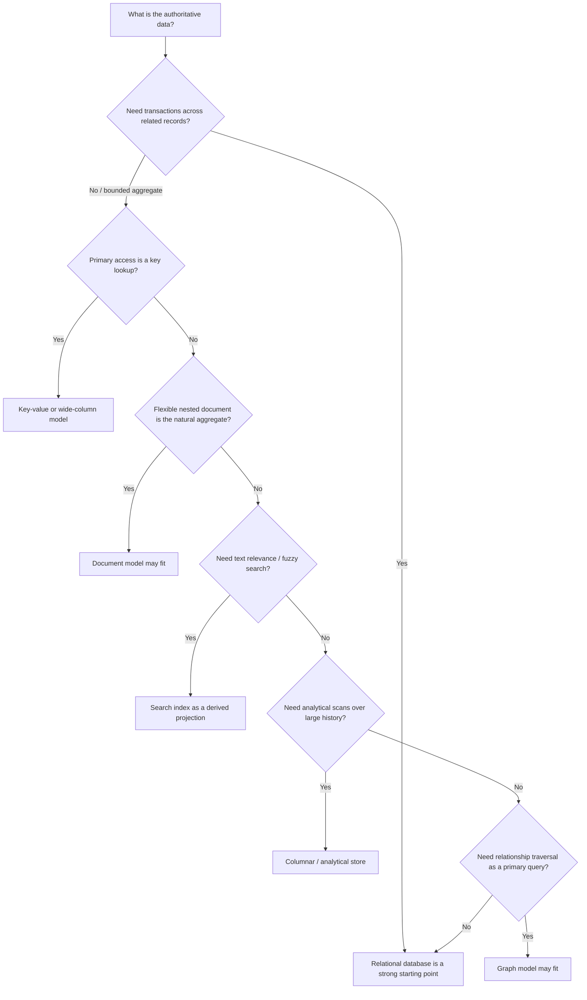
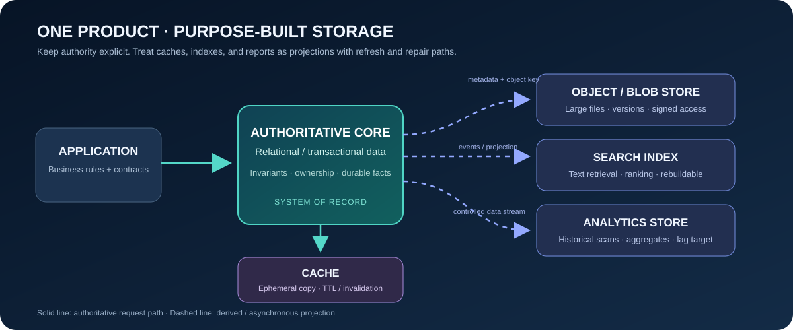
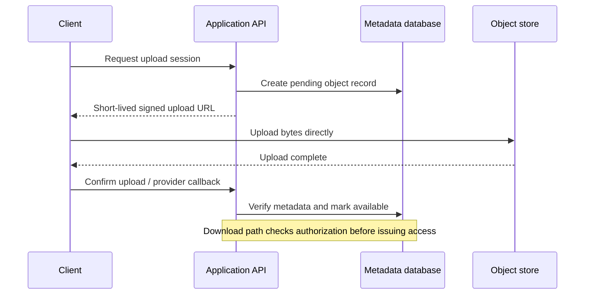

# 10 · Storage systems and database selection

[← Course home](../README.md) · [Previous: Interview method](09-design-interview.md) · [Next: Networking & edge →](11-networking-and-edge.md)

## Why storage choice follows the access pattern

There is no “best database” in isolation. Start with entities, query shapes, write rates, consistency requirements, retention, and operational skills. A storage engine optimized for key lookups may be poor for ad-hoc joins; a search index is excellent for text retrieval but should not become the only authoritative copy of mutable business state.

## A practical selection flow



This diagram narrows the conversation; it is not a product selector. A relational database can serve key-value workloads, and many modern systems support more than one model. Operational familiarity, backup/restore, query needs, and migration costs can outweigh theoretical performance.



## 1. Relational stores

Relational databases model records in tables with constraints, indexes, and transactions. They are a strong default when relationships, integrity constraints, and multi-row updates matter. Normalize canonical data to reduce update anomalies; denormalize deliberately for read performance while documenting how derived copies are refreshed.

Use a transaction when a logical operation must preserve invariants across related changes. Keep transactions short: do not hold locks while calling a remote service or waiting on a user. Long transactions hold resources, increase contention, and complicate failover.

## 2. Key-value and wide-column stores

These systems commonly scale around partition keys and predictable access patterns. They work well when reads can name a key (or bounded key range) and the product can model data around those queries. They are less convenient for ad-hoc joins or queries that do not include the partition key. Understand hot partition behavior, item-size limits, conditional-write semantics, and consistency options before committing to the model.

Example access-driven key design:

```text
Partition key: CONVERSATION#<conversation_id>
Sort key:      MESSAGE#<ordered_sequence>

Query: one conversation, messages after sequence N, limit 50
```

This makes a common conversation-history query local and ordered. It does not automatically balance an extremely active conversation; that key may still be hot.

## 3. Document stores

Documents keep related fields together and can reduce joins for aggregate-shaped data. They fit when the document is usually read/written as a unit and nested structure evolves. Duplicating the same customer address into many documents makes reads convenient but creates a multi-copy update problem. Set document-size and nesting limits, define partial-update behavior, and avoid treating a flexible schema as “no schema.”

## 4. Object / blob storage

Large immutable or versioned files—images, videos, backups, exports—usually belong in object storage, while a database stores metadata, ownership, status, checksums, and object keys.



Direct upload avoids routing huge payloads through application servers. Signed URLs are bearer capabilities: constrain object key, method, content length/type, and expiry; do not log them. Treat an object as unavailable until integrity and policy checks complete. Cleanup jobs must remove abandoned pending records and orphaned blobs safely.

## 5. Search indexes are usually projections

Full-text search engines build inverted indexes mapping terms to documents and often trade immediate consistency for indexing speed and relevance features. A safe pattern is to keep canonical entities in a primary store and asynchronously project fields into search. Define lag tolerance, deletion propagation, reindex/rebuild procedure, and fallback behavior. Never assume an indexed result grants permission: validate access against authoritative policy before returning protected data.

## 6. Analytical and time-series workloads

Operational databases answer individual user operations; analytical systems scan and aggregate large datasets. Sending every dashboard scan to a transactional primary can harm the customer-facing workload. Replicate/stream selected data into an analytical store, define freshness, and minimize sensitive fields. Time-series data benefits from retention, downsampling, and bounded tag cardinality; an unbounded user/device tag can create excessive series.

## 7. Indexes, partitions, and physical layout

An index speeds a subset of queries by maintaining an alternate lookup structure. A partition key determines which node owns data and often influences available query shapes. These choices interact: a query can be indexed within a partition but still fan out across every partition. Use representative data volume and skew when testing query plans; small development data hides expensive scans.

## 8. Data lifecycle and deletion

Map where every copy flows: primary, replicas, cache, search, event log, analytics, export, backup. A deletion requirement needs behavior for each copy: immediate tombstone, asynchronous cleanup, retention expiration, or cryptographic erasure. A tombstone must outlive delayed events that could otherwise recreate deleted data. Backups may have a retention exception, but restored data must reapply deletion records before users can access it.

## Storage review checklist

- What is the system of record for each fact?
- Which queries must be fast, and what is their expected selectivity/cardinality?
- Which writes must be atomic together?
- What consistency can each read tolerate?
- How does this data grow, expire, back up, restore, and delete?
- What are the hot key / partition failure modes?
- Can derived indexes be rebuilt from canonical data?
- What migration path exists if the data model changes?

### Knowledge check

1. Why should a search index usually not be the sole source of truth for mutable account permissions?
2. Which storage path is appropriate for a 200 MB user-uploaded video, and what does the database store?
3. What query shape should influence a partition key?

<details><summary>Suggested answers</summary>

1. Indexing can lag, and search relevance/storage semantics are not necessarily the authoritative transaction boundary; permission should be checked against canonical policy.
2. Store the bytes in object/blob storage; the database stores owner, object key, status, checksum, content metadata, retention, and access policy.
3. The most frequent and important bounded read/write patterns; the key should place commonly accessed related data together while avoiding harmful skew.

</details>

## Worked example: a photo product needs more than one storage model

Store photo metadata such as owner, capture time, visibility, and object version in a relational store when the product needs transactions and queries across those fields. Store original image bytes and generated thumbnails in object storage; keep their durable object identifiers and checksums in metadata rather than treating a filesystem path as the product contract.

Build search and analytics as derived projections from the authoritative metadata and event stream. They can be rebuilt, but they may lag. That means search results must be re-authorized against current access rules before returning a private object, and deletion must propagate to thumbnails, search indexes, caches, and retained backups according to a stated policy. A successful metadata delete is not proof that every copy has disappeared.

For each store, write down the access pattern, consistency need, retention period, owner, and recovery method. The decision is not “SQL versus NoSQL”; it is which store can enforce each invariant at the boundary where that invariant matters, and how derived copies are repaired when they drift.

**Design drill:** trace upload, thumbnail creation, search, permission change, and deletion. Mark the source of truth for each state transition and how you detect a stale projection.

[Continue to Lesson 11 →](11-networking-and-edge.md)
