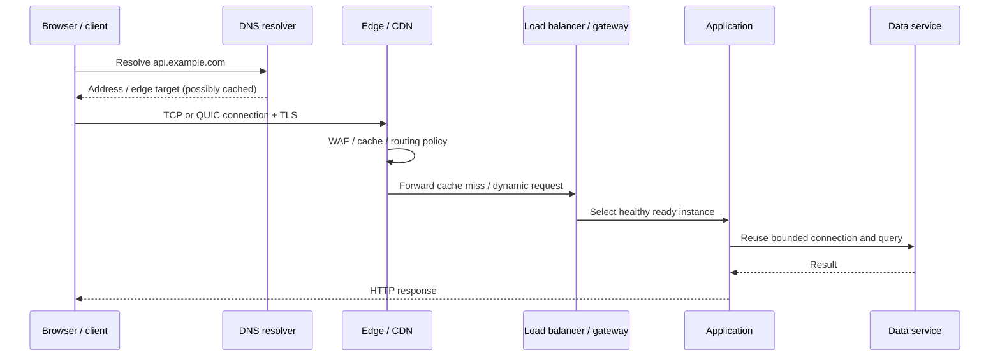

# 11 · Networking, DNS, and the edge

[← Course home](../README.md) · [Previous: Storage systems](10-storage-systems.md) · [Next: Architecture evolution →](12-architecture-evolution.md)

## Follow one request from name to response

A user request crosses multiple layers before reaching application code. Latency, caching, identity, and failure behavior differ at each layer. A high-level diagram should show the boundaries the design depends on, not every router in the internet.



## 1. DNS and naming

DNS maps names to records and is cached according to TTLs. A DNS change does not move every client instantly: resolvers and clients may keep old answers until their caches expire. Failover design must account for TTLs, health-aware routing, client behavior, and whether the destination has the data needed to serve traffic. DNS is not a precise per-request load balancer.

## 2. TCP, QUIC, TLS, and HTTP at a design level

- **TCP** provides an ordered byte stream; a connection setup and congestion control affect latency and throughput.
- **QUIC** carries HTTP/3 over UDP and integrates transport security; behavior still depends on path quality and implementation.
- **TLS** protects confidentiality/integrity in transit and authenticates endpoints. Certificate issuance, renewal, termination point, and service-to-service identity belong in operations.
- **HTTP** defines request/response semantics and intermediaries. Keep-alive and multiplexing reduce connection setup overhead; proxies may buffer, retry, or cache based on explicit rules.

You usually do not choose a transport in a system-design interview unless the workload requires it. You should know where connections terminate, what identity is verified, and how timeouts are bounded.

## 3. CDN and edge caching

A CDN can serve cacheable static or public responses close to users, reducing origin bandwidth and latency. Cacheability is a correctness/security decision. Define cache key dimensions (path, query, selected headers, locale, authorization), TTL, purge/invalidation, and behavior on origin failure. A response that varies by cookie or authorization can leak between users if the cache key omits the variation.

For large media, use immutable/versioned object paths so long TTLs are safe; publish a new version rather than mutating bytes behind the same URL. For private media, use authorization-aware signed access or a controlled edge check, with short-lived capabilities and revocation expectations stated.

## 4. Reverse proxy, gateway, and load balancer

These responsibilities may be combined in one product or split:

| Responsibility | Typical work | Design concern |
|---|---|---|
| Reverse proxy | Terminate TLS, forward requests | Trusted forwarded headers and identity boundaries |
| API gateway | Routing, auth policy, quota, versioning | Avoid central policy becoming an opaque bottleneck |
| Load balancer | Distribute connections/requests across instances | Readiness, draining, locality, uneven request cost |
| WAF / edge filter | Block known malicious or malformed traffic | False positives and bypass paths |

Treat client-supplied `X-Forwarded-For` and identity headers as untrusted unless a known proxy strips and recreates them. Otherwise clients can spoof source IP or principal metadata.

## 5. Connection pools and queueing

Opening a database or upstream connection for every request is expensive. Pools reuse connections, but a pool is also a queue and a capacity limit. Too-small pools create waiting; too-large pools overwhelm the dependency. Estimate maximum aggregate connections across all app replicas, background workers, migrations, and admin access.

```text
Potential database connections
 = app instances × pool per instance
 + workers × worker pool
 + migration / admin / monitoring headroom
```

Use connection acquisition deadlines. When a pool is exhausted, fail or shed low-priority work in bounded time rather than letting requests wait indefinitely and consume memory.

## 6. Streaming and long-lived connections

WebSockets and server-sent events keep connections open, changing scaling costs: connection count, heartbeats, idle timeout, reconnect storms, draining, and per-connection memory matter more than requests per second alone. A load balancer must support the protocol and route a reconnect to a service that can recover state from a durable source. Do not rely on a particular gateway instance being immortal.

## 7. Network security boundaries

Use TLS across untrusted networks and consider service identity for east-west calls. Network segmentation reduces reachability but does not replace application authorization. Restrict egress where practical, authenticate webhooks, validate signatures and replay windows, and avoid treating an internal network location as proof of trust.

### Knowledge check

1. Why is DNS not an instantaneous failover mechanism?
2. What can go wrong when a CDN cache key ignores authorization or locale?
3. How can increasing app replicas unexpectedly overload a database connection limit?

<details><summary>Suggested answers</summary>

1. Resolver/client caches keep old answers until TTL or implementation-specific behavior allows refresh; existing connections may also remain open.
2. One user’s private response or one locale’s content can be served to another request.
3. Aggregate pool size grows as replicas × per-instance pool, independent of the database’s own connection budget.

</details>

## Worked example: cache private media without making it public

A browser requests a protected video segment. DNS resolves the playback hostname; TLS authenticates the endpoint; the request reaches an edge location, where a cache lookup may happen before origin work. The authorization mechanism must therefore be available at the edge or represented by a narrowly scoped signed capability that the edge can validate.

Define the cache key from every dimension that changes the representation or access decision, such as asset version, permitted rendition, and authorization scope. Avoid including arbitrary headers that fragment the cache, but never collapse two users into one cache entry when their access differs. Set a bounded capability lifetime and define what happens when access is revoked before it expires. If the product requires immediate revocation, a long-lived cacheable token is the wrong contract.

On a miss, the edge should fetch only from the intended origin and respect origin deadlines. Monitor cache-hit ratio alongside origin request rate, egress, and authorization failures; a high hit ratio alone does not prove correctness. Test both a valid user and a user without permission against a warmed cache.

**Review check:** write the cache key, token scope, expiry, revocation behavior, and origin fallback in one place. These are one end-to-end design, not separate CDN settings.

[Continue to Lesson 12 →](12-architecture-evolution.md)
