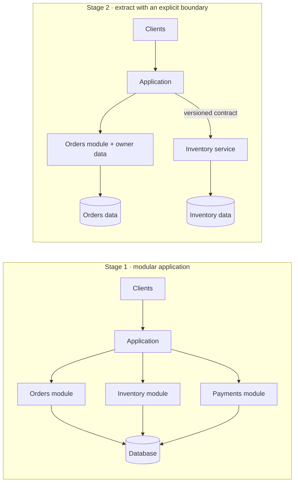
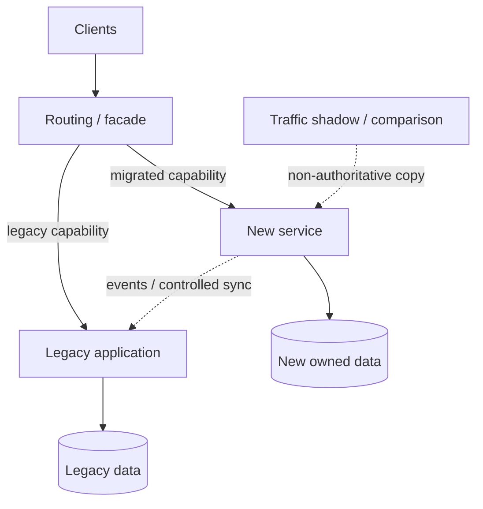
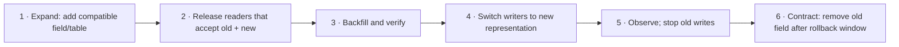

# 12 · Architecture evolution and migrations

[← Course home](../README.md) · [Previous: Networking & edge](11-networking-and-edge.md) · [Next: Search & recommendations →](13-search-and-recommendations.md)

## Architecture is a path, not a destination

A useful design fits the current workload and leaves a plausible route to the next one. Avoid building hypothetical scale into the first release, but also avoid choices that make essential future changes impossible (for example, no stable IDs, no ownership boundaries, or no migration plan).

## 1. Start with the simplest deployable unit that keeps clear boundaries

A modular monolith can keep calls in-process and operations straightforward while separating domain responsibilities in code and data ownership. Split a component into a service when there is evidence for independent scaling, deployment, reliability isolation, security boundary, or team ownership—not merely because a diagram looks cleaner.



The right-hand design adds a network boundary and independent operations. It should earn those costs. A service boundary without data ownership is often a remote façade over a shared database, which combines network complexity with tight data coupling.

## 2. Decompose around business capabilities and change

Useful boundaries group concepts that change together and protect their invariants. Ask:

- Which data and rules must change atomically?
- Which team is accountable for the behavior and on-call response?
- Which workloads have very different scaling or availability needs?
- Which operations can become asynchronous without confusing the user?
- Which domain is stable enough to publish as a contract?

Avoid splitting every noun into a service. A service should own its data or have a clear authority rule; other components interact through contracts, not arbitrary direct table writes.

## 3. The strangler migration pattern

For a large legacy system, route one bounded capability at a time to a replacement while the old system continues serving the rest.



Migration sequence: establish baseline behavior and metrics → define the new contract → backfill data → verify counts/checksums → shadow or compare reads → route a small cohort → monitor correctness and latency → increase traffic → retire old path only after dependencies and rollback window are understood.

Shadow traffic must not trigger duplicate side effects. Use read-only requests, isolated test sinks, or carefully stripped operations. A dual-write period requires clear ownership, idempotency, reconciliation, and an exit date; it is not a permanent consistency strategy.

## 4. Expand–migrate–contract for schema change



Keep every intermediate version compatible with the versions that can be deployed concurrently. Backfills need rate limits and resumability. Verify not only row counts but key invariants, nulls, duplicates, and representative reads. The contract step is destructive; delay it until rollback no longer needs the old shape.

## 5. Multi-region choices

Multi-region design has multiple independent axes:

| Choice | Simpler option | More complex option |
|---|---|---|
| Compute | One active region | Active-active request serving |
| Writes | One write authority | Multi-region writes with conflict resolution |
| Reads | Local region with replication lag | Global strongly coordinated reads |
| Recovery | Restore / fail over after incident | Continuous cross-region failover |
| Data residency | One jurisdiction | Region-specific storage and routing |

“Deploy in two regions” is not a recovery plan. Define where writes are accepted, how clients discover failover, how stale/conflicting data is handled, how much capacity is warm, and how failback avoids overwriting newer state. Test regional failure and restoration, including DNS and credentials.

## 6. Complexity and cost are design dimensions

Every new deployable component adds build/release pipelines, dashboards, access policies, capacity reservations, on-call knowledge, and failure modes. A design review should include operational cost and human ownership. Optimize cost per successful user operation, not just infrastructure cost per hour: an inexpensive system that loses work or causes manual recovery can be more costly overall.

## 7. Architecture decision records

Record consequential decisions briefly:

```text
Title: Feed entries are derived asynchronously for ordinary authors
Status: Accepted
Context: Feed reads dominate; several-second freshness is acceptable
Decision: Persist canonical posts, then fan out through an outbox/worker
Consequences: Faster post creation; temporary feed lag; replay and cleanup needed
Revisit when: write volume, freshness target, or follower distribution changes
```

An ADR captures why a decision was made, not only what the diagram looks like. Revisit it when assumptions change; do not treat an old decision as permanent policy.

### Knowledge check

1. When is extracting a service likely worth its operational and network cost?
2. Why must a backfill be resumable and observable?
3. What is the danger of dual-writing indefinitely during a migration?
4. Name two details required before claiming multi-region disaster recovery.

<details><summary>Suggested answers</summary>

1. When independent ownership, deployment, scaling, isolation, or security needs justify a stable boundary.
2. Large migrations can fail midway; resumability avoids restarting from zero and observability proves progress/correctness.
3. Copies can diverge, failure handling becomes permanent complexity, and teams may never establish one source of truth.
4. Write authority/conflict policy, RPO/RTO, failover routing, warm capacity, data replication lag, failback procedure, tested credentials/runbooks.

</details>

[Continue to Lesson 13 →](13-search-and-recommendations.md) · [Apply the course in the case studies](../case-studies/README.md)
