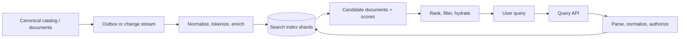
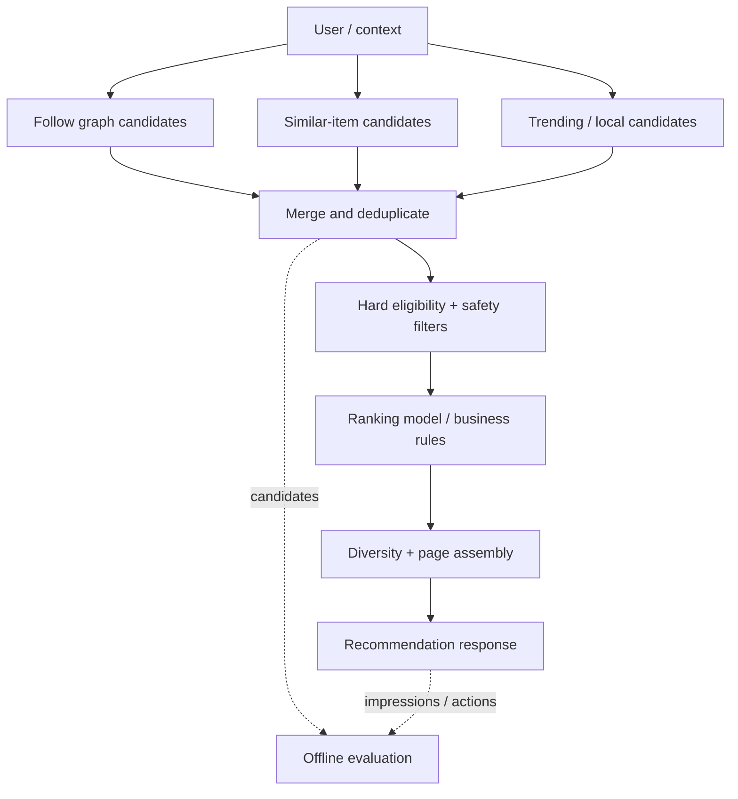

# 13 · Search and recommendation systems

[← Course home](../README.md) · [Previous: Architecture evolution](12-architecture-evolution.md) · [Next: Data pipelines →](14-data-pipelines.md)

Search and recommendations help users discover items. Both transform canonical product data into derived retrieval structures, but their objectives differ: search responds to an explicit query; recommendations predict useful items when the user has not fully specified what they want.

## 1. Start with retrieval behavior

“Search” could mean exact ID lookup, full-text relevance, typeahead, faceted filtering, vector similarity, or spatial proximity. The query shape determines the index and latency budget. Define:

- What fields can be queried, filtered, sorted, or faceted?
- Which fields are searchable versus display-only?
- How fresh must updates and deletions appear?
- How should typos, synonyms, language, and personalization work?
- Are results public, tenant-scoped, or permission-filtered?

## 2. Inverted indexes and query flow

An inverted index maps each normalized term to documents that contain it. The index may also store positions, field weights, and term statistics for phrase matching and ranking.



The index is usually a projection, not the source of truth. Keep document IDs and versions so updates/deletes are idempotent. A search hit should not by itself prove authorization; validate permissions against current policy before returning protected fields.

## 3. Indexing pipeline

1. Receive a durable change referring to a canonical entity/version.
2. Fetch a consistent record or consume a sufficiently complete event.
3. Normalize fields: language-aware tokenization, case/diacritic policy, stop words, synonyms, and field weighting.
4. Upsert or tombstone the search document using an entity/version key.
5. Track consumer offset and index version; expose indexing lag.
6. Rebuild a new index generation from canonical data, verify, then switch aliases/traffic.

An event should carry enough context for a consumer but should not copy sensitive data to every analytics/search pipeline. If consumers hydrate the record later, account for it changing between the event and the fetch.

## 4. Query execution and relevance

The query service validates syntax and scope, routes to relevant shards, retrieves a bounded candidate set, merges results, and applies ranking/filters. Global top-K across shards requires each shard to return enough candidates for the coordinator to compute a correct page. Deep offset pagination is expensive; use a stable cursor or search-after token tied to the index generation and sort key.

Separate candidate retrieval from ranking:

```text
query → lexical candidates ─┐
      → prefix candidates  ─┼→ merge / dedupe → policy filters → rank → page
      → semantic candidates ┘
```

Lexical relevance can combine term match, field boosts, phrase match, recency, and business rules. Personalization should be a bounded ranking feature, not a hidden authorization mechanism. A ranking timeout should have a deterministic fallback such as lexical score or popularity.

## 5. Autocomplete and typeahead

Autocomplete serves partial prefixes with a tighter latency budget and shorter result list than full search. Options include a trie/FST, prefix index, or precomputed popular-prefix table. A compact finite-state transducer can represent many shared prefixes efficiently. Ranking may use popularity, locale, recency, or user context.

Debounce client requests, cancel stale queries where possible, and return the query/version with results so late responses do not overwrite newer input. Avoid caching personalized suggestions under a key that omits user/tenant scope. Apply abuse limits because prefix endpoints can be scraped at high request rates.

## 6. Recommendations: candidates before ranking

Recommendation systems commonly use two stages:

1. **Candidate generation:** retrieve a manageable pool from follows, similar items, co-occurrence, geography, subscriptions, or recent activity.
2. **Ranking and filtering:** score the pool using relevance features, then enforce hard policy (visibility, blocks, safety, freshness) and diversify results.



Candidate retrieval should be fast and have bounded fan-out. Ranking can use a model or simpler score; define feature freshness and model version. If an online feature store is slow, use a bounded timeout and a known fallback rather than letting personalization stall the entire feed.

## 7. Quality, freshness, and evaluation

Measure search success at the user journey level: p95 latency, zero-result rate, reformulation rate, click-through with position context, stale/deleted result rate, and permission-filter cost. For recommendations, evaluate coverage, relevance, diversity, freshness, safety, and user impact; click-through alone can reward clickbait or narrow repeated content.

Use offline replay for candidate/ranking changes and controlled online experiments for user impact. Guard experiments with safety metrics and a rollback path. Model quality does not excuse broken infrastructure: a deleted result must not reappear because an old indexing event replayed.

## 8. Failure modes and repair

| Failure | User effect | Design response |
|---|---|---|
| Indexing lag | New content missing | Show lag metric; offer direct recent-content fallback if bounded |
| Search shard unavailable | Partial or failed result set | Define partial-response policy and replica/failover scope |
| Rebuild has mapping bug | Wrong or missing fields | Build a new generation, compare samples, switch alias only after validation |
| Ranking service slow | Long tail latency | Deadline, bounded candidate list, lexical/popularity fallback |
| Delete event delayed | Removed content persists | Tombstone/version checks and serve-time authorization |
| Hot prefix/query | One key overloads a shard | Cache common prefixes, coalesce, partition and rate limit |

### Knowledge check

1. Why is a search index usually a projection rather than a canonical permission store?
2. What is the difference between candidate generation and ranking?
3. Why should a deep cursor bind to an index generation or sort version?
4. What is a safe fallback if personalized ranking times out?

<details><summary>Suggested answers</summary>

1. Indexing can lag and may not share the transaction boundary of the canonical record; current access policy must remain authoritative.
2. Candidate generation finds a bounded set likely to be relevant; ranking orders that set by more detailed features and policy.
3. Documents and sort order can change between pages; a versioned cursor makes pagination semantics explicit.
4. Return a bounded lexical or popularity-ranked result set after hard visibility and safety checks.

</details>

[Continue to Lesson 14 →](14-data-pipelines.md)
