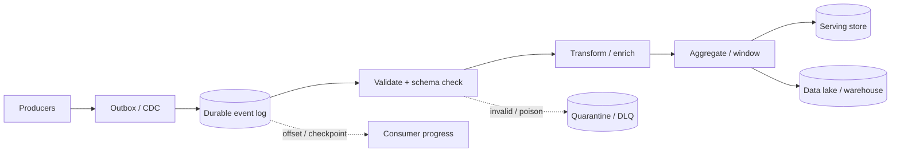

# 14 · Data pipelines and stream processing

[← Course home](../README.md) · [Previous: Search & recommendations](13-search-and-recommendations.md) · [Next: Cost & performance →](15-cost-and-performance.md)

A data pipeline moves facts from systems that produce them to consumers that aggregate, enrich, index, alert, or train models. The central design questions are: how much lag is acceptable, how is progress recorded, what happens on replay, and how do consumers agree on event meaning?

## 1. Batch, stream, and hybrid processing

| Pattern | Input | Latency shape | Typical fit | Main trade-off |
|---|---|---|---|---|
| Batch | Bounded files or database snapshots | Minutes to hours | Reconciliation, historical reports, backfills | Efficient large scans; results are not immediate |
| Stream | Unbounded events | Seconds or less | Alerting, live counters, projections | Continuous operations; late/duplicate events complicate semantics |
| Lambda / hybrid | Both live stream and batch correction | Low-latency view plus later correction | Products needing responsive estimates and audited totals | Two paths to maintain and reconcile |

“Real time” needs a measurable target. A dashboard refreshed every minute and a fraud decision made before authorization are different contracts.

## 2. Pipeline anatomy



The event log provides retention and replay; consumer progress says how far each independent consumer has safely processed. A serving store is optimized for queries, while a data lake/warehouse supports broad analysis. Do not use an analytics table as a low-latency transactional database by accident.

## 3. Event time versus processing time

- **Event time:** when the event occurred at the source.
- **Processing time:** when a pipeline worker handles it.
- **Ingestion time:** when the event entered the pipeline.

For a “purchases per minute” metric, grouping only by processing time can shift delayed/offline events into the wrong minute. Event-time windows use event timestamps; watermarks estimate how complete a window is before emitting a result. Late data policy can update a prior result, route to correction output, or be dropped after a defined lateness bound.

```text
Event time:       10:00  10:01  10:02  10:03
Arrival order:    A(10:00) → C(10:02) → B(10:01, delayed)
Processing time:  10:00      10:02        10:04

Window result for 10:00–10:01 is provisional until the watermark passes it.
```

## 4. Partitions, ordering, and parallelism

Events with the same partition key typically preserve order within a partition, not globally. Choose the key from the invariant: account ID for per-account ledger order, conversation ID for chat order, or object ID for a projection. A single hot key limits parallelism. More partitions enable parallel work but do not make one key’s ordered updates independent.

Partition count is an architectural commitment: too few constrain throughput; too many increase metadata, file handles, scheduling, and rebalancing work. Test consumer scaling and reassignment at expected event sizes and key skew.

## 5. Delivery, idempotency, and checkpoints

At-least-once delivery means the same event may be processed again. An offset/checkpoint must advance only after the associated output is durably committed. A robust consumer often uses an inbox/dedup table keyed by event ID and writes its business effect in the same database transaction.

```text
read event → validate schema → begin transaction
          → if event_id unseen: apply state change + record event_id
          → commit transaction → acknowledge / checkpoint
```

If the sink is external, a local transaction cannot make the remote side effect atomic. Pass an idempotency key when supported, record a pending/confirmed workflow, and reconcile ambiguous outcomes. “Exactly once” claims should name the scope: broker processing, transactional sink update, or externally visible user effect.

## 6. Schema evolution and replay

Events outlive the deployment that created them. Add optional fields compatibly, version breaking semantics, and keep readers tolerant of unknown fields. Validate schema at the edge and quarantine invalid events with enough metadata for repair—avoid copying secrets into dead-letter payloads.

Replay is a production operation. Specify the replay start point, rate limit, target isolation, duplicate behavior, and whether side effects are suppressed. A reindex may be freely replayable; sending a payment reminder may not be. Keep event retention long enough for expected recovery and backfill, but define deletion/privacy obligations for retained payloads.

## 7. Capacity example

At 50,000 events/second with 1 KB average payload:

```text
Ingress bandwidth ≈ 50 MB/s (before protocol/replication overhead)
Events/day         = 50,000 × 86,400 = 4.32 billion
Raw payload/day    ≈ 4.32 TB decimal, before replicas and indexes
```

Compression can reduce stored bytes but consumes CPU; retaining multiple replicas increases physical bytes. Size producer, broker, consumer, and sink capacity independently. If a consumer processes 40,000/s while 50,000/s arrive, backlog grows by 10,000/s until capacity changes or producers are throttled.

## 8. Data quality and replay-safe transformations

Validate required IDs, timestamps, units, and schema version. Prefer deterministic transformations so reprocessing the same event yields the same derived output. Preserve source provenance and transformation version for reproducibility. Handle malformed records explicitly; silently dropping them creates invisible data loss.

### Knowledge check

1. Why can processing-time windows miscount events that arrive late?
2. When should a consumer checkpoint its offset?
3. Which key would you partition by if updates to one account must be ordered?
4. What additional design is needed when a replay triggers an external payment or notification?

<details><summary>Suggested answers</summary>

1. Delayed records are counted in the window they arrive rather than the window in which they occurred.
2. After output/state is durably committed, or atomically with the output using a transaction supported by the sink.
3. Account ID, while measuring whether one high-volume account becomes a hot partition.
4. Idempotency, suppression/side-effect policy, durable workflow state, and reconciliation for ambiguous outcomes.

</details>

## Worked example: late events and replay in a streaming pipeline

Suppose a trip event is created at 10:00 but a mobile device reconnects and delivers it at 10:12. A dashboard that groups by arrival time puts it in the wrong interval; a pipeline using event time can place it in the 10:00 window, but must decide how long to wait before finalizing that window.

Choose a lateness allowance from the product's freshness requirement and observed delivery delays. A watermark is an estimate that earlier event-time data is unlikely to arrive, not proof that no late event exists. Define what happens after the watermark: drop the event, emit a correction, or update a restatable result. Keep a durable event ID so replay can be idempotent, and checkpoint both source offsets and sink progress in a way that avoids losing or double-applying changes.

Monitor event-time lag, processing lag, late-event rate, checkpoint age, and sink errors separately. If a sink is unavailable for 20 minutes, bound the backlog, preserve source data for replay, and confirm that recovery throughput can catch up without starving live traffic.

**Design drill:** specify the window, watermark policy, correction behavior, deduplication key, and replay horizon. Then test a duplicate event that arrives both before and after the checkpoint.

[Continue to Lesson 15 →](15-cost-and-performance.md)
