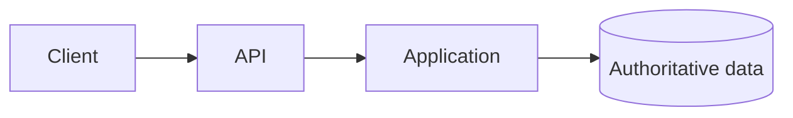
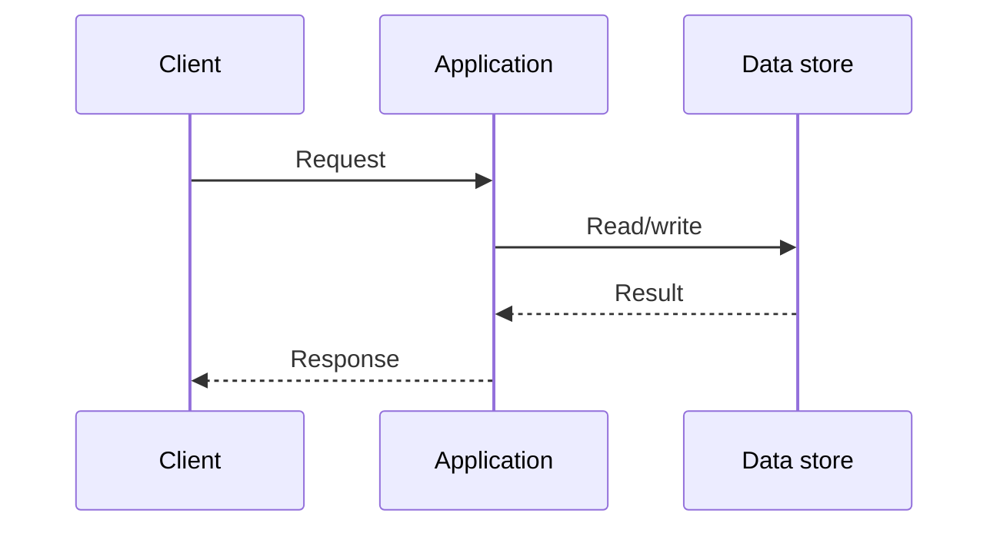

# System design review template

> Copy this file for a new design. Replace all prompts; keep assumptions visible.

## 1. Problem and scope

- **System / product:**
- **Users and primary jobs:**
- **In scope:**
- **Out of scope:**
- **Known constraints:**
- **Open questions / assumptions:**

## 2. Requirements

### Functional

| ID | User-visible behavior | Priority |
|---|---|---|
| F1 | | Must / Should / Could |

### Quality attributes

| Attribute | Target | Measurement scope / window | Rationale |
|---|---|---|---|
| Latency | | | |
| Availability | | | |
| Durability / RPO | | | |
| Recovery / RTO | | | |
| Privacy / retention | | | |

## 3. Workload and capacity assumptions

| Operation / data | Average | Peak | Payload / growth | Read-write mix |
|---|---:|---:|---:|---|
| | | | | |

Calculation notes and sensitivity (what if the estimate is 10× higher?):

## 4. API, data, and correctness

- **Key API operations:**
- **Entities and access patterns:**
- **Authoritative source(s):**
- **Invariants:**
- **Consistency / ordering scope:**
- **Idempotency and retry behavior:**
- **Authorization boundary:**

## 5. Architecture

Explain every component and boundary. Mark synchronous/asynchronous paths, trust boundaries, and observability signals.

## 6. Critical flows

Document ambiguous timeout behavior, duplicate requests, and partial failure.

## 7. Bottlenecks and evolution

| Constraint / evidence | Proposed change | Benefit | Cost / new failure mode |
|---|---|---|---|
| | | | |

What would you measure before implementing the change?

## 8. Reliability and operations

- **SLI / SLO:**
- **Timeouts, retries, and deadlines:**
- **Degradation / load shedding:**
- **Backup, restore, and recovery drill:**
- **Deployment and migration:**
- **Dashboards and actionable alerts:**

## 9. Alternatives and decisions

| Decision | Chosen approach and why | Alternative | Revisit if… |
|---|---|---|---|
| | | | |

## 10. Open risks

-
